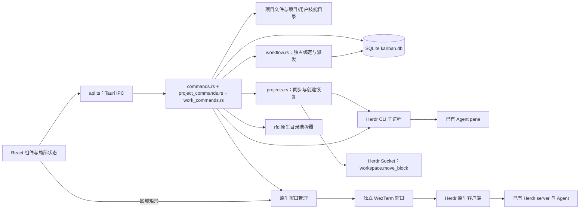
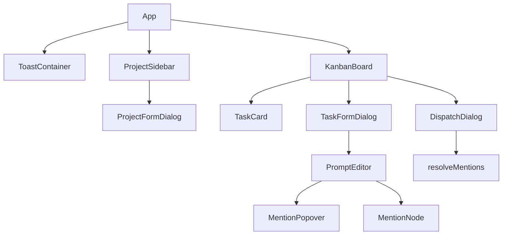
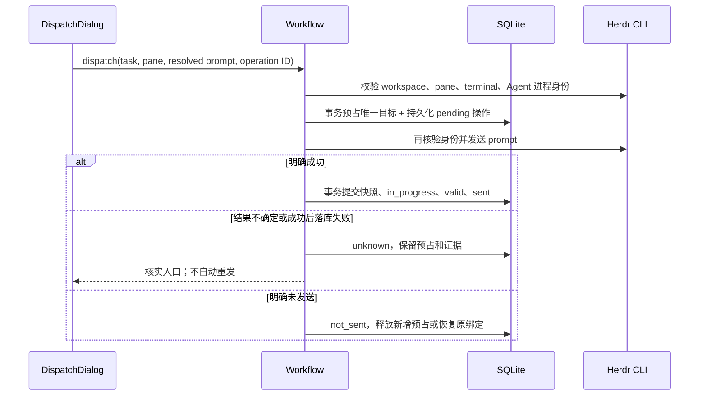

# Kanban 代码结构与关键流程分析

更新日期：2026-10-30。自动标题增加持久化退避重试、重启续跑及卡片手动重试。schema 19 保存尝试次数和下次执行时间，取消排队 60 秒即失败；通过请求 ID、编辑版本和尝试次数拒绝迟到结果。旧失败记录仅由用户手动重试，已有手动修改和开发派发不受影响。实现见 6.2.4，验证见[标题重试验证](docs/verification/2026-10-30-title-retry.md)。

更新日期：2026-10-30。SSH Prompt 提交支持临时只读观察错误的有界恢复：整次提交最多重试两次，仅明确失败的观察可重建控制连接，写入结果不确定时仍停止。新增逐步输入日志和未发起 Enter／Enter 结果待核实提示，无数据库迁移及新增 IPC。规格为 GitHub #44，实现见 6.4.1、6.6.3，验证及交付边界见[SSH 提交恢复验收](docs/verification/2026-10-30-ssh-submit-recovery.md)。

更新日期：2026-10-30。自动标题跟随任务所属执行电脑：本地调用本机 Codex，SSH 任务通过身份校验后的 helper 调用远端 Codex；失败保留摘要且不回退本机。增加 npm 入口解析、可取消的部署/请求时限及稳定错误码；无数据库迁移和前端 IPC 变化。实现见 6.2.4，验证及真实 SSH 阻碍见[标题机器路由验证](docs/verification/2026-10-30-title-machine-routing.md)。

更新日期：2026-10-30。Codex 启动遇到确认的更新选择页时自动发送一次 Esc（Skip），等待同一进程交互就绪后继续原流程；其他弹窗、身份变化及不确定结果不自动回答或重放。无 IPC／数据库迁移。285 项 Rust 常规测试及真实本机 0.165.0 更新页跳过验证通过，运行中的安装版未替换；实现见 6.6.4，证据及边界见[更新提示 Skip 验证](docs/verification/2026-10-30-codex-startup-update-skip.md)。

更新日期：2026-10-29。SSH 任务新建与精确恢复跳过模型目录预检，保留配置格式检查并将冻结的模型／思考强度直接传给 Herdr；本地启动仍查询目录校验。远端目录或缓存继续用于表单选择，查询失败提示可保留已有配置启动。无 IPC／数据库迁移，恢复与未知结果不重发。实现见 6.2.7，测试和真实 SSH 未覆盖边界见[SSH 模型预检修正](docs/verification/2026-10-29-ssh-model-preflight.md)。

更新日期：2026-10-29。任务 Codex CLI 新建与精确恢复统一改为 Full Access，保留模型、思考强度、目录及会话隔离；恢复核验适配单一目标写锁，并兼容已有自动审批绑定。运行中的有效绑定沿用原权限。实现见 6.6，验证与限制见[Full Access 验证记录](docs/verification/2026-10-29-codex-full-access.md)。

更新日期：2026-10-29。Workspace 顶部 NewTask 旁新增 OpenTerminal／打开终端（GitHub #43），在右侧打开独立普通 shell；按电脑/session/Workspace 持久化复用，未知创建只核实不重放。本机及 Windows SSH 使用同一服务，普通终端不依赖 Codex 状态，并受任务占用和清理保护。实现见 6.5.1，验证及远端环境限制见[Workspace 终端验收记录](docs/verification/2026-10-29-workspace-terminal.md)。

更新日期：2026-10-29。InProgress 卡片默认压为两行：单行标题与编辑入口、优先级及提示词图标／完成／删除。模型与异常详情按需展开，来源信息并入操作行且保留身份颜色。浏览器组件实测折叠高度约 78 CSS px；实现见 6.2.1，验证与限制见[两行卡片验证记录](docs/verification/2026-10-29-compact-in-progress.md)。

更新日期：2026-10-29。侧栏与 All Tasks 共用计算机／Workspace 两套身份颜色，按稳定 ID 自动分配并保存本机偏好；改名、排序、隐藏恢复及离线不会改色，连接状态仍由状态圆点和提示表达。来源信息使用结构化字段分别着色，兼容进行中卡片的紧凑来源和详情。实现与验证边界见 3.1 及[身份颜色验证记录](docs/verification/2026-10-29-identity-colors.md)。

更新日期：2026-10-29。修复本机默认 Herdr 会话启动误报：`status --json` 中显式 `session: null` 仅在目标为 `default` 时视为匹配，字段缺失及非默认会话仍严格拒绝。启动模块 11 项、前端启动/重试 3 项、生产构建和真实默认 Herdr 只读探测通过；未替换运行中的安装版。实现见 6.1.5，证据见[默认会话启动校验修复](docs/verification/2026-10-29-default-session-startup.md)。

更新日期：2026-10-28。修复原生终端大帧写入阻塞（GitHub #42）：命名管道单次最多写入 32 KiB，保留完整 Herdr 帧、实际写入偏移、整体 5 秒截止时间及取消检查。真实管道回归、桌面/SSH 证据和绘制残留边界见[大帧验收记录](docs/verification/2026-10-28-native-pipe-frames.md)，实现见 6.5。

更新日期：2026-10-28。Windows Codex 多行提示词通过 bracketed paste 保留换行、空行与制表符；原 10 秒状态确认窗口结束后，再进行最多 30 秒的只读精确回执补查。正文与 Enter 各发送一次，回执仍要求同一目标、会话、时间范围及完整正文。实现见 6.4.1，真实 Herdr 与测试边界见[多行提交及延迟回执验收](docs/verification/2026-10-28-multiline-dispatch-receipt.md)。

更新日期：2026-10-27。远端电脑接入优先复用现有 SSH 配置，另提供显式“配置 SSH 密钥”；连接检查仅验证 Herdr、平台与辅助程序身份，不再要求后台 `codex --version` 成功。模型与任务能力在各自操作中检查，见第 12 节及 [远端接入流程验证](docs/verification/2026-10-27-remote-onboarding.md)。

更新日期：2026-10-27。修复 SSH 接入目标为 `用户名@主机` 时专用密钥未自动匹配、Herdr 再次要求密码的问题；按原始主机及用户限定配置，重试时修复旧生成条目，注册前验证不带 `-i` 的免密连接。实现和验证边界见第 12 节及 [SSH 接入配置回归](docs/verification/2026-10-27-ssh-enrollment-config.md)。

更新日期：2026-10-27。任务自动分配始终新建 `kanban` Tab 内的 pane；单 Workspace 的 NewTask 旁提供“关闭空闲会话”，经二次确认和逐项复核后清理。InProgress 绑定、未决操作及 pause 子进程受保护；未知关闭持久化且不重放。实现见 6.6.5，验证边界见[空闲会话清理验收](docs/verification/2026-10-27-idle-cleanup.md)。

更新日期：2026-10-27。异常任务支持只读查看提示词及“退回 Todo”。重置保留原卡片内容和模型设置，将旧执行记录隔离为历史，阻止迟到结果写回；下一次手动启动使用新会话。桌面、本机／SSH 验证及边界见[任务重置验收](docs/verification/2026-10-27-task-reset.md)，实现见 6.2.8。

更新日期：2026-10-27。本机 Herdr 自动启动：Kanban 首次同步前检查所选入口和 session，仅在明确未运行时启动后台服务；合并并发请求、限时等待并提供显式重试，失败保留缓存。实现与验证边界见 6.1.5 及[本机启动验收](docs/verification/2026-10-27-herdr-startup.md)。

更新日期：2026-10-27。失败及待核实 Workspace 创建记录增加“移除记录”和应用内二次确认。移除仅持久化本地标记，保留已有项目、任务、Herdr 资源及原始创建证据；离线及停用电脑可用，拒绝已移除操作的重试/核实。实现与验证边界见 6.1.4 及[创建记录移除验收](docs/verification/2026-10-27-workspace-dismissal.md)。

更新日期：2026-10-27。任务级 Codex 启动配置（GitHub #35–#40）：新建及可编辑 Todo 可选择模型/思考强度，最近一次成功创建的整组设置跨 Workspace 持久化；后台启动冻结配置，通过独立 CLI 参数应用，精确恢复不重发提示词。目录由实际执行电脑提供，支持缓存、刷新及失败提示。真实桌面、本机与 SSH 验证及安装边界见[模型设置验收记录](docs/verification/2026-10-27-task-model-settings.md)，实现见 6.2.7。

更新日期：2026-10-27。修正点击 Kanban 后原生终端被主窗口遮挡：主窗口持有系统前台时，先将终端排到其紧下方，待实际相邻后再将主窗口排到终端下方；保持焦点，不把整个应用降到其他窗口后面。新增真实前台切换回归在上一轮实现上失败、本轮通过；12 轮终端/宿主/外部窗口前台循环及 Rust 常规 213 项通过。00:25 构建的新 NSIS 包已更新到固定交付目录并核对校验和；实际 release 鼠标点击脚本尚未完整通过，未覆盖安装。上一轮仅有后台遮挡注入的验收不足，证据和当前边界见[前台切换验收记录](docs/verification/2026-10-27-native-window-activation.md)。

更新日期：2026-10-27。原生 Herdr 窗口层级修复：排序识别可见窗口及 owner 关系，避开隐藏 IME/TSF 和终端自身附属窗口；异步调整后持续核验，限频重试并记录失败，保持焦点和普通窗口层级。前端 229 项、Rust 213 项及单独执行的两项原生窗口回归通过；实际 release Kanban/Herdr 的任务切换、12 次遮挡恢复、弹窗和最小化恢复通过。release/NSIS 已构建；诊断证据、安装包和未覆盖边界见[窗口层级验收记录](docs/verification/2026-10-26-native-window-stacking.md)。当前安装实例未替换。

更新日期：2026-10-26。All Tasks 页内交互（GitHub #26，子任务 #27–#34）：与普通看板共用 TaskBoard，支持编辑、终端、拖拽流转、派发恢复、新建及单项／批量整理；跨项目操作从任务归属解析上下文。查询、草稿与迟到意图保护见 6.2.6，实际验收与限制见[交互验收记录](docs/verification/2026-10-26-all-tasks-interactions.md)。

更新日期：2026-10-26。文件引用对齐 Codex CLI 0.164.0：预览、手动派发、后台启动及图文混合派发直接输出 Workspace 相对路径，不展开正文、不加 `[文件:]` 或额外换行；含 Unicode 空白且不含双引号时加双引号。技能仍发送 `$技能名`，由 Codex 加载。相关前端 40 项、Rust 213 项测试通过（20 项跳过），限定本次模块及其依赖的 TypeScript 检查和 Vite 构建通过。实际序列化结果交给本机 Codex `debug prompt-input` 的三个案例也逐字一致。共享工作区全量前端当次为 215 通过、1 项汇总交互测试失败，常规构建另受汇总测试类型错误阻断；不将其他进行中改动计为本次通过。未重新打包安装或完成真实 TUI/Herdr 派发验收。提交前另将仅含本次 14 个文件/改动块的暂存树导出为隔离副本，完整前端 215 项、Rust 201 项测试通过（19 项环境依赖测试跳过），`npm run build` 通过；这些结果验证本提交不依赖共享工作区其他未提交改动。规则来源见[原生引用研究](docs/research/2026-10-26-codex-native-references.md)，实现见 6.4、6.6.1。

更新日期：2026-10-26。修复复用 Codex 的两处启动时序问题：`agent.start` 成功后等待同一 terminal、shell 与新进程真正交互就绪；旧 Agent 在相邻查询间清除注册时，通过身份与前台进程检查确认 shell，避免误报无效回复。两条确定性失败回归均已通过，并保留替换身份拒绝、不重复启动或发送的保护。真实验收边界见[启动就绪修正](docs/verification/2026-10-26-start-readiness.md)。

更新日期：2026-10-26。远端新任务启动使用独立操作级 SSH 控制连接，pane 候选和 Agent 列表在远端批量检查，避免逐条 CLI 重建 SSH。启动、搜索和查看统一在使用新协议前更新 helper；保留每次写入前的任务/进程核验，断线不重放。实现见 6.6.3，验证见[远端启动性能记录](docs/verification/2026-10-26-remote-start-performance.md)。

更新日期：2026-10-26。修复安装版远端 helper 空响应：PowerShell 非管道调用 release GUI helper 不等待输出，导致更新 helper 后的 preflight 报 `machine.invalid_response`。单次请求与持久查询统一经 `remote_transport::helper_command` 使用 cmd 直接标准流启动；主机身份、协议和不重发边界保持。真实 release 回归与验收见[安装版远端响应修复](docs/verification/2026-10-26-release-remote-helper.md)。

更新日期：2026-10-26。远端 @/$ 使用预热索引和持久 SSH 查询通道；任务切换按电脑/session 复用 Herdr/WezTerm 客户端，切换期间关闭输入通路，确认新定位后恢复。实现、生命周期与实际测量见 6.3、6.5 及[长连接验收记录](docs/verification/2026-10-26-persistent-connections.md)。

更新日期：2026-10-26。原生 Herdr 字号记忆：在 WezTerm 正常加载用户配置后追加字号快捷键处理，本机 Kanban 的任务及 Workspace 共用字号偏好；窗口切换、重连及应用重启恢复，重置字号清除覆盖。原配置、普通输入与原生菜单沿用；实现见 6.5，真实桌面结果及未覆盖项见[字号验收记录](docs/verification/2026-10-26-native-font-persistence.md)。

更新日期：2026-10-26。侧栏 Workspace 隐藏与删除统一使用应用内二次确认弹窗，显示电脑和 Workspace 名称及操作后果，默认聚焦取消；确认隐藏后继续原有草稿保护。实现见 6.1.3，测试与真实桌面验收见 [Workspace 操作确认记录](docs/verification/2026-10-26-workspace-action-confirmation.md)。

更新日期：2026-10-26。跨 Workspace 汇总看板（GitHub #22，子任务 #23–#25）：侧栏固定入口汇总已显示 Workspace 的未归档任务，三列跨项目按紧急／优先／一般、创建时间、任务 ID 排序。卡片标明电脑与 Workspace，点击按最新状态定位原项目的编辑面板、任务终端或完成任务弹窗；明确关闭 Todo 面板后恢复进行中任务选择。新增只读批量摘要 IPC，不新增迁移；实现见 6.2.6，含真实本机／SSH Herdr 的证据与边界见[汇总看板验收记录](docs/verification/2026-10-26-task-summary.md)。

更新日期：2026-10-26。修复复用旧 Codex 窗格时 `agent_pane_busy` 导致启动卡住：仅对明确拒绝的启动请求，在同一窗格身份下有界等待重试；持续明确拒绝转为可重试失败，旧卡片可通过“核实启动结果”释放本次预占。超时和不确定响应仍保留核实保护。实现见 6.6.2，真实 Herdr 三次复用均触发原错误并成功恢复，验证及运行中应用未替换的边界见 [启动时序验收记录](docs/verification/2026-10-26-agent-start-busy.md)。

更新日期：2026-10-26。空 Workspace 定时闪烁修复：看板仅首次查询期间显示加载占位；空列表、后台轮询、焦点刷新、删除最后一张任务及失败重试均保留已展示的看板。已重新生成 0.1.0 Windows x64 NSIS 安装包并核对 SHA-256，未执行安装验证。实现与验证边界见 [空看板刷新验收记录](docs/verification/2026-10-26-empty-board-refresh.md)。

更新日期：2026-10-26。本地 Herdr 自定义安装入口修复：优先使用 PATH 中的 Herdr，Windows 按 PATHEXT 解析 `.exe/.com/.cmd/.bat`，默认安装目录仅作回退；保留显式 `KANBAN_HERDR_EXECUTABLE`。Workspace 目录通过同一入口查询会话目录并核对 session/socket，不再假定 `%APPDATA%/herdr`。实现与验证边界见 [本地 Herdr 入口验收记录](docs/verification/2026-10-26-local-herdr-entry.md)。

更新日期：2026-10-26。SSH 提示词引用反馈（GitHub #21）：新建/编辑任务的 @/$ 候选增加搜索中、空结果、错误与重试；迟到响应不覆盖新输入，后续长连接增量将查询合并移至后端索引服务。该反馈增量的真实桌面搜索、保存重开、失败恢复与专用派发记录见 [引用搜索验收记录](docs/verification/2026-10-26-remote-mentions.md)。

更新日期：2026-10-26。Todo 右侧编辑：点击待办卡片或铅笔按钮，在原 Herdr 区域显示编辑面板，保存后保持打开。切换任务或 Workspace、关闭面板及启动/派发前保护未保存修改；返回进行中任务重新确认目标并复用仍存活的查看连接。实现见 6.2.5，验证边界见 [Todo 编辑验收记录](docs/verification/2026-10-26-todo-editor-panel.md)。

更新日期：2026-10-26。侧栏 Workspace 紧凑卡片：第一行显示 local/远端机器名与项目名，第二行显示 Git 分支与进行中任务数；第三行操作按钮默认隐藏并固定保留 32px 占位，悬停或键盘聚焦时显示，卡片位置不变。机器状态并入标识，进行中计数复用本地批量统计、前台每 2 秒刷新。实现见 3.1、6.2.3 节，验证及边界见 [紧凑侧栏验收记录](docs/verification/2026-10-26-compact-sidebar.md)。

更新日期：2026-10-26。Workspace 选择性显示与 SSH 接入界面（GitHub #14、#15–#20）：本地和远端均支持隐藏、搜索/多选添加已有、新建后同步 Herdr 并显示；schema 13 独立保存显示偏好，外部发现不再自动加入左栏。Local/Remote 来源与连接状态分开显示；授权操作有明确结果，连接检查通过后进入目标电脑的 Workspace 选择。实现见 6.1.3 和第 12 节，验证及首次密码交互未覆盖项见 [本次验证记录](docs/verification/2026-10-26-workspace-selection.md)。

2026-10-25 SSH 多机支持正在实施：一个本地数据库按稳定机器身份管理本机及 Windows SSH 电脑。机器注册、隔离迁移、远端资源/任务路由和官方原生终端桥接已接入；真实远端文件/技能/图片、完成与原会话精确恢复已分阶段通过；真实 Tauri 跨机输入、最大化和专用 SSH 断线重连也已通过；具体边界见验证记录。实现与验证边界见第 12 节及 [SSH 验证记录](docs/verification/2026-10-25-ssh-multi-machine.md)。

2026-10-25 Herdr 默认隐藏侧栏：每次打开查看窗口生成独立客户端配置和状态，明确收起并完全隐藏侧栏；拖动分隔线跨越 Herdr 窄屏阈值时不再恢复展开。真实桌面拖动、最大化/恢复、主动展开后重连及任务切换验证见[侧栏验收](docs/verification/2026-10-25-herdr-hidden-sidebar.md)。

2026-10-25 当前任务单窗显示：任务选择和重连改用专用连接的 `pane.zoom(mode: on)`，只显示目标 pane；后台新增分屏清除 zoom 时，在目标仍聚焦的条件下自动恢复。其他任务继续运行；Herdr 同 Tab 的缩放状态仍共享。实现见 6.5 节，验证见[单 pane 验收](docs/verification/2026-10-25-selected-task-pane.md)。

2026-10-25 提交确认补偿：Windows Codex 已接收提示词但 Herdr 状态确认超时时，读取同一实时会话的精确用户消息补确认；“核实启动结果”和人工确认已发送均可统一恢复派发、绑定、会话及启动状态。见 6.4、6.6 节及[提交确认恢复验收](docs/verification/2026-10-25-dispatch-receipt-recovery.md)。

2026-10-25 Herdr 0.9.5 多客户端定位修正：删除全局 `agent focus`，通过 Kanban 专用连接发送客户端范围的 `pane.focus`。真实双窗口测试覆盖不同 workspace、同 workspace 不同 tab、连续/快速任务切换及输入隔离，见[独立导航验收](docs/verification/2026-10-25-herdr-client-navigation.md)。

2026-10-25 WezTerm 原生 Herdr 修正：直接启动官方 Herdr 客户端，删除桥接、自定义鼠标转发及专用 Lua，保留 Herdr 自带右键菜单，见[原生客户端验收](docs/verification/2026-10-25-herdr-native-client.md)。窗口跟随部分：移除 xterm 与 FitAddon，右侧内容改为独立无边框 WezTerm 窗口；同步位置、尺寸、窗口层级及显示状态，不设置父子或 owner 关系。修正失焦消失和后台停止定位，新增原生移动事件唤醒。当前链路与验收边界见 6.5 节及 [WezTerm 验收记录](docs/verification/2026-10-25-wezterm-terminal.md)。

2026-10-25 中英双语增量：应用仅提供简体中文和 English，侧栏切换即时生效并保存本机偏好；首次使用按系统语言选择中文或英文。覆盖既有界面、错误提示、编辑器和日期；切换保留草稿与终端连接，详见 2.5 节及[双语验收记录](docs/verification/2026-10-25-language-support.md)。更新日期：2026-10-25。

2026-10-25 自动标题增量（GitHub #1）：新建只输入提示词与优先级，先保存摘要标题，再由独立 Codex CLI `gpt-6-luna` 后台命名；编辑冲突、失败兜底、队列限制及退出恢复见 6.2.4。更新日期仍为 2026-10-25；本次验证见[自动标题验收记录](docs/verification/2026-10-25-task-auto-title.md)。

2026-10-25 独立仓库迁移：应用平铺于仓库根目录，开发技能及其规则文档一并迁移，新增需求指向 `legendxcheng/herdr-kanban`。旧仓库 Issue 与历史验收路径保留来源含义；本次迁移范围及验证见[独立仓库迁移记录](docs/verification/2026-10-25-kanban-repository-migration.md)。

2026-10-25 任务概况增量：项目标题旁新增按需打开的统计弹窗，汇总当前导航中的各 Workspace 待办、进行中、未归档已完成及今日已完成；2026-10-26 起侧栏卡片另常驻显示各项目进行中数量。新增完成时间迁移 10 和批量统计 IPC，交互、口径及验证见 6.2.3 节。

2026-10-24 图片输入增量：新建/编辑任务支持剪贴板图片、120px 缩略图、悬停删除及点击放大；图片持久化与两种派发路径见 6.3.1。实际通过的验证及原生 Ctrl+V 未覆盖项见[图片输入验收记录](docs/verification/2026-10-24-kanban-image-input.md)。

更新日期：2026-10-25（迁移至独立仓库并平铺应用；新增终端最大化与恢复；修复拖入任务后 Codex 首次回车未提交；新增 Workspace Git 分支显示；新增 Workspace 拖动与 Herdr 双向排序；新增 @ 文件相关性排序、忽略规则与路径/模糊查询；新增首批重构：测试按场景拆分与 Herdr 适配职责提取；修复终端右侧列裁切；修复项目及用户级技能发现；新增异常任务删除；新增 Windows 一键打包与原路径更新；修复 workspace 顺序及关闭后的导航隐藏；移除顶部 Agent 派发栏；修复 Codex 会话归属与命令行恢复；新增启动受理与后台准备；新增卡片 Agent 状态与等待反馈置顶；保留 Skill 候选修复、Herdr workspace 同步、统一任务表单、归档及终端增量）。范围：仓库根目录的前端、Rust 后端、数据库及构建配置，项目身份与默认目录直接来自 Herdr，已移除 ContextSwitcher 读取。已加入任务独占 pane、右侧交互终端与恢复流程；验证证据和未覆盖项见[验收记录](docs/verification/2026-10-24-kanban-herdr.md)。

2026-10-24 本次增量：自动启动的任务共用对应 workspace 的 `kanban` Tab，各自独占 pane；并发分配与创建结果核实见 6.6 节，验证见[共用 Tab 验证记录](docs/verification/2026-10-24-kanban-shared-tab.md)。

2026-10-24 Codex 权限增量：看板新建及恢复会话默认传入 `--approve-for-me`；自动审批的辅助会话写锁采用启动时证据核验，支持无新消息完成及数据库重开。实现、真实 Herdr 验证及边界见 6.6 节和 [Approve For Me 验证记录](docs/verification/2026-10-24-kanban-approve-for-me.md)。

2026-10-24 已完成区域增量：列标题新增一键归档和一键删除，固定处理点击时当前项目已完成卡片的 ID 快照，逐项事务复核并返回成功、跳过与失败结果。实现见 6.2.1.1 节，验证与原生桌面限制见[批量操作验收记录](docs/verification/2026-10-24-kanban-completed-bulk.md)。

## 1. 项目定位与架构边界

Herdr Kanban 是独立仓库中的桌面应用，使用 React + TypeScript 构建界面，以 Tauri/Rust 提供 SQLite、文件系统、原生目录选择和 Herdr CLI 调用能力。它不是 Python/PySide6 主程序中的一个页面，也没有直接调用主程序的 TaskManager 或 WindowManager。

业务中心是“为本地项目维护任务卡片，编辑带文件/技能引用的提示词，自动分配或手动选择 Herdr Agent，并保存可恢复的 Codex 会话”。当前已形成项目管理、三列看板、提示词编辑、引用搜索和派发的基本闭环。

必须区分三个概念：

| 概念 | 当前职责 | 关系的实际约束 |
| --- | --- | --- |
| ContextSwitcher Task | Python 主应用管理的窗口上下文及任务 | Kanban 不再读取或同步 |
| Kanban Project | 看板容器，关联执行电脑 + Herdr session + workspace ID，缓存名称与目录 | 同一电脑/session 中 workspace 关联唯一；旧歧义项目保留待关联 |
| Kanban Task | 项目中的单张卡片，含状态、提示词及最近一次派发信息 | 不等同于主应用 Task，也不映射主应用的 `todo_items` |

Project 的稳定身份来自 Herdr；旧 `cs_task_id` 仅作为历史字段保留。名称同步不修改任务、绑定或会话身份。



没有业务 HTTP 服务或 Agent 业务完成回调。启动由应用持有后台线程，生命周期变化发出任务通知，持久化记录负责恢复；应用退出后不继续执行。CRUD 通过 `invoke → Promise` 请求/响应传递；查看窗口关闭状态通过 Tauri Channel 传递；终端画面、输入与鼠标由 WezTerm 和官方 Herdr 客户端直接处理。Herdr 继续拥有底层 Agent 进程；看板管理查看连接，并通过任务流转命令创建、准备及关闭任务 pane。

## 2. 目录与入口

```text
herdr-kanban/
├─ .agents/skills/kanban-dev/       项目开发技能
├─ AGENTS.md / kanban_code_structure.md  Agent 入口与结构说明
├─ docs/                           项目规则、规格、打包与验收文档
├─ build_kanban.bat / scripts/      Windows 打包与可选浏览器验收脚本
├─ .github/workflows/ci.yml         Windows 前端与 Rust 常规检查
├─ package.json / package-lock.json  前端依赖与 npm 脚本
├─ vite.config.ts                   Vite、开发端口、HMR；测试仅扫描 src/，排除构建副本
├─ tsconfig*.json                   TypeScript 编译约束
├─ index.html                      WebView 页面入口
├─ src/
│  ├─ main.tsx                     React 挂载，启用 StrictMode
│  ├─ App.tsx                      项目列表、项目选择及顶层布局
│  ├─ App.css                      全局主题、布局、组件样式与动画
│  ├─ Icon.tsx                     本地 SVG 线性图标
│  ├─ types.ts                     前端数据结构
│  ├─ api.ts                       Tauri IPC 及启动变化事件适配层
│  ├─ taskFlow.ts                  启动投影列、未决守卫及准备文案
│  ├─ useTaskFlowUpdates.ts         启动事件、前台 2 秒及焦点对账
│  ├─ ProjectSidebar.tsx           项目列表、Workspace 拖动排序和管理入口
│  ├─ WorkspaceActionDialog.tsx    侧栏隐藏/删除确认、目标身份、焦点与遮罩管理
│  ├─ WorkspaceAddDialog.tsx       执行电脑选择、完整候选搜索/多选、远端接入与新建衔接
│  ├─ TaskOverviewDialog.tsx       按需统计弹窗、本地日界线、查询合并及关闭清理
│  ├─ TaskSummaryBoard.tsx / taskSummary.css  跨 Workspace 范围入口，复用 TaskBoard 页内交互
│  ├─ CreateTaskDialog.tsx         先选择任务所属 Workspace，再进入共用新建表单
│  ├─ ProjectFormDialog.tsx        新建/关联 Herdr workspace、改名及回退目录
│  ├─ useProjectSync.ts            启动/焦点/前台 15 秒同步、重排与旧响应隔离
│  ├─ useProjectGitStatus.ts       独立 Git 状态刷新、查询合并及项目/路径响应隔离
│  ├─ useProjectTaskCounts.ts      可见 Workspace 进行中数量；本地批量统计、前台轮询/事件刷新与旧范围响应隔离
│  ├─ WorkspaceRecovery.tsx        未决 workspace 创建核实与显式认领
│  ├─ board-tests/                 按导航、表单、删除归档、状态、选择、派发与后台启动分组的组件回归；fixtures 隔离每个用例
│  ├─ KanbanBoard.tsx              卡片加载、三列、拖拽及弹层协调
│  ├─ TaskCard.tsx                 紧凑卡片、优先级及编辑/完成/删除/归档入口
│  ├─ agentStatus.tsx              实时身份匹配、状态语义及卡片状态圆点
│  ├─ useAgentStatus.ts            前台 3 秒查询、焦点刷新、合并请求及迟到结果隔离
│  ├─ PrioritySelect.tsx           创建与编辑共用的三档优先级选择
│  ├─ CodexSettingsSelect.tsx       按 Project 查询模型目录、保留无效选择、刷新与迟到响应隔离
│  ├─ TaskFormDialog.tsx           共用 TaskForm：新建/其他状态编辑弹窗、Todo 右侧 TaskEditPanel、未保存修改确认
│  ├─ PromptEditor.tsx             Tiptap 初始化与 JSON 输出
│  ├─ imagePaste.ts               图片 paste、导入占位与异步图文顺序
│  ├─ PromptImageNode.tsx / ImagePreview.tsx  缩略图、悬停删除、大图与焦点恢复
│  ├─ useImageDraft.ts             表单独立的惰性图片草稿及迟到关闭
│  ├─ imageInput.test.tsx          图片表单、撤销、多图顺序及预览回归
│  ├─ MentionNode.ts              自定义原子行内 mention 节点
│  ├─ MentionPopover.tsx           @/$ 搜索状态、重试、远端查询合并、键盘选择和节点插入
│  ├─ mentionSearch.css / remoteMentions.test.tsx  搜索反馈样式与真实任务表单的远端引用回归
│  ├─ fileDiscovery.test.tsx        @ 文件候选防抖、迟到响应、项目隔离及引用选择回归
│  ├─ DispatchDialog.tsx           Agent 选择、预览和派发
│  ├─ TerminalPanel.tsx            原生终端连接状态、布局区域同步及最大化/恢复按钮
│  ├─ nativeTerminalBounds.ts     WebView 区域测量、裁切与弹窗可见性判定
│  ├─ BindingDialog.tsx            显式修复独占绑定，不发送提示词
│  ├─ DispatchRecovery.tsx         核实不确定的派发结果
│  ├─ i18n.ts / locales/           中英词库、语言订阅、本机偏好、插值与错误显示
│  ├─ LanguageSelect.tsx          侧栏语言选择；不重建组件树
│  ├─ dispatchUtils.ts             文件相对路径与原生技能名称序列化；预览共用文件格式
│  └─ Toast.tsx                    全局通知函数与展示容器
├─ src-tauri/
│  ├─ Cargo.toml / Cargo.lock      Rust 依赖
│  ├─ build.rs                     tauri_build::build()
│  ├─ tauri.conf.json              窗口、构建、资源、安全配置
│  ├─ capabilities/default.json    主窗口权限配置
│  └─ src/
│     ├─ main.rs                   调用 kanban_lib::run()
│     ├─ lib.rs                    初始化数据库、插件与命令注册
│     ├─ db.rs                     数据路径、建表、轻量迁移
│     ├─ models.rs                 Rust 模型及状态转换
│     ├─ commands.rs               CRUD/归档 IPC、文件/技能读取与目录选择
│     ├─ file_search.rs            @ 文件发现：忽略规则、目录剪枝、显式子树与相关性前 50 条
│     ├─ file_search_tests.rs      临时副本、排序截断、忽略规则及路径/模糊查询回归
│     ├─ skill_discovery_tests.rs  项目/用户技能发现、优先级、去重与截取回归
│     ├─ tasks.rs                  任务存储、优先级排序、归档事务、已完成批量处理及活跃任务守卫
│     ├─ task_titles.rs            原子任务保存、标题请求与双 worker 调度、编辑保护和退出清理
│     ├─ codex_settings.rs         任务配置、最近新建偏好、编辑守卫、启动快照与 argv
│     ├─ codex_catalog.rs          执行环境目录查询、机器/目录缓存与配置能力校验
│     ├─ model_acceptance.rs       显式 opt-in 的本机/SSH 真实模型启动与精确恢复验收
│     ├─ title_prompt.rs           正文/引用名称摘要、输入限长及纯图片兜底
│     ├─ title_routing.rs          按 Project 归属冻结标题执行电脑、SSH helper 调用及返回身份复核
│     ├─ title_executable.rs       执行电脑的 Codex 入口解析；npm 经 node + 官方 JS 入口运行
│     ├─ title_cli.rs / title_process.rs  最小 Codex 配置、结构化结果、有界进程及后代清理
│     ├─ title_tests.rs / title_retry_tests.rs / title_process_tests.rs  真实 SQLite、退避/重启/迁移/竞态、可控生成器/进程及显式 CLI live 验收
│     ├─ task_overview.rs / task_overview_tests.rs  跨项目列计数、今日完成聚合及迁移/日界线验证
│     ├─ task_summary.rs / task_summary_tests.rs  可见 Workspace 未归档任务摘要、跨项目优先级排序与启动状态投影
│     ├─ completed_task_tests.rs   批量范围、后台启动投影、部分失败回滚、归档重开与异常删除回归
│     ├─ agent_status.rs           只读 Agent 发现、完整身份匹配及有效任务归属
│     ├─ work_commands.rs          派发、修复、终端的 IPC 适配
│     ├─ lifecycle.rs              自动分配、会话记录、完成清理与启动核实
│     ├─ idle_cleanup.rs / idle_cleanup_tests.rs  清理预览、确认、逐项日志、任务保护及恢复
│     ├─ herdr_idle_cleanup.rs     执行电脑上的 Tab、进程、空闲核验及关闭
│     ├─ idle_cleanup_acceptance.rs  隔离本机/SSH Workspace 的显式真实验收
│     ├─ lifecycle_tests/          共用 fixture 与分配、后台启动、完成清理、恢复场景
│     ├─ agent_start_tests.rs      实际 CLI 适配器的启动拒绝/有界重试进程替身，以及隔离 Herdr/Codex 复用验收
│     ├─ start.rs                  持久化受理、后台提示词序列化及启动通知
│     ├─ prompt_reference.rs       执行电脑路径的词法归一化及 Workspace 相对路径
│     ├─ images.rs                 附件/引用存储、短事务、后台回收及提示词解析
│     ├─ image_commands.rs         图片草稿、导入、预览及关闭 IPC
│     ├─ image_tests.rs / lifecycle_tests/images.rs  持久化、回收、两种派发与不重发回归
│     ├─ workflow.rs               任务绑定、派发操作及恢复事务
│     ├─ workflow_tests/           独占、派发恢复、任务变更互斥与显式 live 场景
│     ├─ herdr.rs                  Cli/Herdr 对外适配、目标身份核验及 workspace/pane 操作
│     ├─ herdr_cli.rs              参数化的有界进程执行、动态 endpoint、输出及响应错误分类
│     ├─ herdr_startup.rs          本机启动状态检查、共享启动结果、有界等待与显式重试；服务独立于应用存活
│     ├─ herdr_startup_tests.rs    启动进程替身与 opt-in 隔离真实 Herdr 验收
│     ├─ herdr_executable.rs       显式覆盖 → PATH/PATHEXT → 默认安装目录的入口发现，保留 Windows 批处理入口
│     ├─ herdr_socket.rs           有界 JSONL 重排请求、Windows 管道/Unix socket、响应与管道回归
│     ├─ projects.rs / project_commands.rs  Workspace 同步、创建恢复及拖动重排服务/IPC
│     ├─ project_selection.rs      ProjectService 完整候选、按稳定身份批量添加与事务回滚
│     ├─ project_visibility.rs     schema 13、显示偏好、首次配置状态和隐藏项目待核实入口
│     ├─ project_visibility_tests.rs  隐藏/重加、迁移重开、批量原子性与跨机隔离
│     ├─ machine_enrollment.rs     原生授权子进程、精确操作结果、关闭判定及临时文件清理
│     ├─ project_git.rs / project_git_tests.rs  有界只读 Git 分支查询及真实临时仓库回归
│     ├─ project_reorder_tests.rs  SQLite 排序、未知结果读回、重开与失败恢复回归
│     ├─ herdr_workspace.rs        session 文件定位与只读 workspace 目录元数据
│     ├─ herdr_codex.rs            Codex 默认自动审批、新建、精确恢复、身份读取及提交路由
│     ├─ codex_receipt.rs          有界只读会话证据：精确消息、时间窗口、会话与进程身份复核
│     ├─ herdr_codex_submit.rs     Windows 正文/粘贴边界/候选关闭/单次 Enter 与有界提交核验
│     ├─ dispatch_trace.rs         按派发操作逐步记录输入请求/确认/失败及观察恢复，不记录正文
│     ├─ codex_process.rs          Windows 进程写锁观测、恢复启动证据及会话切换拒绝
│     ├─ shared_tab.rs             查找唯一 kanban Tab、选择分屏位置及真实拓扑回归
│     ├─ pane_allocation.rs        同 workspace 分配互斥、创建前快照与未知结果隔离
│     ├─ mention_search.rs / mention_search_tests.rs  完整远端索引、预热、刷新、限量缓存和身份隔离
│     ├─ search_connection.rs / search_wire.rs  查询/控制共用的持久 SSH 子进程、有界帧协议及超时清理
│     ├─ remote_control.rs / remote_control_tests.rs  单次启动私有控制连接、身份固定及断线不重放回归
│     ├─ start_timing.rs           有界启动阶段计时日志，不记录提示词内容
│     ├─ native_terminal.rs        任务定位、独立 WezTerm/官方 Herdr 客户端复用及关闭
│     ├─ workspace_terminal.rs     Workspace 普通终端创建意图、持久化复用、身份与占用保护
│     ├─ herdr_workspace_terminal.rs  普通 pane 身份核验、唯一创建标记查找与带 cwd 的 Tab 创建
│     ├─ native_view_session.rs    电脑/session 客户端池、短期任务选择与隐藏/空闲回收
│     ├─ native_client_connection.rs  私有管道连接、原样转发及单 pane 显示/恢复超时
│     ├─ native_client_wire.rs      endpoint generation 1 zoom 信封、回执及单 pane 快照确认
│     ├─ native_client_profile.rs   查看窗口配置快照、默认隐藏侧栏及独立偏好目录清理
│     ├─ native_font.rs / native_font.lua  原生字号快捷键、每窗口变更日志及本机字号偏好
│     ├─ native_font_tests.rs       切换/迟到写入隔离、残缺记录、重试及路径回归
│     ├─ native_terminal_windows.rs  独立窗口位置/尺寸/前台同步与 Job 清理
│     ├─ native_terminal_windows_tests.rs  真实 Win32 附属窗口层级及 WezTerm 遮挡恢复回归
│     └─ terminal.rs               历史协议回归实现，仅 cfg(test)，不参与产品运行
├─ public/、src/assets/、src-tauri/icons/  静态资源和图标
└─ dist/、node_modules/、src-tauri/target/ 构建产物与依赖目录
```

### 2.1 桌面启动顺序

1. [main.rs](src-tauri/src/main.rs) 调用 `kanban_lib::run()`；release 模式设置 Windows GUI subsystem。
2. [lib.rs](src-tauri/src/lib.rs) 创建数据目录，持有数据库实例锁，再打开 SQLite、执行迁移，将上次中断的 pending 派发及生命周期操作标为 unknown。
3. 连接包装为 `Arc<Mutex<Connection>>`，CRUD 与 Workflow 共享。外部 Herdr 请求不持有数据库锁。
4. 注册插件、业务命令、Workflow、LocalHerdrStartup 和 NativeTerminalManager，再启动 Tauri 窗口；销毁窗口时关闭专用 WezTerm/Herdr 客户端，保留后台 server 与 Agent。
5. [main.tsx](src/main.tsx) 挂载 `App`；读取项目缓存，首次本机在线同步前检查并按需启动所选 Herdr session（见 6.1.5），自动选择列表中的第一个有效项目。
6. `KanbanBoard` 按项目 ID 加载卡片，由后端按 Project ID 解析稳定 workspace ID 查询 Agent；卡片成功加载后自动选择第一张开发中任务，已有有效选择则保留。加载期间及没有项目时也保留右侧空终端。

数据库初始化发生在窗口启动前。创建目录、连接和建表失败使用 `expect` 终止，没有恢复界面。数据库命令通过一把 Mutex 串行访问同一连接。

### 2.2 构建与平台

前端声明使用 React 19、Tiptap 3、TypeScript 6、Vite 8；Rust 使用 Tauri 2、rusqlite 0.32（bundled SQLite）、serde、uuid、chrono、walkdir、ignore 和 rfd。声明范围与实际锁定版本应分别查看 `package.json` 和 lockfile。

`tauri.conf.json` 配置窗口为 1280×800，最小 900×600，标题为 Herdr Kanban。`dragDropEnabled: false` 配合当前 HTML 拖放实现，不能误当成“应用不支持拖拽”。Vite 固定端口 1420，设置 `TAURI_DEV_HOST` 时另用 1421 提供 HMR。

虽然保留 Tauri 模板的 mobile 入口属性，默认应用数据路径依赖 `APPDATA`，外部执行依赖本机 `herdr`；现阶段应按 Windows 桌面工作流理解，不能据此宣称跨平台验收完成。

### 2.3 应用图标

2026-10-24 替换 Tauri 默认应用图标。唯一设计源稿为 [public/app-icon.svg](public/app-icon.svg)：炭灰圆角底、翡翠绿三列任务卡片，以错落排列形成抽象 H；透明外角，不含文字或外部字体。`index.html` 的 favicon 和 `ProjectSidebar.tsx` 的 32px 品牌图标均引用 `/app-icon.svg`，网页标题为 `Herdr Kanban`。

`src-tauri/icons/` 保存从该 SVG 导出的桌面 PNG、Windows ICO、macOS ICNS 和 Windows 商店图标；`tauri.conf.json` 原有 `bundle.icon` 路径继续生效，`bundle.windows.nsis` 的 `installerIcon` 和 `uninstallerIcon` 显式指定同一份 `icons/icon.ico`，替换 NSIS 自带图标。ICO 包含 16、24、32、48、64、256px。业务操作的线性图标仍由 `Icon.tsx` 提供。

在仓库根目录重新导出时，先生成到临时目录，再只复制顶层桌面资源，避免引入未使用的 Android/iOS 资源：

```powershell
.\node_modules\.bin\tauri.cmd icon public/app-icon.svg --output .scratch/kanban-brand-icons
Get-ChildItem -LiteralPath .scratch/kanban-brand-icons -File | Copy-Item -Destination src-tauri/icons
```

本次验证：16–128px 深浅背景目视检查、透明通道与 ICO/ICNS 尺寸检查通过；前端构建和 28 项现有测试通过。Windows debug 可执行文件及 NSIS 安装包构建通过，从应用及安装器可执行文件提取的图标均已确认为新设计。因默认 `target/debug/kanban.exe` 正在运行而被占用，构建使用 `--target-dir E:/ContextSwitcher/.scratch/kanban-icon-build`，没有停止当前应用或安装新包。尚未验收新进程的实际任务栏显示、安装后快捷方式缓存及 macOS 显示；前端构建仍有既有大 chunk 提示。

### 2.4 Windows 分发与更新

根目录 [build_kanban.bat](build_kanban.bat) 调用 [scripts/build-kanban.ps1](scripts/build-kanban.ps1)，兼容 Windows PowerShell 5.1。流程为：取得构建锁 → 将当前源码镜像至独立的 `release/kanban-source`（排除依赖、产物、release 与 .scratch，避免递归复制）→ 检查 Node/MSVC/SDK/Rust target 及版本一致性 → 在副本执行 `npm ci` → Tauri Windows x64 Release/NSIS 构建，Cargo `--locked` → 将成功产物、SHA256SUMS 和使用说明复制到 `release/kanban/<版本号>/`。Cargo 缓存固定为 `release/kanban-build`，默认并发 4；不覆盖开发目录的依赖及运行中的 debug 程序。脚本完整日志位于 `release/kanban/logs`，失败返回非零码，BAT 保留窗口，成功默认打开产物目录；自动化可传 `-NoPause -NoOpen`。

`tauri.conf.json` 的 bundle.targets 固定为 nsis，installMode 为 currentUser，安装语言为简体中文/英文；WebView2 缺失时联网下载安装。保持现有 productName `kanban`、identifier `com.administrator.kanban` 以及 publisher `administrator`，其中 publisher 从此前推导值变为显式配置，避免注册表安装身份随配置漂移。Tauri 生成的 NSIS 脚本将目录写入 `HKCU\Software\administrator\kanban`，下次安装通过 `RestorePreviousInstallLocation` 自动读回；首次可自选目录，同用户正常重装/升级沿用该路径。版本号不进入默认安装目录。用户手动改目录或显式 `/D=` 可覆盖；跨用户、记录丢失、卸载后重装以及旧 MSI 迁移不在保证范围。

本增量不新增业务 IPC 或数据库迁移。任务仍保存在 `%APPDATA%\herdr-kanban\kanban.db`，与安装位置无关。分发不包含 Node/Rust/Python，也不捆绑 Herdr、Codex 或登录信息；当前没有自动更新服务或代码签名。版本修改方法与环境要求见 [打包说明](docs/kanban-packaging.md)，实际验证和限制见 [打包验收记录](docs/verification/2026-10-24-kanban-packaging.md)。

本次完整 BAT Release 打包和打包副本的 81 项前端测试通过；真实 Windows 11 x64 静默安装的 29 项断言覆盖中文/空格自选目录、同版本重装、0.1.1 测试安装器升级、注册表/文件一致、隔离 SQLite 数据保留及安装后进程启动。0.1.1 测试安装器复用同一应用二进制，不代表新业务版本发布。未逐页验收安装向导、快捷方式、干净系统 WebView2 下载或真实 Herdr/Codex 生命周期。

### 2.5 中英语言与本机偏好

`main.tsx → initializeLocale()` 在 React 挂载前读取 `localStorage["kanban.locale"]`。仅接受 `zh-CN` / `en-US`；没有有效偏好时读取 `navigator.language`，所有 `zh-*` 使用简体中文，其他语言使用英文。存储读取异常按系统语言启动，写入异常仍允许本次会话切换；此时不保证重启记忆。

`ProjectSidebar → LanguageSelect → setLocale()` 更新 `document.documentElement.lang`、保存选择，并通知 `useSyncExternalStore` 订阅者。选项固定为“简体中文 / English”。`tr` 支持参数插值，缺词回退英文，未知键原样保留。组件不以语言作为 key，不因切换而重挂载；编辑器、图片节点、弹窗及通知均订阅语言变化。

已有侧栏、空态、三列看板、任务卡片及派发弹窗文案已迁入词库。`useLocalizedMessage`、批量处理反馈与 Toast 保存稳定键、参数及原始诊断，在显示时翻译，避免旧错误停留在切换前的语言。外部 CLI / 文件系统诊断保留原文。任务概况日期及派发核实时间按当前语言格式化；本地日界线与统计口径不变。

`PromptEditor` 使用动态 placeholder，并在语言变化时刷新装饰和无障碍属性，不替换 Tiptap 实例、正文、选择或撤销历史。终端连接 effect 不依赖语言，切换仅更新看板自己的标题和状态。项目名、任务名、提示词、引用/图片名称、已有派发快照和终端输出均保留内容；实际发送的提示词包装格式不随 UI 语言变化。新建任务继续通过已有 `locale` 参数生成纯图片任务兜底标题，不追溯改写旧标题。

`pick_folder` 新增可选 `title` 参数，由前端传入当前语言的窗口标题；旧调用省略时沿用原中文标题。原生选择器的系统按钮由操作系统决定，安装器继续使用既有简体中文 / English 配置。无数据库迁移。

验证：136 项前端、132 项 Rust 常规测试通过，9 项 opt-in live 忽略；前端和 Windows debug 构建通过。Edge + 真实 React/Tiptap/xterm、模拟 IPC 验证双语布局、草稿/错误更新、日期、偏好恢复与终端不重连；独立 Tauri/WebView2 + SQLite 验证切换、进程重启恢复及实际任务保存。真实 Herdr/Codex 终端在本次未连接，详见验收记录。

## 3. 前端组件与状态归属



| 模块 | 拥有的状态/职责 | 与外部的交互 |
| --- | --- | --- |
| [App.tsx](src/App.tsx) | `selectedId`、`terminalMaximized`；从同步列表派生当前项目 | 将同步、排序状态与操作下传侧栏；按 Project ID 保持看板；协调终端最大化和背景禁用，项目变化后恢复分栏 |
| [useProjectSync.ts](src/useProjectSync.ts) | 项目、session、未决记录、刷新及排序状态 | 请求合并；重排前后增加代次，隔离旧刷新；失败只读回实际顺序 |
| [useProjectGitStatus.ts](src/useProjectGitStatus.ts) | 独立于 Herdr 的项目 Git 状态 | 启动、目录变化及已有刷新触发查询；串行合并在途请求，拒绝迟到结果 |
| [useProjectTaskCounts.ts](src/useProjectTaskCounts.ts) | 可见项目按 ID 隔离的进行中数量 | 全部电脑一次本地批量读取；前台 2 秒、启动事件和焦点刷新；失败显示未知，旧项目范围结果不回写 |
| [ProjectSidebar.tsx](src/ProjectSidebar.tsx) | 添加弹窗、编辑目标、隐藏操作、拖动来源与插入位置 | 当前 session 的 ready 项可拖；同电脑移动；隐藏只修改本地偏好，未决记录保留入口 |
| [WorkspaceAddDialog.tsx](src/WorkspaceAddDialog.tsx) | 电脑、候选、搜索、多选及接入/新建子流程 | 完整候选不依赖可见导航；迟到查询隔离；连接成功刷新不关闭添加流程 |
| [ProjectFormDialog.tsx](src/ProjectFormDialog.tsx) | 名称、目录、workspace ID、操作 ID、保存状态和错误 | 创建/关联/改名、回退目录、未知结果核实 |
| [KanbanBoard.tsx](src/KanbanBoard.tsx) | 卡片列表、加载、创建弹窗、拖拽状态、Agent 列表、编辑 ID、Todo/终端选择、待派发对象 | 加载/创建/变更状态；协调右侧编辑/终端与弹层，启动前处理未保存修改 |
| [TaskCard.tsx](src/TaskCard.tsx) | 展示名称、实时状态圆点、优先级、异常与紧凑图标操作 | 编辑/派发回调；完成交给看板流转；删除/归档调用 API |
| [useAgentStatus.ts](src/useAgentStatus.ts) | 按项目隔离实时 Agent 列表；可见时 3 秒刷新及焦点刷新 | 共用在途查询；本机 2 槽与远端 3 槽独立，任务刷新作废旧观察，卸载清理监听，失败显示未知 |
| [TaskFormDialog.tsx](src/TaskFormDialog.tsx) | 提示词、优先级、标题草稿与保存基线 | TaskFormDialog 与 TaskEditPanel 共用表单；Todo 保存后保持面板；requestLeave 处理保存/放弃/继续编辑；主动改名才提交 name |
| [PromptEditor.tsx](src/PromptEditor.tsx) | Tiptap Editor 实例 | 接收 JSON 字符串；每次编辑输出序列化 JSON |
| [MentionPopover.tsx](src/MentionPopover.tsx) | 搜索词、引用种类、候选项、选择下标、展开状态 | 查询文件/技能；写入编辑器 transaction |
| [DispatchDialog.tsx](src/DispatchDialog.tsx) | Agent 列表、选中 pane、loading、错误、预览文本 | 重新查 Agent、序列化引用、派发 |
| [Toast.tsx](src/Toast.tsx) | 通知数组及自增 ID | 模块级 `_notify` 指向容器回调，3 秒后删除通知 |

没有 Redux、Zustand 或查询缓存层。操作回调通知父组件重新查询。`KanbanBoard.initialLoading` 只覆盖首次查询，最新有效请求结束后关闭；成功返回空列表同样结束加载，首次失败保留原错误通知并结束占位。后续轮询、焦点刷新及操作后的查询均不重置此状态，标题、工具栏与三列保留原 DOM，删除最后一张任务后仍可使用新建入口。请求代次阻止迟到列表覆盖新结果。App 用 Project ID 作为 KanbanBoard 的 key，切项目销毁旧任务选择、弹窗和终端连接，并重新进入该项目的首次加载。`board-tests/refresh.test.tsx` 覆盖慢请求、空列表、失败恢复、删除最后一项及切项目迟到响应；本次自动化与桌面验证见[验收记录](docs/verification/2026-10-26-empty-board-refresh.md)。

表单草稿只存在内存里，任务编辑没有自动保存。Todo 右侧编辑在用户切换任务/Workspace、隐藏当前 Workspace、关闭面板及启动/派发前提示处理未保存修改；刷新或退出应用仍不持久化未保存草稿。其他状态编辑弹窗沿用原取消行为。“保存提示词”和“派发提示词”是两个独立动作，派发读取卡片中已保存的 `prompt_json`。

### 3.1 样式与交互实现

2026-10-29 身份颜色：`identityColors.ts` 统一为 `machine` 和 `workspace` 两个命名空间分配颜色，分别以 Machine ID（本机为 `local`）及本地 Project ID 为键。首次使用优先分配该命名空间未用的 12 色调色板，超出后生成 HSL 色值；已有颜色不重排。映射以实际颜色字符串保存在 `localStorage` 的 `kanban.identityColors.v1`，读取校验、存储异常时保留本次运行的内存映射。不删除隐藏项目映射，因此重新显示仍同色；跨机同名 Workspace 由不同 Project ID 隔离。清除应用 WebView 偏好会重新分配，颜色不跨安装同步；大量身份虽色值不同，视觉上仍可能相近。

`ProjectSidebar` 分别给机器名称和项目名称着色，在线／离线／同步／停用的语义色仅用于状态圆点，完整状态提示保留。`KanbanBoard.TaskBoard` 将机器 ID、机器标签、Project ID 和 Workspace 名组成 `TaskCard.source`，`TaskCard` 通过同一映射分别渲染来源名称；普通来源行、进行中紧凑来源和展开详情颜色一致。来源名称分别省略，完整名称仍由提示和详情承载；不增加来源行高度或改变侧栏操作行占位。本增量不新增 IPC、数据库字段或 Herdr 写入。验证见[身份颜色验证记录](docs/verification/2026-10-29-identity-colors.md)。

2026-10-26 侧栏卡片改为两行：第一行 `[local/远端机器名] 项目名`，第二行 Git 分支与 `进行中 N`（英文 `In progress N`）。分支及名称各自省略并保留完整提示，计数不换行；项目名称 14px、分支 12px、机器标识及数量 11px。隐藏/编辑/删除排成第三行，固定占用 32px（含 4px 顶部间距），默认 `visibility: hidden` 且禁用鼠标事件；悬停或 `focus-within` 时显示，无悬停设备保持可操作。拖动期间仅隐藏按钮，始终保留占位，避免卡片坐标变化。机器分组仍决定顺序和重排边界，去掉常驻标题及 Online 行，状态圆点和完整提示置于机器标识；断线重试同时保留上次错误与同步状态，没有可见项目的机器仍可显示错误。后续根据用户反馈改为第三行常驻占位：浏览器实测卡片约 87.2px，默认隐藏、悬停和键盘聚焦三种状态的高度与后续卡片坐标一致；初版密度对比及本次稳定性检查见验收记录。

[App.css](src/App.css) 集中定义深色中性色阶、语义色、间距、圆角以及组件样式。2026-10-24 界面调整借鉴 [Supabase 官网](https://supabase.com/) 的中性色、绿色强调、细边框和留白，在现有深色界面上实现：炭灰背景、`#3ecf8e` 主色、6/8px 圆角；根字号为 16px，任务标题、列标题与编辑正文为 16px，操作按钮和辅助文字为 14px，紧凑状态标签为 12px；侧栏宽度 200px，1100px 及以下窗口收为 180px，品牌、底部留白及紧凑两行项目卡片适应窄侧栏，操作按钮按需横向展开。左侧三列 grid 等宽、每列至少 180px、间距 8px，看板内容左右留白 12px。右侧终端从窗口内容区顶部贯通到底部，默认占整个应用内容宽度的 1/3，侧栏、看板及分隔线合计占 2/3。首次测量前通过 CSS viewport 宽度保留相同比例；ResizeObserver 在未手调时持续维护默认比例。分隔线支持拖动和方向键，手调后保持像素宽度并随窗口缩小约束上限；最小终端 280px，左侧看板至少 320px。切项目重置默认宽度，不跨重启保存。项目面包屑、目录与任务工具栏位于左侧看板，三列任务区域紧接工具栏，顶部 Agent 派发栏已移除，终端标题和连接状态合并为单行。左侧根据自身宽度收起辅助文字。空间不足时仅三列区域横向滚动；任务新建及非 Todo 编辑弹窗通过 Portal 挂载至 body，相对整个窗口居中，宽 720px、最大宽度 94vw、最大高度 calc(100dvh - 48px)，正文区滚动而头尾固定。弹窗打开时应用根节点 inert，Tab 在表单内循环，关闭后恢复入口焦点。动画包括遮罩淡入、Toast 滑入和加载旋转，并响应系统减少动效设置。

`App` 负责项目侧栏与主区域，`KanbanBoard` 在左侧渲染工作空间面包屑和项目目录层级；`ProjectSidebar` 增加品牌区、项目数量与明确的新建入口，项目选择使用原生按钮；`KanbanBoard` 增加任务总数、完成数量及打开创建表单的顶部新建按钮。`Icon.tsx` 提供本地 SVG 线性图标，替换看板空态与项目操作的字符图标，不加载远程字体或样式。任务卡片、项目表单、任务表单弹窗、派发对话框、引用候选与通知使用同一套主题。

此前主题调整的浏览器模拟检查仅证明界面行为。本次补充了隔离 SQLite、真实 Tauri/WebView2 与 Windows Herdr 的终端输入和生命周期验收；见第 9 节及验收记录。

看板使用原生 `draggable`、`dataTransfer` 与 React 拖放事件，没有使用已经安装的 `@dnd-kit/*`。`draggingIdRef` 是拖放时的首选任务 ID 来源，代码注释说明这是对 WebView2 中 `getData()` 可能为空的兼容措施。

`@tiptap/extension-mention` 也没有用于当前引用链路；项目采用自定义 `MentionNode` 与 `MentionPopover`。前端 opener 包和 Rust opener/shell 插件存在，但业务调用 Herdr 用的是 Rust `std::process::Command`，不是 shell 插件 API。

## 4. 数据模型与持久化

源码入口：[types.ts](src/types.ts)、[models.rs](src-tauri/src/models.rs)、[db.rs](src-tauri/src/db.rs)。前后端模型手工维护，没有生成共享契约。

### 4.1 Project

| 字段 | 作用 |
| --- | --- |
| `id` | Rust 生成 UUID v4 字符串，主键 |
| `name` | 项目展示名称 |
| `root_path` | 文件搜索及新任务启动目录；已有会话/已绑定任务保留原工作目录 |
| `herdr_workspace` | 兼容的展示名称；不再用于查找派发目标 |
| `machine_id`、`herdr_session`、`workspace_id` | 稳定关联身份；部分唯一索引保证同一电脑/session/workspace 一个 Project |
| `sync_status` | ready / unlinked / missing |
| `directory_source`、`herdr_directory` | herdr / missing / cached / fallback / conflict，以及最近权威目录 |
| `cs_task_id` | 仅保留历史值，不触发运行时读取 |
| `created_at` | UTC RFC3339 字符串；未取得 workspace 顺序时作为稳定回退，ID 用于同时间排序 |
| `workspace_order`（仅 SQLite） | 迁移版本 8 新增的可空整数；成功同步时保存 Herdr 列表位置，导航按此排序，未关联/未排序项目置后；无需新增 IPC 模型字段 |

创建在后端校验名称与有效目录，正式关联只接受在线存在的 workspace ID；显式重新关联拒绝改写活跃绑定或未决操作。

侧栏分支使用独立瞬时投影 `ProjectGitStatus`：`project_id`、`root_path`、`state`（branch / detached / not_repository / unavailable）及可空 `head`（分支名或短提交号）。该投影通过独立 IPC 查询，在前端内存中按项目和路径匹配；不写入 Project 或 SQLite，不新增数据库迁移。

### 4.2 Task

| 字段组 | 作用 |
| --- | --- |
| `id`、`project_id` | 卡片主键及所属项目；SQL 声明项目外键 |
| `execution_epoch` | 当前执行代次；默认 0，每次明确放弃执行并退回 Todo 时递增，防止重置前的派发准备跨代提交 |
| `name`、`status` | 名称与 `todo / in_progress / done` 三态 |
| `title_generation` | 可空标题请求投影：id、state、attempts、next_attempt_ms、error；创建和任务列表返回，独立于开发生命周期 |
| `prompt_json` | Tiptap 文档的 JSON 字符串；新建表单直接提交正文，旧 IPC 调用省略 promptJson 时兼容 `"{}"` |
| `prompt_snapshot` | 最近一次成功派发时实际发送的文本，可为空；历史快照不重写 |
| `dispatched_at`、`dispatched_to` | 最近一次派发时间与 `workspace/pane_id`，可为空 |
| `priority` | normal / high / urgent，显示一般 / 优先 / 紧急；默认 normal，SQL CHECK 与 IPC 枚举拒绝非法值 |
| `codex_settings`、`codex_settings_editable` | 任务启动模型/思考强度（各自可空）及后端派生可编辑性；旧任务双默认，列表读取独立配置表 |
| `archived_at` | 可空归档时间；非空任务不在看板及三列状态计数中出现，仍保留 done 状态及历史；今日已完成单独包含归档任务 |
| `completed_at`（仅 SQLite） | 迁移 10 新增的可空 UTC RFC3339 完成时间；进入 done 时与状态同条 SQL 写入，已 done 的关闭重试保留原值；进入 todo 或成功进入 in_progress 时清空，编辑/归档不修改；旧记录不从 updated_at 推测回填 |
| `created_at`、`updated_at` | 创建及最后修改时间；列表按优先级降序、创建时间升序、ID 稳定排序 |
| `cleanup_required` | 派生布尔值：最近一次 complete 操作 failed/unknown 时为 true；不受后续 start 失败覆盖 |

新增数据表：

| 表 | 约束及用途 |
| --- | --- |
| `task_bindings` | task_id 主键；`UNIQUE(machine_id,session,pane_id)` 跨项目保障独占；保存完整目标身份和 valid/reserved 状态。Target JSON 的可选 `codex_resume_locks` 保存本应用精确恢复新进程时观测的写锁集合；旧 JSON 省略时反序列化为空，无数据库迁移 |
| `dispatch_operations` | 操作 ID 主键；pending/unknown/sent/not_sent；保存目标、实际 prompt、时间与人工核实依据；部分唯一索引限制每任务一个未决操作 |
| `task_sessions` | 按 task_id 保存 Codex 会话 UUID、目录和更新时间；与活跃 pane 独立 |
| `task_execution_resets`、`retired_execution_targets` | schema 16：重置请求与代次、原任务与历史执行作用域映射、旧快照／会话／目录，以及旧 terminal 隔离证据；不因删除原卡片而清除 |
| `start_requests` | 启动操作快照：项目/workspace、目录、提示词文档、是否需要首次派发、原状态及阶段；按操作 ID 关联生命周期记录 |
| `task_codex_settings`、`last_codex_settings` | 任务独立配置和数据库范围的最近成功创建整组偏好；创建事务原子提交两者，任务删除不清空偏好 |
| `start_codex_settings` | 按生命周期 operation_id 冻结模型与思考强度；受理启动同事务保存，保留核实证据 |
| `codex_catalog_cache` | 以 machine_id + cwd 为键持久化目录；目录不代表账户授权，启动前仍重新校验 |
| `lifecycle_operations` | 启动/完成操作 UUID、pending/unknown/succeeded/failed、目标、错误和核实依据；每任务最多一条未决记录 |
| `pane_allocations` | 创建操作 ID、session/workspace、创建前 pane/terminal 清单、返回的目标及 resolved 标记；保留创建证据，任务删除不级联清除 |
| `workspace_operations` | 创建操作 ID、session、请求、已知 workspace ID、Project ID、pending/unknown/succeeded/failed 与错误；重启 pending 转 unknown |
| `workspace_operation_dismissals` | schema 17：创建操作 ID 外键及移除时间；保留原状态和身份，阻止旧操作重试/核实，列表排除已移除记录 |
| `workspace_exclusions` | 用户本地删除后的 session + workspace ID；防止自动重新导入 |
| `task_working_directories` | 按任务保存首次启动/派发目录；同步项目目录不覆盖历史上下文 |
| `workspace_terminals` | schema 18：按 machine/session/workspace 唯一保存普通 shell 的创建操作 ID、初始 cwd、完整 pane/terminal/Tab 身份及 creating/ready/failed 状态；独立于任务和 Project 删除生命周期，未知结果保留创建意图 |
| `schema_migrations` | 当前 18；4 加优先级，5 加归档时间，6 加稳定项目身份，7 加后台启动快照，8 加 workspace 导航顺序，9 加图片附件及引用，10 加完成时间与生命周期索引，11 加标题请求与失效触发器，12 加执行电脑身份和隔离约束，13 加显示偏好，14 补机器连接元数据，15 加任务配置、最近偏好、配置快照及目录缓存，16 加任务执行代次、重置历史及旧目标隔离，17 加 Workspace 创建记录移除标记，18 加 Workspace 普通终端；初始化可重复执行 |
| `task_title_requests` | task_id 主键并级联删除，唯一请求 UUID、最多 2000 字符输入快照、created_ms、edit_version、状态及稳定错误码；schema 19 新增 attempts、next_attempt_ms 和到期索引，pending/running/retry_wait 与开发生命周期独立；新请求重启续跑，旧失败/中断记录仅手动重试 |
| `prompt_images`、`image_drafts` | 图片 ID、项目归属、名称、MIME、字节数、尺寸及内容摘要；草稿按项目/可选任务独立持有，重启释放未保存草稿 |
| `draft_image_refs`、`task_image_refs`、`operation_image_refs` | 分别保护可撤销的草稿、已保存正文和已受理操作；归档保留引用，删除不抹除已有启动/派发证据 |
| `image_prompt_snapshots` | 手动图片派发的操作 ID、正文及展开文本；重试同一操作使用同一快照，无实际操作记录的孤儿准备在任务删除/应用重开后释放 |

Task 上的 `binding`、`flow` 是列表返回的派生字段，不写入旧 tasks 表。`flow` 包含保存的会话 ID、最近生命周期操作及错误。无活跃绑定但有会话记录时返回 dormant；没有会话记录的旧开发中任务返回 repair，旧共享目标不会自动认领。完成后成功关闭才解除 pane 绑定；缺会话 ID、身份变化或关闭失败时保留目标并提供重试关闭。普通移回未开发保留绑定；明确“放弃本次执行，退回 Todo”会隔离旧执行并清除当前绑定／会话，下次新建会话，详见 6.2.8；删除解除绑定，保留操作审计记录。`DispatchRecord` 仍是命令返回值，最近一次快照也继续保存在 Task 上。

### 4.3 数据路径、迁移与约束

2026-10-26 升级兼容修复：`db::init` 在 schema 13 后执行 `machines::migrate_connection_metadata`（schema 14）。早期 schema 12 的 machines 表可能没有 `helper_name` / `host_identity`；迁移通过 `PRAGMA table_info` 识别缺列，在同一事务中仅补缺列并写入版本 14，保留已有连接身份和已验证元数据。缺失的元数据保持 NULL，由正式连接检查填充；不清库、不重建项目及任务。覆盖两列缺失、单列缺失、两列已存在、重复初始化与保留历史的回归；故障真实数据库副本已完成 Tauri → Devpc 连接 → Workspace 列表验证，见本次 Workspace 验证记录。

默认数据库为 `%APPDATA%\herdr-kanban\kanban.db`；隔离验收可设置 `KANBAN_DATA_DIR`。它与 Python 主应用的 tasks.json 独立。启动持有同目录数据库锁，避免第二实例把活跃派发误判为中断；进程退出自动释放锁。

显式启用 `foreign_keys=ON` 和 3 秒 busy timeout。增量建表保留原项目、任务、prompt、快照及目标文本；原有 cs_task_id 迁移仍兼容。status 仍无 SQL CHECK，但状态命令只接受 todo/done，拒绝直接改为 in_progress；进入开发中必须经手动派发或自动启动/恢复工作流。pending/unknown 操作阻止相关任务的冲突操作，并阻止项目删除和身份重新关联；任务删除不受未决状态阻挡；已知身份一致的自动迁移与名称同步可继续，以保留核实证据。关闭中断允许在重新核验原目标后重试。

## 5. IPC 命令契约

[api.ts](src/api.ts) 是唯一的前端 invoke 入口；[lib.rs](src-tauri/src/lib.rs) 注册命令；[commands.rs](src-tauri/src/commands.rs) 实现本地 CRUD，[project_commands.rs](src-tauri/src/project_commands.rs) 适配 ProjectService，[work_commands.rs](src-tauri/src/work_commands.rs) 适配派发和终端服务。

参数在 TypeScript invoke 对象中使用 camelCase，例如 `rootPath`、`projectId`；Rust 函数参数和返回结构字段使用 snake_case。Rust 的 `Result<T, String>` 对应前端成功值或 Promise rejection，新增业务错误使用稳定 key 前缀，由 React i18n 映射；CLI 细节作为附加诊断。

| 命令 | 主要输入 | 返回/副作用 |
| --- | --- | --- |
| `list_projects` | 无 | 缓存导航 `Project[]`；只返回已选择显示且未确认 missing 的项目，按持久化 workspace 顺序排序 |
| `last_codex_settings` | 无 | 本数据库最近成功新建的模型/强度；没有历史时双默认 |
| `codex_model_catalog` | projectId、refresh? | 从 Project 解析执行机器/目录，有界查询或返回缓存及失败提示；不信任前端指定执行机器 |
| `navigation_state` | 无 | 返回是否已配置显示选择、未显示项目中含 pending/unknown 任务操作的恢复入口；只读本地数据库 |
| `workspace_choices` | machineId | 查询指定电脑/session 的完整在线候选，包含 Project 关联、shown 与未决创建 blocked 标记 |
| `add_existing_workspaces` | machineId、session、workspaceIds | 在线验证全部身份后，在本地事务复用/关联 Project、解除显式选中的旧排除并设置显示；不创建 Herdr Workspace |
| `hide_project` | id | 仅写本地显示偏好，离线/停用机器可用；不删除数据或关闭 Herdr 资源 |
| `sync_projects` | machineId? | 同步指定电脑的 session 后返回与缓存相同规则的可见 Project、在线 workspace、未决操作快照；完整记录仍在数据库保留 |
| `project_git_statuses` | projectIds | 后端解析可见项目当前目录，在释放数据库锁后只读查询 Git，返回 ProjectGitStatus[]；不依赖 Herdr 在线 |
| `move_project` | projectId、可空 beforeProjectId | 验证 session/在线身份，调用 Herdr 原子移动单个 Workspace；按权威结果更新原顺序缓存并返回 Snapshot |
| `workspace_operations` | 无 | 当前 session 未决创建记录 |
| `dismiss_workspace_operation` | operationId | 仅本地持久化移除标记；允许 failed/unknown，重复调用幂等；不构造电脑执行适配器，不删除 Project 或调用 Herdr |
| `create_project` | name、rootPath、operationId | 先记录意图，再创建 Herdr workspace、核实并关联 Project |
| `recover_workspace` | operationId、可选 workspaceId | 只核实/认领实际创建结果，不重新创建 |
| `link_workspace` | 可选 projectId、workspaceId、可选 fallbackPath | 显式添加或修复关联 |
| `update_project` | id、name、可选 fallbackPath | 稳定 ID 改名，读回实际结果并返回 Project |
| `delete_project` | id | 本地删除并记录排除；不关闭 Herdr workspace/Agent |
| `list_tasks` | projectId | 项目内未归档 Task[]，优先级降序，同级创建时间升序、ID 稳定排序 |
| `board_tasks` | projectIds | 后台线程在同一数据库锁内读取当前可见范围的完整 Task；复用普通列表正文、绑定、生命周期与清理状态组装，按全局优先级排序；不查询 Herdr |
| `task_summary` | projectIds | 后台线程一次本地 SQL，范围与当前可见 Project 取交集；返回 id / project_id / name / status（投影列）/ priority / created_at，跨项目按优先级、创建时间、ID 排序，不读取正文、绑定或查询 Herdr |
| `task_overview` | projectIds、dayStart、dayEnd | 后台线程持数据库锁执行单次聚合；返回各 project_id 的 todo / in_progress / done / today_done；日期参数为本地当天起止转换的 RFC3339 时间，区间左闭右开；不读取提示词或查询 Herdr |
| `create_task` | projectId、priority、可选 name/promptJson/draftId/locale/codexSettings | 新 UI 不传 name；事务保存摘要标题、正文/图片、生成意图、任务模型及最近配置，立即返回 todo Task；旧调用省略配置为双默认，显式 name 保留原名且不生成 |
| `update_task` | id、promptJson、priority、可选 name/draftId/codexSettings | name 省略则保留库内最新标题；配置省略保留原值，修改需通过任务编辑守卫；同一事务更新正文、图片和配置，失败保留原数据，编辑不更新最近新建偏好 |
| `open_image_draft` | projectId、可选 taskId | 返回草稿 UUID；编辑时保护原任务图片，支持取消和撤销 |
| `import_prompt_image` | draftId、name、mime、base64 data | 校验 PNG/JPEG/WebP，返回稳定图片元数据；解码和文件写入不持应用数据库 Mutex |
| `preview_prompt_image` | draftId、imageId | 校验草稿引用及文件摘要，返回临时预览 data URL |
| `close_image_draft` | draftId | 释放草稿引用并安排独立连接回收，不删除仍被任务或操作引用的原图 |
| `update_task_status` | id、status | todo 直接更新；done 兼容入口转完整完成工作流；拒绝直接 in_progress |
| `start_task` | taskId、operationId | 短事务持久化受理后返回 Flow；后台序列化已保存提示词、预占/创建 pane 并启动或恢复；同一操作 ID 不重复执行 |
| `complete_task` | taskId、operationId | 标记完成、保存会话、关闭 pane；返回可为空的 warning |
| `preview_idle_cleanup` | projectId | 固定候选快照，返回 id/count/unresolved；不发送关闭 |
| `execute_idle_cleanup` | projectId、previewId | 确认批次，仅处理快照内仍符合条件的 pane；返回逐项结果和关闭/跳过/失败数量 |
| `idle_cleanup_result` | projectId、previewId | 读取日志并只读核实未知关闭；不重复发送关闭 |
| `recover_lifecycle` | taskId、operationId | 只核实未知启动，不发送/启动/关闭；确认已派发或精确恢复，或确认启动 pane 已不存在后释放 |
| `delete_task` | id | 本地事务删除卡片，允许未决操作；级联释放绑定/会话/目录，保留操作事实，关闭本应用查看连接 |
| `reset_task` | id、expectedEpoch、flowId、dispatchId、requestId | 原子隔离异常执行、保留内容退回 Todo，返回最新 Task；仅关闭本应用查看连接，不关闭 Herdr pane |
| `archive_task` | id | 仅 done 且无未决操作/清理时归档；事务释放独占绑定，保留历史，关闭本应用查看连接 |
| `archive_completed_tasks` | projectId、taskIds | 后台逐项归档快照中仍属于当前项目已完成列的任务，沿用单项归档守卫；返回 succeeded ID[]、skipped/failed {id,error}[] |
| `delete_completed_tasks` | projectId、taskIds | 后台逐项删除快照中仍属于当前项目已完成列的任务；允许异常完成/派发状态，保留操作审计；返回同上 |
| `search_files` | rootPath、query、可选 projectId/refresh | 本机后台扫描；远端共享完整索引后按相关性返回最多 50 个 FileEntry，refresh 强制重扫当前目录范围 |
| `search_skills` | query、可选 rootPath/projectId/refresh | 项目优先，排序/去重后匹配，最多 30 个 SkillEntry；远端共享索引，refresh 强制重扫 |
| `prepare_mention_search` | projectId、rootPath | 打开编辑器时预热远端技能及根目录文件索引；本机直接返回 |
| `read_file_content` | absPath | UTF-8 文件全文 |
| `read_skill_content` | skillMdPath | UTF-8 SKILL.md 全文 |
| `herdr_list_agents` | projectId | 后端解析 session + workspace ID，返回 occupied_by、verified_task_id、完整实时 target 和状态；不修改任务或绑定 |
| `dispatch_to_herdr` | taskId、agentName（pane ID）、promptText、operationId、可选 promptJson | 后端从项目解析 workspace；有图正文由后端冻结、解析及校验，再经原独占派发流程；旧无图文本调用兼容 |
| `resolve_dispatch` | taskId、operationId、sent、evidence | 人工核实未知结果，不重发 |
| `repair_binding` | taskId、paneId | 显式验证并替换独占绑定，不重发 |
| `terminal_open` | taskId、connectionId、bounds、output Channel | 校验任务、定位 pane，并启动 WezTerm 中的官方 Herdr client；窗口发现后返回，Channel 仅通知关闭 |
| `workspace_terminal_open` | projectId、connectionId、bounds、output Channel | 后端按 Project 路由电脑，创建或复用持久化普通终端，复用同一原生查看器；不创建任务、不启动或派发 Codex |
| `terminal_bounds` | connectionId、bounds | 同步内容区 CSS 矩形、WebView 宽高和可见性；拒绝旧连接、非有限及越界值 |
| `terminal_close` | connectionId | 关闭对应查看窗口与私有连接；不关闭 Agent |
| `pick_folder` | 可选 `title` | 使用当前 UI 语言的标题；省略沿用中文。原生目录选择结果，取消返回 null |

`dispatch_to_herdr` 的 `agentName` 实际传入 `pane_id`，不是 `HerdrAgent.name`。`name` 是 Agent 类型，`title` 用于展示，`pane_id` 才是发送目标。

## 6. 关键业务调用链

### 6.1 Herdr workspace 同步、创建与恢复

`App → useProjectSync → sync_projects → ProjectService → Herdr CLI + SQLite`。启动先展示本地缓存，焦点及前台 15 秒刷新保持现有列表直至在线成功；显式刷新/本地 CRUD 后允许重新加载持久化导航，使离线本地移除仍能生效。请求合并，迟到结果不覆盖后续刷新。在线失败保留最近有效项目列表及任务，不等同于空列表。

成功同步在同一事务内更新名称、目录、存在状态与 `workspace_order`，顺序直接来自 Herdr workspace 列表，不按名称或 ID 推算。`projects::visible_list` 为缓存 IPC 与在线快照共用导航投影：只返回用户已选择显示、且未被确认 missing 的项目。内部 `projects::list`/`get` 仍可读取完整记录，供身份匹配、关联与未决操作恢复使用；隐藏及未关联旧项目不被删除。在线存在但被未决创建保护的已关联项目仍更新存在状态与位置，不误判为关闭。读取或落库失败不提交部分排序/存在状态；同步不会修改显示偏好。

关闭只隐藏导航，不删除 Project、卡片、提示词、会话、绑定及操作历史，也不写入本地移除排除记录；同一 session + workspace ID 再次出现复用原 Project ID，同名新 ID 不接管任务。排序保持当前 Project ID、看板和终端；选中项目消失时 App 回退到首个可见项目，没有可见项目则显示空态，原看板卸载释放本应用终端查看连接。同步不关闭 Herdr 资源，也不改变任务业务状态。表单草稿仍独立。

已有 workspace 按稳定 ID 同步为内部候选，默认不加入左栏；用户通过添加已有选择显示。旧 Project 优先使用一致的历史绑定/未决目标身份，其次唯一的名称与等价目录；冲突保留待关联，不合并任务。Windows 目录比较统一大小写、斜杠及尾分隔符。

默认目录按在线 ID 从 Herdr version 3 会话数据 `identity_cwd` 只读补充，不读取 pane cwd。保留显式 `KANBAN_HERDR_SESSION_FILE`；未覆盖时，通过所选 Herdr 入口调用 `status server` 与 `session list --json`，仅在唯一 session 名和 socket 匹配且 `session_dir` 为绝对路径时读取其中的 `session.json`。自定义启动脚本设置的目录同样生效，不从 Kanban 的 APPDATA 或 socket 父目录推测数据位置。查询失败、身份不匹配或元数据无效时保留既有降级行为。读取上限 8 MiB；格式、目录无效时保留缓存或请求本地回退。回退与后来读取的权威目录不同会显示冲突，由用户明确选择；不会写回 Herdr 会话文件。

本地 CLI 入口优先级为显式 `KANBAN_HERDR_EXECUTABLE`、进程 PATH、`%LOCALAPPDATA%/Programs/Herdr/bin/herdr.exe`，最后保留 `herdr` 以返回既有不可用错误。Windows 在各 PATH 目录中依 PATHEXT 顺序识别 `.exe/.com/.cmd/.bat`，解析成绝对路径并保留 wrapper 本身，不跳过其配置去寻找内部 exe。同步、API socket 查询、启动检查和原生终端使用同一 Cli 入口；仅按 6.1.5 启动选定的本机 session，不自动切换 session。入口须对 Kanban 进程可见，仅在某个终端临时设置的 PATH 不会自动出现在已运行的桌面进程中。

Windows 批处理无法接收 CR/LF 参数。经批处理入口调用 `workspace/pane/agent/tab` 且包含换行时，先通过该入口读取 `status --json`，核验实际 native exe 和在线 socket，再直接调用该 exe 并以 `HERDR_SOCKET_PATH` 固定到同一服务；不传会重新推导地址的 `--session`。单行调用及原生客户端仍使用所选入口。探测失败明确为尚未发送，不自动重发；多行和命令特殊字符按字面值传递。

`ProjectFormDialog → create_project → 持久化 UUID → workspace create --label kanban-create-<UUID> --cwd <目录> --no-focus → 保存返回 ID → rename → 读回 → 提交 Project`。明确发送前失败可复用原操作重试；响应未知或落库失败只核实已知 ID/标记，不再次创建。歧义由用户显式选择，并保护其他未决操作保留的 ID/标记；已被自动导入的实际结果可就地认领，保留其任务。`WorkspaceRecovery` 在重启后继续核实。

Kanban 改名调用 Herdr 并读回确认；外部改名按 ID 同步。外部调用不持 SQLite Mutex，短事务提交结果。本地删除保留排除记录，不关闭外部资源。旧 ContextSwitcher 读取 IPC、类型和表单入口均已移除。

2026-10-25 本地目录纠正验收（配置变更，无产品代码变更）：项目显示名称不决定文件/技能搜索范围，提示词沿用 `project.root_path → search_skills`。Herdr 的 `identity_cwd` 与实际项目目录不一致时，经用户明确选择，可按现有 `ProjectService::update` 的语义保留本地目录；`directory_source=conflict` 表示仍保留不同的 Herdr 原始目录，`directory_state` 在后续同步继续保留该本地选择。不要仅按名称推断目录，也不要把改名或终端内切目录当作 `identity_cwd` 已变化。

本次将 `herdr-kanban` 项目的本地目录纠正为 `E:\herdr-kanban`，保留 Project/Workspace 身份及其他数据，修改前已备份数据库。当前运行的 Tauri/WebView2 通过辅助功能读取确认目录与 Git 分支刷新，同步后设置仍保留；独立调用相同 Rust 技能搜索实现能返回新仓库的 `kanban-dev`。未完成本次原生候选点击插入/保存验收，未创建测试任务或重启应用；Herdr 默认目录没有修改，项目设置会继续如实显示本地目录冲突来源。
### 6.1.1 Workspace 拖动与双向排序（2026-10-24）

`ProjectSidebar → useProjectSync.move → move_project → ProjectService::move_project → Cli::move_workspace → workspace.move_block`。当前 session 中 ready 且已关联的项目行支持原生 HTML 拖放，显示上/下插入线；排除编辑/删除操作，使用独立拖动来源引用及 MIME，外来文件或任务拖放不触发排序。来源按 Project ID 保持，松手发送 source 与下一可见项目锚点；空锚点表示 session 末尾，同位置不发送。拖动后的点击不切项目，保存期间拒绝重复重排。

后端沿用项目服务 gate 串行化同步与重排，验证源和锚点属于当前 session，查询实时在线身份后，仅移动源 Workspace 到锚点之前。被本地排除或未在侧栏出现的其他 Workspace 保留；不整表覆盖 Herdr。外部调用不持 SQLite Mutex。CLI 暂无重排包装，适配器通过同一 CLI 的 `status server` 解析实际 endpoint，再以 Windows named pipe（Unix 使用 UnixStream）发送有界 JSONL；请求/响应 ID 必须匹配，单次 socket 连接/收发限 12 秒，响应限 4 MiB。本机协议 19 的响应为 `workspace_list`，不同于 `workspace.reordered` 事件；解析时检查身份唯一及目标相邻位置。Windows 使用 PIPE_NOWAIT 和 PeekNamedPipe 区分暂时无数据与断开，避免将延迟响应误作 EOF；没有后台遗留 I/O 线程。

成功后直接复用 `store_snapshot` 的同步事务保存真实顺序、名称、目录和存在状态；继续使用迁移 8 的 `workspace_order`，无新增数据库结构。失败/超时只重新读取 Herdr 并尝试刷新缓存，不自动重发；落库失败也由后续同步对账。前端重排前后使旧查询代次失效，期间合并刷新，成功使用权威快照，随后补查；失败保留已确认界面并提示，再重读缓存及在线列表。Herdr 端调整继续通过焦点/前台 15 秒/手动同步跟随，不增加独立本地排序偏好。仅排列变化时保留 Project key、当前选择及终端连接。

验证结果与明确边界见[拖动排序验收记录](docs/verification/2026-10-24-kanban-workspace-reorder.md)。

### 6.1.2 Workspace Git 分支显示（2026-10-24）

侧栏第一行保留 Workspace 名称，第二行显示 Git 图标及当前分支，代替原目录路径；长文本省略，悬浮提示保留完整标签与目录。游离 HEAD 显示“游离 HEAD · 短提交号”，非仓库显示“非 Git 仓库”，目录/Git 不可用、权限或查询错误显示“分支不可用”；未取得结果时显示“读取分支中…”。原未关联等 Workspace 状态仍优先显示。

`useProjectSync → useProjectGitStatus → project_git_statuses → project_git::read_projects`。启动、项目/目录变化及现有的焦点、前台 15 秒、手动同步触发分支读取；Git 请求独立于 Herdr 同步成败。在途请求串行合并，过时排队请求不执行，迟到结果不覆盖新路径；相同项目和路径保留上次标签直到新结果返回。仅刷新分支不更换 Project key、任务选择或终端连接。

后端仅接收项目 ID，在数据库短锁内读取当前可见项目与目录，再交给后台线程查询。按目录去重，每批最多四个并发查询；每个目录共用两秒 Git 进程截止时间，超时终止并回收子进程，输出限 16 KiB。使用无 shell 的 `git -C <目录> symbolic-ref --quiet --short HEAD`，游离时读取 `rev-parse --short HEAD`；支持未产生提交的分支、仓库子目录与 worktree。不读取 pane cwd、不改变分支或写入 Git 配置，清除宿主 GIT_DIR/GIT_WORK_TREE 等仓库定位环境，Git 权限/安全目录拒绝按不可用处理。

验证：共享工作区 110 项前端测试、111 项 Rust 常规测试及生产构建通过，7 项已有 Herdr/Agent live 用例忽略。独立 Windows Tauri/WebView2 + SQLite + 真实 Git 验证七类目录、完整悬浮文案、长文本省略、中英文及 Herdr 离线下的手动/焦点事件/15 秒刷新；未执行本次真实 Herdr/Codex 生命周期或安装包替换。详见 [Workspace 分支验收记录](docs/verification/2026-10-24-kanban-workspace-branch.md)。

### 6.1.3 Workspace 显示选择（2026-10-26）

`WorkspaceAddDialog → workspace_choices / add_existing_workspaces → ProjectService` 用完整在线候选完成单项及批量添加，独立于侧栏可见列表。请求包含读取候选时的 session，后端校验当前路由；同一电脑/session/Workspace 复用原 Project ID。候选缺失、未决创建保护或数据库失败使整次添加回滚，重复选入幂等，旧删除排除仅在显式添加时清除。网络查询在数据库锁外执行。添加已有不发 Herdr 创建命令。

schema 13 的 `project_visibility(project_id, visible)` 保存明确显示/隐藏决定；缺行表示未选入，`navigation_preferences.configured` 区分首次引导和显式空选择。升级保留全部项目及任务而不默认全选。创建及第一次核实成功使用 `INSERT OR IGNORE` 完成显示意图，重复核实直接返回原结果，因此不会覆盖后来的显式隐藏。

`hide_project` 只修改本地偏好，不通过远端路由，离线或停用后仍可使用。前端成功后立即移除行、作废对应同步/排序代次并刷新缓存；隐藏当前项回退，卸载仅释放本 App 查看连接。统计和 Git 查询沿用可见项目范围；拖动继续使用同机器锚点移动，不覆盖未显示 Workspace。含 pending/unknown 任务操作的隐藏项目由 `navigation_state` 提供独立入口，用户可临时进入原看板核实；未决 Workspace 创建仍从本地操作记录展示。

侧栏隐藏与删除入口均先打开 `WorkspaceActionDialog`，不在首次点击时写入。弹窗显示点击时的电脑与 Workspace 名称，分别解释隐藏后的恢复入口和删除本地项目/全部任务不可撤销、Herdr Workspace 保留的后果。中英词库同步；删除确认使用红色按钮。Portal 渲染到 body，背景 root inert，默认聚焦取消，支持 Tab 循环、Esc/遮罩取消及返回触发按钮焦点；现有原生终端遮罩检测在弹窗期间隐藏查看窗口。

`ProjectSidebar.confirmAction` 固定 Project ID，复核目标仍在列表，先同步关闭弹窗并释放 inert，再调用原有 `onHide → App.requestLeave → useProjectSync.hide` 或 `api.deleteProject`；隐藏当前项目的草稿确认与操作确认顺序出现。执行期间统一禁用隐藏/删除入口，并以同步引用防止重复提交；失败沿用通知并恢复操作入口。后端、IPC 和迁移不变，删除仍经 `ProjectService.remove` 删除本地项目及任务后释放查看连接，不删除外部 Herdr Workspace。验收范围见 [Workspace 操作确认记录](docs/verification/2026-10-26-workspace-action-confirmation.md)。

新建复用 `ProjectFormDialog` 与正式创建服务；本地目录选择、远端手填目录均保留。`WorkspaceRecovery` 的失败重试及候选查询明确传递原 machine_id，修正原先漏传导致回落 Local 的问题。来源标签在侧栏、看板、空终端及最大化终端中保留。

### 6.1.4 失败及待核实创建记录移除（2026-10-27）

`WorkspaceRecovery → WorkspaceActionDialog → useProjectSync.dismissOperation → dismiss_workspace_operation → ProjectService::dismiss_operation`。failed 和 unknown 条目提供“移除记录”，复用确认框的取消优先、焦点管理及背景 inert；确认文案显示电脑和 Workspace 名称，明确保留已有工作区、任务及 Herdr 进程。确认期间禁用重复移除/核实，失败保留条目与错误。

后端仅依据操作 ID 查询本地记录所属电脑，使用与创建/恢复相同的机器级锁，锁内重新检查状态后写入 schema 17 的移除标记；pending 或已成功拒绝，重复移除幂等。无需构造机器适配器，离线及机器停用不影响操作。原始创建状态、错误和身份保留；create/recover 在持锁后检查标记，拒绝旧操作 ID。候选及同步使用排除已移除记录的投影，释放恢复占用，但不删除或隐藏已有关联项目，不写 Workspace 排除记录，不调用外部创建、改名或关闭。

前端在成功后持有已移除 ID 集合，立即过滤本机/远端合并列表，即使旧快照迟到也不恢复条目；重启依据数据库投影。共用确认框的遮罩 mousedown 阻止默认聚焦，避免取消后的焦点被浏览器移走。隔离副本的 238 项前端及 228 项 Rust 测试通过（23 项环境相关测试跳过）；焦点修正后相关 22 项及生产构建再次通过。独立 Windows Tauri/WebView2 与真实本机 Herdr 验证绑定冲突移除、取消/焦点、数据保留、离线与进程重启；停用远端记录也能本地移除，未执行真实 SSH 或安装升级。证据与边界见[创建记录移除验收](docs/verification/2026-10-27-workspace-dismissal.md)。

### 6.1.5 本机 Herdr 启动与重试（2026-10-27）

`useProjectSync → ensure_local_herdr(retry) → LocalHerdrStartup → 同一 Cli 的 status --json / server`。`lib.rs` 将与 Workflow 共用入口/session 的启动管理器注册为应用状态。只对本机执行；远端同步仍由既有远端链路负责，不新增数据库迁移或修改任务派发。

前端首先读取本地缓存；首次本机同步等待启动检查，已有本机项目在此期间展示启动占位及空终端，避免过早发起任务终端连接。无项目时保留原有空态及终端布局。首次检查结束后普通刷新不卸载看板，保留编辑草稿。侧栏检查期间禁用重复刷新；失败显示诊断和“重试连接”，保留缓存卡片和未决操作。失败后的焦点/15 秒轮询不重新启动；显式刷新再次检查，成功后继续 Workspace 同步。

后端核验状态中的 client/server session，只在 `server.running=false` 且 `status=not_running` 时通过原入口运行 `--session <已选 session> server`。入口不存在、访问拒绝、状态格式错误、会话不匹配或协议不兼容均返回错误，不推断为未启动。启动检查总限时 20 秒，单次状态读取最多 2 秒；并发调用共享同一结果。超时保留尚未退出的子进程，重试继续等待；包装器成功退出但服务尚未就绪时保留待交接状态，重试不重复启动该不确定交接。

2026-10-29 默认会话兼容修正：Herdr 0.9.5 的默认会话状态可在 client/server 两侧返回显式 `session: null`。`status_running` 分别读取两侧字段，仅当所选 session 为 `default` 时接受该表示，同时保留显式字符串名称的精确匹配。使用 `get` 区分显式 null 与字段缺失；缺失、错误类型、空字符串、其他名称和非默认目标下的 null 均拒绝。运行状态与协议兼容性检查不变。修复后正常默认会话继续 Workspace 同步并沿用现有成功清除侧栏错误的逻辑；没有新增 IPC、迁移或自动重启策略。回归及真实只读验证见[验收记录](docs/verification/2026-10-29-default-session-startup.md)。

后台服务使用空标准输入和隐藏控制台，输出写入数据库同目录的 `herdr-startup.log`；不使用会在 CLI 结束时终止整个进程树的短命令执行器。成功后仅异步回收启动入口，Kanban 退出不关闭服务。真实 Herdr 和桌面验证、安装边界见[验收记录](docs/verification/2026-10-27-herdr-startup.md)。

### 6.2 创建、编辑和移动卡片

1. 顶部“新建任务”按钮或 N 打开 `TaskFormDialog`，聚焦提示词；新建不显示标题输入，优先级默认一般。文字、有效 @ 文件/$ 技能引用或导入完成的图片至少有一种；完全空白不能提交。失败保留完整草稿并恢复正文焦点，取消不创建；再次打开清空草稿。
2. `create_task → TaskTitles::create → images::save_task_in` 以短事务保存 todo 卡片、图片引用与标题请求，立即返回摘要标题；生成失败不撤销卡片，前端关闭弹窗并重新加载。标题状态使用迁移 11，正文仍复用 prompt_json。
3. Tiptap 编辑内容经 `getJSON()` 序列化到面板草稿。
4. Todo 点击卡片或铅笔按钮使用右侧 TaskEditPanel，其他状态编辑使用 TaskFormDialog；均以任务 ID 为 key 并复用 TaskForm。允许手动改名；未主动修改标题时 `update_task` 省略 name，由后端保留最新名称，避免旧草稿覆盖生成结果。正文或显式改名使在途标题请求失效，只改优先级不使请求失效。保存后刷新，同列按优先级重排；Todo 面板和编辑器保持打开，其他编辑弹窗关闭。
5. 卡片拖到“开发中”时立即投影到目标列并选中，显示“窗口准备中”，调用 `start_task` 仅等待本地受理。首次执行在后台序列化已保存提示词并发送，已保存会话或保留原绑定的任务只恢复/连接、不重发。准备完成通过通知及查询刷新，不抢回后来选择的任务。拖到“完成”及完成按钮统一走 `complete_task`，关闭失败也刷新完成状态并显示清理警告。拖到“未开发”调用 `update_task_status`；拖到原列不执行更新。任务流转期间禁用该卡片操作和拖拽，并用同步 Set 阻止重复请求。

列之间允许迁移，包括 done 回 todo；从 todo 或 done 拖入 in_progress 自动启动或恢复，无派发确认弹窗。同一列不提供手动排序；后端按紧急、优先、一般，再按创建时间和 ID 排序。前端仅对开发中列做稳定分组，将身份匹配且状态为 blocked 的任务放到顶部；组内保持后端顺序，状态恢复后回到原位置。重排不改变已选任务或终端连接。“标记完成”按钮只出现在 in_progress 卡片；拖放可以把任意状态卡片直接移到 done。

看板快捷键是无 Ctrl/Meta/Alt 修饰的小写 `n`；编辑标题框 Enter 提交，提示词内 Enter 换行，中文输入法确认不提交。Escape 取消，引用候选打开时先关闭候选。本地保存期间锁定表单并防重复提交，后台生成期间不锁定卡片。全局快捷键排除 input、select、textarea、contenteditable、已有弹层和右侧终端。

### 6.2.1 紧凑卡片与归档

Todo／Done 卡片标题最多两行，完整名称通过悬停查看；右上角为编辑笔图标，完成卡片旁有归档图标，删除为底部图标。去掉可见时间、重复状态标签与常驻派发目标，优先级文字标签的悬停提示展示目标。紧凑按钮样式仅作用于卡片，不改变终端恢复控件。

2026-10-29 起，`TaskCard` 按 `taskColumn(task) === "in_progress"` 使用两行布局，包含投影到进行中列的待核实启动任务。标题单行省略；操作行保留优先级、独立只读提示词图标、文字“完成 / Done”及删除，完整操作名通过 aria-label/title 保留。两行各 28px、间距 4px、上下内边距各 8px，折叠高度约 78 CSS px。模型与来源详情由标题旁信息按钮展开；All Tasks 来源在操作行压缩显示，内容宽度不超过 230px 时收进信息入口，机器／Workspace 颜色与全文仍保留。内容宽度不超过 170px 时缩小操作图标横向占位及优先级字号。

准备中、需核实和异常状态占据操作行左侧，按钮支持键盘展开并通过 `aria-expanded` / `aria-controls` 关联详情；错误、完整准备阶段、重试、核实、退回 Todo 与清理入口放入详情区，展开时允许增高。查看提示词仍独立于未决状态 fieldset；完成、重试、重置、删除沿用各自禁用条件。信息与操作事件不触发选卡，既有按钮拖拽防护继续生效。不新增 IPC、持久化或迁移。浏览器与自动化边界见上述验证记录。

`archive_task → tasks::archive` 在同一 SQLite 事务检查 done、未归档、无 pending/unknown 派发或生命周期操作、无未完成的 complete 清理，再写入归档时间、updated_at 并解除 task_bindings；成功后只释放本应用的终端查看连接，不调用 Herdr 关闭 pane、停止 Agent 或发送 prompt。重复归档幂等；事务失败保留卡片、绑定与证据。任务正文、priority、快照、会话及操作历史全部保留。

最近一次 complete 的 failed/unknown 独立派生 `cleanup_required`；后续 start 失败不会掩盖它。前端使用该字段保留清理重试入口，后端重新核对后才允许归档。归档互斥复用生命周期守卫和派发事务；更新、状态改变、派发、开始/完成、修复绑定及终端目标解析均拒绝已归档任务，防止迟到请求重新激活。

归档成功后看板先从本地列表移除该任务并清理相关选择/弹层，再刷新任务和 Agent 占用信息；即使列表刷新失败，卡片与统计也不会回退。归档失败保留卡片并显示错误，不额外弹确认框。当前没有归档列表或恢复归档入口；列标题的批量入口见下一节。

### 6.2.1.1 已完成列批量归档与删除（2026-10-24）

`KanbanBoard → api.archiveCompletedTasks/deleteCompletedTasks → commands::archive_completed_tasks/delete_completed_tasks → tasks::remove_completed`。完成列标题右侧提供两个带本地化悬停提示及无障碍名称的紧凑图标。空列禁用；归档直接执行，删除使用一次带任务数量及正文/本地会话删除说明的确认。点击时以 `taskColumn` 固定当前项目已完成列的 ID 快照，后来完成的任务不追加；批量执行期间锁定这批卡片的编辑、删除、恢复及拖放，保留其他任务和新建入口。

IPC 使用后台线程执行本地事务。每个去重后的 ID 都在自己的事务内重新核对项目、done 状态及未归档条件，并检查 `start_requests` 对应的 pending/unknown start，跳过已投影回开发中的任务；归档继续共用单项归档事务逻辑，待核实派发/生命周期及完成清理未结束均保留为跳过。删除沿用本地删除语义，允许未决完成/派发和损坏的目标文本，级联释放绑定、会话及目录，保留操作审计。不新增数据库迁移；不查询 Herdr 或关闭底层 pane。事务失败只回滚当前任务，继续处理后续 ID；提交成功后释放本应用查看连接。

返回的 `succeeded` 是实际已提交的任务 ID，`skipped` 和 `failed` 分别携带任务 ID 及原因。列内展示三项数量及可展开的逐项原因；失败或跳过的任务等待列表对账。成功项先在本地移除、更新数量并清理关联弹层，再统一刷新；组件持有已移除 ID 集合，避免迟到旧列表恢复已删除/归档卡片。切项目卸载后忽略旧批次回调，不影响新项目。

本增量新增 7 项前端组件回归、4 项 Rust 场景测试。共享工作区 109 项前端、112 项 Rust 常规测试、生产构建及 Rust 检查通过，7 项 Herdr live 用例默认跳过。Chromium + 真实 React、模拟 API 在 900×600、1280×800、1920×1080 验证按钮无重叠、部分成功反馈、删除确认/取消及空列禁用。隔离原生实例调试端点未就绪，Computer Use 窗口观测失败；本增量原生 WebView2/真实 Herdr 验收仍未完成，未打包安装。详见[批量操作验收记录](docs/verification/2026-10-24-kanban-completed-bulk.md)。

### 6.2.2 实时 Agent 状态与等待反馈置顶（GitHub #15）

`useAgentStatus → herdr_list_agents → Workflow::list_agents → Herdr::targets`：Herdr 外部查询不持 SQLite 锁，返回后再次核对项目关联。pane 占用仍由 `occupied_by` 表示；仅当前项目中未归档、无未决生命周期操作、绑定 valid 且完整身份一致的任务获得 `verified_task_id`。身份比较使用 session、workspace、pane、terminal、Agent 类型和进程标识，不使用标题或历史状态。前端再与当前任务绑定比较，未决操作、清理失败、身份变化、缺失或查询错误显示 unknown。

任务卡片标题左侧显示 8px 圆点：working 蓝色、blocked 橙色、done 绿色、idle 灰色、unknown 灰色空心；悬停和无障碍名称使用中英翻译键。done 解释为“本轮已结束，待查看”，不修改业务任务状态；idle 是空闲等待输入，blocked 仅表示 Herdr 识别到审批或提问界面，不分析回复中的自然语言。未启动任务显示“未启动”；正常关闭、无活跃绑定的任务显示“会话已关闭”，异常恢复提示继续保留。

当前项目可见时每 3 秒尝试刷新；获得焦点、恢复可见以及任务列表刷新时使旧观察失效并补查。慢请求不重叠，StrictMode 重挂载共享在途请求；隐藏时暂停轮询并清除状态，切项目或卸载不接受旧结果。实时列表不写回 Task/binding/数据库，状态变化不会改变 TerminalPanel 连接身份。查询沿用现有 Herdr CLI 的有界子请求；大量 Agent 或慢进程检查可能延长单轮耗时，不保证严格 3 秒内更新。

验证及限制见[状态验收记录](docs/verification/2026-10-24-kanban-agent-status.md)。

### 6.2.3 任务概况弹窗（2026-10-25）

`App → ProjectSidebar.onOverview → TaskOverviewDialog → api.taskOverview → commands::task_overview → task_overview::read`。概况弹窗入口位于侧栏项目标题旁，弹窗自身的查询与刷新只在打开期间运行。顶部显示待办、进行中、今日已完成总数，下方按当前导航顺序列出所有 Workspace 的四项计数，包括零任务项目。点击名称关闭弹窗并切换看板。弹窗通过 portal 渲染到 body，背景 root inert，支持关闭按钮、Esc、遮罩点击、焦点循环与关闭后恢复；长列表在弹窗内滚动。

2026-10-26 侧栏计数：`App → useProjectTaskCounts → api.taskOverview` 复用同一批量查询，将 `in_progress` 按 Project ID 传入 `ProjectSidebar`。Local 与远端项目都从本机 SQLite 读取，不依赖 SSH 在线；统计范围是可见项目集合，重排或改名不重建查询。前台每 2 秒、窗口焦点/恢复可见和相关启动事件刷新；慢查询合并，显式刷新在已有请求之后补查，项目范围改变后忽略旧响应，卸载清理监听和定时器。未读取、失败或响应缺少该项目时显示 `—`，实际零任务显示 `0`；正在启动或待核实的投影口径与下述统计一致。不增加 IPC 或数据库迁移。

统计只覆盖传入的当前导航项目 ID，不遍历所有任务正文或逐项目调用 `list_tasks`。SQL 按最新生命周期操作与 start_requests 判断 pending/unknown 启动投影，与 `taskColumn` 的开发中显示一致；明确启动失败后恢复原列计数。前三项排除归档任务；今日已完成要求当前投影仍为 done 且 completed_at 位于当天，包含已归档任务。删除或重新打开后不计，重复完成/关闭重试不增加数量。完成清理失败不撤销业务完成，也不撤销完成计数。旧任务完成日期未知时仅计入已完成。

完成时间由 `lifecycle::complete_task` 在写 done 的同条 SQL 中记录；`commands::update_task_status` 的 todo 路径、`lifecycle::activate` 的成功恢复及 `workflow` 的成功派发清空完成时间。后台启动受理时不提前清除，准备期间由列投影排除今日计数；启动失败仍可恢复原完成事实。

前端使用本地日历零点及下一天零点转换为 UTC 参数，不用固定 24 小时推算，兼容夏令时。打开时、启动通知、前台每 2 秒、焦点及恢复可见时刷新，午夜重新计算日期；仅弹窗挂载期间持有计时器和监听。查询串行合并；项目 ID 集合变化或关闭后丢弃旧响应，跨日旧结果不展示。失败显示错误与重试，不把失败显示为零任务；关闭后的后台回复不恢复弹窗。

验证与边界见 [任务概况验收记录](docs/verification/2026-10-25-kanban-task-overview.md)。本次没有增加真实 Herdr 的查询或写操作；真实 Agent 派发/恢复与安装包升级需单独验收。

### 6.2.4 自动任务标题（2026-10-30 更新，GitHub #1）

`TaskFormDialog → create_task → TaskTitles` 负责保存；应用启动注册两个后台 worker。`title_prompt` 从第一段有效普通文字生成最多 40 个 Unicode 字符的摘要；无普通文字时使用引用名称，纯图片直接使用本地化“图片任务”，不调用模型。输入快照保留文字和引用显示名称，最多 2000 字符，不读取文件/技能正文或上传图片。

`title_cli → title_process` 直接启动独立 `codex exec`，固定 `gpt-6-luna`、low、Standard；最小配置、临时工作目录、短标题指令和 JSON Schema，禁用开发工具、技能上下文、插件及 hook。复用 CLI 登录，不修改全局配置或正常开发模型。可用 `KANBAN_CODEX_EXECUTABLE` 指定测试执行程序；显式错误路径不回退。进程上限 30 秒，stdout/stderr 各限制 64 KiB；Windows Job Object／Unix 进程组清理后代。最多两路，不换模型。2026-10-30 的重试修正取消队列等待 60 秒直接失败；临时超时、进程调用失败、I/O 和无效输出在 10 秒、30 秒、120 秒退避后重试，含首次共最多 4 次。机器停用、身份变化、入口不可用、工具/容量违规等不自动重试；通用 CLI 失败未细分登录与网络错误，因此同样受 4 次上限约束。

2026-10-30 起，worker 将保存的 project_id 交给 `title_routing::RoutedTitles`，在短数据库锁内解析机器，释放锁后调用模型。本地沿用上述 CLI；SSH 使用独立的一次性 JSON 请求 `task_title`，先确保当前 helper 并核对 profile/主机身份，再在远端以 SSH 登录用户的 Codex 身份生成标题，不占用开发 pane。返回后再次核对机器身份和停用状态；远端失败不调用本机。标题模型仍独立于任务开发模型，远端只接收已有的限长文字/引用名称快照，不发送本机登录凭据。

`title_executable` 在执行电脑上优先使用显式入口，其次已安装的 Codex EXE、PATH 和用户 npm 目录；npm 的 `codex.cmd` 通过同目录官方 `codex.js` 与 node.exe 作为独立参数运行，不将提示词拼入 shell。SSH 准备与调用的总预算为 240 秒（首次可能上传 helper），单次标题传输最多 55 秒，远端模型进程仍限制 30 秒。退出可取消部署、等待部署锁及本机 SSH 子进程；已进入远端的模型由远端自身时限和 Job Object 收尾，不承诺跨机瞬时取消。两路 worker 保持；慢远端可能延迟其他任务，但排队不会因此转失败。退避中的请求持久化等待，不占 worker。

部署的小型身份/哈希元数据作为 Base64 数据放入编码 PowerShell 脚本，绕开 Windows PowerShell 5 在 SSH 下读取 Console.In 的挂起；标题正文仍走 helper stdin JSON。失败请求保留 `title.*` / `machine.*` 稳定错误码，不持久化原始 stderr；旧失败请求不自动补跑，可通过卡片“重试标题”重新读取当前正文并创建新请求。机器路由最初一轮验证和真实 SSH 边界见[标题机器路由验证](docs/verification/2026-10-30-title-machine-routing.md)。

生成结果仅在 task_id、请求 UUID、编辑版本、尝试次数匹配且请求仍 running、任务未归档的短事务中写回；名称/正文修改及归档使 pending/running/retry_wait/failed/interrupted 请求 invalidated，编辑版本递增；删除外键级联移除请求。主动改名即使与临时值相同也撤销旧请求。输出去引号后空白、控制字符、Unicode 行/段分隔符或结构错误保留摘要；正常单行标题去除外围引号并截至 40 字符。请求状态不参与启动、派发或删除互斥，旧任务不批量起名。

`task-title-changed` 只携带 project_id，前端按当前项目读取任务；与现有启动事件共用合并查询、焦点及 2 秒兜底刷新，不抢选择或重连终端。退出取消工作并回收子进程；启动恢复保留 pending 和 retry_wait 的计划，将残余 running 按已消耗尝试次数转为 retry_wait；已达 4 次则 failed。正常退出的取消也按同一预算退避，反复重启不会重置次数。schema 19 首次升级将旧 pending/running 标为 interrupted，旧 failed/interrupted 保持手动恢复，避免自动采用无法证明未修改的旧输入。`images::save_task_in` 在调用者事务内保存图片，确保生成意图与附件一起提交。

新增 IPC `retry_task_title(id, requestId)`：仅受理未归档任务的当前 failed/interrupted 请求，按当前正文重建输入并更换 UUID、递增版本、重置本轮预算；重复请求合并到已经 pending/running/retry_wait 的任务，不新增模型调用。手动改名或正文编辑已撤销的请求不能被旧按钮恢复。`TaskCard` 在三列共用紧凑标题工具区显示等待状态/次数或“重试标题”按钮，沿用 `task-title-changed` 和轮询刷新；不切换终端、不发送开发提示词。

本次重试验证见[标题重试验证](docs/verification/2026-10-30-title-retry.md)。以下为 2026-10-25 初版历史验收，队列超时与重启不重试规则已由本次修正替代：

前端 128 项、Rust 132 项常规测试通过，9 项 live 默认忽略；真实 CLI 三种输入已另行运行。原生 WebView2 + Rust/SQLite 的创建返回约 78 ms，后台刷新、编辑冲突、项目隔离和关闭重开通过，另以真实 CLI 通过桌面命名链路。20 个排队任务验证最高并发为 2、超时保留摘要；真实 Herdr 在标题等待期间启动并取得实际 Codex 回复，测试 Workspace 已清理。完整验收与未覆盖项见[自动标题验收记录](docs/verification/2026-10-25-task-auto-title.md)。

### 6.2.5 Todo 右侧编辑（2026-10-26）

`TaskCard → KanbanBoard.selectTask/editTask → TaskEditPanel`：待办卡片支持整卡点击和标题 Enter/Space，Todo 铅笔按钮进入同一面板。右侧复用原终端宽度与分隔线；标题和操作栏固定，表单正文独立滚动。面板没有遮罩、root inert 或 Tab 焦点圈，用户可继续操作看板。新建及进行中/已完成任务编辑仍使用居中弹窗。

`selectedTodoId` 独立于原 `selectedTaskId`，Todo 显示期间只高亮该 Todo。普通列表刷新保留有效 Todo 选择，TaskForm 以任务 ID 为 key，不从刷新数据重置编辑器、草稿或撤销历史。保存通过原 `update_task` 和图片草稿接口，更新本地保存基线并刷新卡片，保持面板打开；失败保留完整内容。图片导入期间禁止离开和保存，连续保存复用同一个草稿租约，卸载才释放。

`TaskEditorHandle.requestLeave` 用于切换 Todo/进行中任务、关闭面板、启动/派发、切换或隐藏当前 Workspace。有修改时显示“继续编辑 / 放弃修改 / 保存并继续”，确认保存失败时停留原任务；保存完成才执行待定导航或启动。App 的概况入口先关闭概况再打开确认，避免两层模态 root inert 恢复互相干扰。删除任务沿用原删除确认，删除后直接卸载面板；列表显示任务已离开 Todo 时也释放该面板。

Todo 面板与 TerminalPanel 条件互斥。切到 Todo 卸载 TerminalPanel，通过原 `terminal_close(connectionId)` 关闭本应用查看连接，不完成任务、不关闭底层 Agent pane、不发送提示词。点击进行中任务或关闭编辑面板后按原选择逻辑重新连接。无新增数据库、Rust 接口或迁移。组件测试验证关闭/重开调用和不派发；本次真实原生窗口切换未完成，详见 [验收记录](docs/verification/2026-10-26-todo-editor-panel.md)。

### 6.2.6 All Tasks 跨 Workspace 页内交互（2026-10-26，GitHub #26）

`ProjectSidebar → App → TaskSummaryBoard → TaskBoard`。普通 `KanbanBoard` 以单 Project 包装同一个 `TaskBoard`；卡片、编辑／派发／恢复弹层、拖拽和右侧区域共用。All Tasks 保持导航选中，点击任务在当前页面编辑或查看终端，不再切回所属 Workspace。原 #22 的只读摘要接口仍保留，但交互页面改用 `api.boardTasks → commands::board_tasks → tasks::list_visible`。

`list_visible` 与普通 `tasks::list` 共用 `list_scope` 的完整 Task 组装，包括正文、绑定、生命周期和清理状态；批量读取在后台线程、同一数据库锁内完成。后端校验 project_visibility 与 missing，隐藏、未选入、不再存在的项目及归档任务排除；离线电脑的仍可见任务保留本地数据。无数据库迁移。三列通过共用 `taskColumn` 投影启动状态，跨项目按 urgent → high → normal、created_at、id 排序；All Tasks 展示实时 Agent 状态但不作 blocked 置顶，普通看板仍保留该规则。

所有表单、资源引用、派发和绑定修复从 `task.project_id` 查找真实 Project；终端显示对应电脑身份。Todo 使用右侧 TaskEditPanel，保存后保持面板；进行中任务选择原生 Herdr 终端，其他状态使用原编辑弹窗。初次进入汇总不自动连接其他任务，明确选择、启动／派发或关闭编辑面板后沿用对应选择流程。调宽、最大化／恢复与普通看板共用；切视图只释放本 App 查看连接，不停止底层 Agent。

拖拽和卡片按钮调用既有启动、完成、恢复、核实和派发 IPC，不新增生命周期协议。移动前复核最新本地任务，保留忙碌防重、未知结果核实及原会话恢复不重发约束。新建按钮／N 先进入 `CreateTaskDialog` 选择已显示 Workspace，再复用任务表单；没有项目时提示添加，所选项目不再显示时保留新建草稿并禁止保存。

`TaskEditorHandle` 提供 `projectId` 和 `requestLeave`。App 在汇总切回原先选中的项目时也保护草稿，隐藏操作检查实际正在编辑的项目。新建、任务切换、关闭及启动／派发沿用继续编辑／放弃／保存并继续；保存后强制新读取，派发准备再读取最新内容，失败不回退旧正文。选择、编辑、新建和派发准备共用交互代次，迟到结果不会在用户切走后打开旧目标。

单项删除／归档提交成功后立即移除卡片并清理关联选择和弹层，保留已移除 ID，迟到旧列表不会复活任务。完成列批量操作固定点击时的 ID 快照，按 Project 分组调用既有批量服务；删除一次确认说明跨 Workspace 数量与影响。各组独立返回成功／跳过／失败，成功组立即移除，失败组保留卡片并展示原因，不承诺跨项目原子性。

前台 2 秒、焦点、可见性恢复和启动／标题事件触发任务刷新。每个在途读取携带 scope、sequence 与统一对账 Promise；普通轮询共享该结果，不使正在等待的点击失效。修改后的强制读取作废旧快照；旧 scope 回调在入口被拒绝，范围变化立即过滤隐藏项目。失败保留已展示内容和重试入口，首次失败不伪装空列表；刷新不覆盖草稿或抢走有效选择。

实时 Agent 查询按项目隔离，前台 3 秒与焦点刷新；本机最多 2 个、远端最多 3 个在途读取，远端慢请求不占用本机容量。跨 StrictMode／导航合并同项目请求，卸载后忽略旧结果并清理订阅；只查询状态，不打开全部原生终端。

验证在 App／Tauri IPC 交互边界及真实 SQLite 查询边界进行；继承普通看板回归并新增汇总交互用例，包含保存前旧轮询、点击期间刷新、旧范围批次完成、远端查询占满和迟到派发准备。真实桌面、本机／SSH Herdr 结果及未覆盖项独立记录于[本次验收记录](docs/verification/2026-10-26-all-tasks-interactions.md)，不能沿用 #22 只读跳转的历史通过结果。

### 6.2.7 任务模型与思考强度（2026-10-29 更新，GitHub #35–#40）

`TaskForm` 统一承载普通看板、All Tasks 新建及 Todo 编辑。新建初始化从 `last_codex_settings` 读取整组偏好，完成前禁用提交；已有任务加载自身配置。模型/强度参与 dirty 基线及离开保护，保存成功后才允许后续启动。只有无会话、无绑定、无 pending/unknown 启动或派发且从未成功派发的 Todo 可修改，后端同事务校验。已启动任务展示只读“启动配置”，不声称是原生会话的实时设置。

`codex_catalog` 通过 Project 解析执行机器和 cwd，调用目标环境 `codex debug models`（15 秒、8 MiB 上限）；SSH 沿用已验证 helper 协议及部署检查。目录按机器/目录缓存，刷新失败保留缓存并显示错误。列表及强度来自目录；默认模型能力无法确定时不提供单独显式强度，切换模型或跨机继承不兼容时保留选择并阻止保存。表单及保存时对已有目录中的不支持组合保持原有校验；目录不可读且无缓存时仍可保存已有／继承配置，不自动改成默认模型。

缓存目录不保证账户有调用权限。本地显式配置启动前仍查询实际环境，目录检查失败时不分配 pane 或发送提示词。SSH 的辅助程序环境与 Herdr pane 环境可能不同，因此远端新建与精确恢复不再调用目录预检，直接按冻结参数交给 Herdr 启动；`Settings::validate` 在创建 pane 前检查参数格式。真实启动错误继续走既有失败／待核实流程，不静默降级、不重放请求。远端表单的缓存及失败提示明确说明启动不依赖目录查询，查询与刷新功能保留。

`TaskTitles::create_configured` 在既有正文/图片/标题事务中保存 `task_codex_settings` 并更新 `last_codex_settings`。取消、失败、编辑、启动、后台标题更新、归档和删除不改最近偏好。schema 15 对旧任务及没有历史的数据库返回双默认；标题生成仍独立使用既有低成本模型配置。

`submit_start` 在受理事务中写入 `start_codex_settings`；worker 读取同一 operation_id 的冻结配置，仅本地显式配置进入 `checking_model` 阶段，之后由 `prepare_codex_configured` 追加独立 `--model` 与 `-c model_reasoning_effort="…"` argv。双默认不追加参数，不修改全局配置或提示词。精确 resume 带原会话 ID 和任务显式配置，严格进程证据识别只增加受控后缀布局，保持旧/native/npm 路径兼容及不重发规则；保留进程只重连，不覆盖用户在聊天中的手动切换。显式配置任务向未证明配置的新 Agent 手动派发被阻止并提示自动启动；仅保留绑定与最近成功启动目标身份均一致的原进程允许继续派发。

### 6.2.8 异常任务查看提示词与退回 Todo（2026-10-27）

`TaskCard → TaskBoard → TaskFormDialog(readOnly)` 提供独立“查看提示词”入口。开发中、失败、待核实和准备中均可读取已保存正文并选择文字复制；引用和图片沿用 PromptEditor，图片预览沿用任务所属项目的懒加载租约。只读模式隐藏保存和编辑提示，不查询模型目录，不派发任务。查看入口不受未决状态的编辑 fieldset 限制。

失败或待核实任务可点击“退回 Todo”，经应用内二次确认执行；启动／派发仍为 pending 时不提供重置。确认框默认聚焦取消，说明旧 Agent 可能仍运行、已发生的文件修改不会撤销。打开查看或确认前沿用 Todo 草稿保护，普通看板和 All Tasks 共用流程，操作从任务所属项目解析；汇总页不跳转 Workspace。成功后以 IPC 返回的最新 Task 更新卡片，打开右侧 Todo 编辑；后续刷新失败也不恢复旧卡片，重置本身不启动或发送提示词。

`reset_task → task_reset::reset` 仅操作本地 SQLite。schema 16 增加 `tasks.execution_epoch`、`task_execution_resets` 和 `retired_execution_targets`。短事务核对代次及当前 lifecycle/dispatch ID，拒绝 stale、pending 或已恢复为正常的任务；重复成功请求幂等，不能重置后续执行。保留 task ID、项目、创建时间、标题、正文、图片引用、优先级和模型设置；最近新建模型偏好不改。旧任务状态、派发摘要、会话和目录保存到重置快照。

历史生命周期／派发／图片派发快照的 `task_id` 转入唯一 `retired:<request UUID>` 作用域；它不是新建卡片，原卡片 ID 通过 `task_execution_resets.task_id` 关联。操作 ID、原状态、错误、实际提示词和图片操作引用均保留，不把 unknown 改称未发送。现有当前任务查询自然排除旧作用域；审计查询需通过重置表反查原任务。随后清除当前绑定、恢复会话、冻结目录和派发摘要，将原卡片改为 todo 并递增代次。

旧后台写入复核 operation 的当前任务归属，手动派发／图文上传／绑定修复同时核对执行代次。重置后的旧 worker 不能保存会话、提交派发、恢复绑定、更新状态或重新显示错误。旧 terminal 按 machine/session/terminal 隔离，自动分配和手动绑定均不能复用；创建结果未知时保留原 pane_allocations 隔离，后来明确创建的 terminal 可凭其独立创建证据继续使用。隔离不依赖远端在线，不查询或关闭旧进程；在途外部请求可能完成，不能承诺撤销已经发生的代码修改。

验收覆盖事务失败、重复／过时确认、迟到会话和发送回调、图片与配置保留、未知创建隔离、数据库重开、普通／汇总看板与草稿保护。真实桌面保存及重启、本机／SSH 新旧会话隔离已验证；主动注入确认丢失状态不等同于真实网络故障复现。数量、证据和安装边界见[任务重置验收](docs/verification/2026-10-27-task-reset.md)。

### 6.3 @ 文件与 $ 技能引用

`PromptEditor → MentionPopover → searchFiles/searchSkills → 选择候选 → 插入 MentionNode → prompt_json`。

2026-10-24 技能目录修复：`TaskFormDialog` 已传入 `project.root_path`，现在技能候选与文件候选一样，经 `MentionPopover → api.searchSkills(rootPath, query)` 将目录传至 Rust。`commands::search_skills` 解析可用的 USERPROFILE/HOME，交给 `search_skills_in` 按来源优先级发现技能。空项目目录只搜索用户技能；没有用户目录时仍可搜索项目技能。缺失目录、遍历错误和无法读取的文件逐项跳过，不生成虚假候选。不新增数据库字段或迁移，技能引用保存原有 name/path，发送仍为原生 `$技能名`。

引用候选通过 Portal 挂载至 body，使用 fixed 定位跟随光标，并约束在窗口内；监听编辑器内容/选择、滚动和窗口尺寸变化。长提示词顶部或中部的候选不会被表单滚动区裁剪。键盘捕获阶段处理方向键、Enter/Tab 选择和 Escape 关闭，避免编辑器抢先换行；中文输入法组合期间不消费这些选择键。

候选项采用 14px 符号列与可收缩的文本列；文本列中名称在上、可选描述在下，分别以 16px/14px 显示，长名称和完整描述自然换行，无省略或行数裁剪。弹层首选宽度 360px、最大宽度为窗口减 16px，高度最多 min(280px, 40vh)，长内容通过列表纵向滚动查看，滚动边界不继续传递给表单。查询结果变化后列表回到顶部；上下键切换仅调整候选容器的 scrollTop，超高条目从标题开始显示，不滚动编辑器或表单祖先。鼠标实际移动时更新高亮但不主动滚动；使用 mousemove 而非 mouseenter，避免列表滚动后静止鼠标覆盖键盘选择。文件候选复用同一文本列，无描述时不占用额外描述行。

2026-10-24 [GitHub #14](https://github.com/legendxcheng/ContextSwitcher/issues/14)：真实 React/Tiptap + Chromium、模拟 Tauri IPC 检查复现旧布局名称区域为 0px，修复后为 307px；覆盖长名称/描述、空描述、中文、完整末尾可滚动到达、窗口边界、键盘与鼠标选择、文件引用及新建/编辑保存。54 项前端测试与生产构建通过，保留既有大 chunk 提示。本次未执行原生 WebView2/Herdr 验收或重新打包安装；脚本与证据见[候选提示验收记录](docs/verification/2026-10-24-kanban-skill-popover.md)。

节点保存的是引用位置，不是引用正文：

```json
{
  "type": "mention",
  "attrs": {
    "kind": "file",
    "label": "src/App.tsx",
    "ref": "E:/MyProject/src/App.tsx"
  }
}
```

`kind` 为 `file` 或 `skill`，`label` 展示名称，`ref` 保存搜索返回的路径。自定义节点为 inline + atom，渲染为不可编辑的 chip。

候选触发正则为 `/([@$])([\p{L}\p{N}_./\\-]*)$/u`，支持 Unicode 字母/数字（含中文）、下划线、点、斜杠、反斜杠和连字符，不支持空格或盘符冒号。文件查询将反斜杠规范为 `/`，支持 `./` 开头的相对路径；不接受绝对路径或含 `..` 的查询。候选列表支持上下方向键、Enter/Tab、鼠标选择；Escape 关闭。

| 搜索能力 | 当前实现与限制 |
| --- | --- |
| 文件搜索 | `file_search.rs` 使用 ignore WalkBuilder 递归，不跟随符号链接；大小写不敏感，支持文件名、相对路径及按顺序字符模糊匹配，不搜索文件正文 |
| 文件排除 | 默认遵循 `.gitignore`（含嵌套规则及否定规则）、Git exclude/global ignore；无 Git 仓库时仍读取 `.gitignore`。进入目录前剪枝 `.scratch`、node_modules、.git、target、__pycache__、.venv、dist、build；保留未被忽略的 `.agents`、`.github`、`.codex` 等点目录 |
| 显式目录 | 查询中的已有相对目录前缀将搜索限定到该子树，例如 `.scratch/probe/`；只在该子树放宽父级及全局忽略规则，内部 `.gitignore` 和下级噪声目录剪枝仍生效。显式目录前缀不跟随符号链接 |
| 文件结果 | 依次优先文件名/完整相对路径精确匹配、文件名前缀、文件名包含、相对路径包含、文件名模糊、相对路径模糊；模糊时字符间隔更少优先，再按较浅/较短路径和稳定路径顺序排序。遍历全部合格候选，以 BTreeMap 只保留最优 50 条，不受遍历顺序影响 |
| 技能搜索 | 依次扫描当前项目 `.agents/skills`、用户 `.agents/skills`、用户 `.codex/skills`、用户整个 `.claude`；递归寻找 SKILL.md 文件，不跟随目录内符号链接 |
| 技能元数据 | 手工从 frontmatter 读取单行 name/description，非完整 YAML 解析；name 缺失或为空时使用父目录名 |
| 技能结果 | 按来源优先级、名称、路径确定顺序；路径及大小写不敏感的同名技能去重，项目副本优先；去重后名称或描述 contains 匹配，最后取最多 30 条 |

文件 IPC 通过 `spawn_blocking` 执行。本机文件及带 Project ID 的 @/$ 查询采用 120ms 防抖；无 Project ID 的技能查询即时执行。前端不再按关键词串行排队；搜索词、种类、项目变化或关闭候选时清空旧结果，取消未发出的定时请求，迟到结果和异常不写回。编辑器按 Project/root 调用 `prepare_mention_search` 预热，失败交给实际搜索展示；候选和错误状态均有刷新/重试入口，保留草稿。

`mention_search::Search` 为应用级服务，每次 IPC 重新核对项目目录和机器启用状态。远端缓存键包含 machine/profile/SSH target/session/host identity、Project、root；文件再包含显式目录前缀。保存完整合格候选，搜索时在本机匹配和排序后才截断至 50/30 条，避免旧关键词和前 50 条结果形成不完整缓存。每类最多 8 个范围，TTL 30 秒；同范围共用在途扫描，失败冷却 1 秒且保持错误，显式刷新替换缓存条目，旧扫描不能回写新条目。远端文件快照最多 100000 项/12 MiB 路径数据，协议帧最多 20 MiB，超限报告错误而非返回部分列表。本机文件搜索仍边遍历边保留最优 50 条。

持久 SSH 子进程直接连接同版本 helper 的 `--remote-helper --search-stream-v1`，使用长度前缀 JSON 多请求协议。每条响应检查 request ID、协议版本及主机身份；仅允许 file_index、skill_index 和固定的只读 validate_target，不使用终端输入模拟文件查询，也不复用提示词派发通道。索引与目标校验使用不同连接，慢目录扫描不阻塞切卡片。池最多 8 条连接，空闲 60 秒后由 5 秒巡检回收，应用退出取消请求并释放子进程；单请求 30 秒超时，错误后丢弃连接，由下一次显式操作重新连接，不自动重放。首次遇到旧 helper 时，沿用已有校验安装器按当前 exe 内容哈希发布新 helper，并更新本地记录；同一电脑部署互斥，不重启 Herdr/Agent。首次部署和索引构建仍有等待。

2026-10-26 搜索反馈：`MentionPopover` 显式区分 loading/ready/error，候选为空时仍显示搜索中、无匹配或错误原因；远端等待文案明确来源，错误通过现有 i18n 规则翻译，并提供保留草稿的原地重试。@ 缺少工作目录时提示先设置目录；$ 保持无项目目录时查询用户技能的能力。状态框沿用候选 Portal 的定位与尺寸约束，语言切换更新文案与位置，不重新搜索。原引用存储和派发语义不变；无需 IPC 或数据库迁移。真实 WebView2/SSH/Herdr 验证及未复现原始持续失效的限制见 [GitHub #21 验收](docs/verification/2026-10-26-remote-mentions.md)。

2026-10-24 文件搜索修复：新增 8 项 Rust 文件搜索回归与 5 项真实 Tiptap/模拟 IPC 组件回归；完整前端 93 项、Rust 88 项通过，6 项既有 Herdr live 用例按原规则跳过，类型检查与生产构建通过。真实 Windows Tauri/WebView2 + Rust IPC + 隔离 SQLite 验证正式文件优先、超过 50 条时的相关性排序、路径/模糊查询、显式 `.scratch` 子树、键盘/鼠标选择、新建/编辑保存及刷新读回。真实仓库搜索 `MentionPopover` 的源码文件排第一，单次观测约 22ms；不是性能保证。本次未重新打包安装，也未执行 Herdr 派发或重启用户应用。详见[文件搜索验收记录](docs/verification/2026-10-24-kanban-file-search.md)。

本次 84 项前端测试、78 项 Rust 测试通过，5 项需独立 Herdr 环境的测试按原规则跳过；生产构建通过，仍有既有大 chunk 提示。真实 Chromium + 生产前端验证 `$kanban-dev` 的候选、键盘/鼠标选择、新建/编辑保存及重新打开、切项目隔离；搜索桥接从当前源码提取的 Rust 函数扫描真实目录，Tauri 通信及任务存储为模拟。未验收原生 WebView2/Herdr 技能加载，未重新打包安装。证据与命令见[项目技能发现验收记录](docs/verification/2026-10-24-kanban-project-skills.md)。

### 6.3.1 剪贴板图片、缩略图与持久引用（2026-10-24，GitHub #30–#34）

`TaskFormDialog → useImageDraft → PromptEditor / imagePaste → 图片 IPC → images`。普通文字继续使用原粘贴流程；剪贴板图片在当前光标位置放置导入占位，串行完成导入并按映射后的锚点插入 `promptImage`。占位保持在用户后输入文字之前，同锚点多图按顺序推进；关闭/卸载后的迟到结果不写入其他编辑器。剪贴板同源名称的不同 MIME 表示选取一份，独立文件及 HTML 多图保留顺序。导入未完成时禁用保存，失败保留其他输入；取消只释放本次草稿。

图片节点保存 `imageId/name/bytes`，预览 URL 不进入持久正文。图片按 UUID 保存在数据库同级 `images/`，遵循隔离数据目录；metadata 保存 MIME、尺寸与 SHA-256。支持 PNG、JPEG、WebP，单张 10 MiB / 4000 万像素，正文最多 20 张、累计 50 MiB。导入阶段在数据库锁外解码和同步写入临时文件，再以短事务确认草稿仍有效并提交引用；失败在锁外清理未提交文件。

按用户追加确认的交互，正文仅显示 120×120px 缩略图；鼠标悬停或键盘聚焦时显示右上角删除按钮，删除可撤销。点击缩略图通过 Portal 打开大图，底层任务表单 inert；Escape、关闭按钮或背景点击只关闭大图并恢复缩略图焦点。多图横向排列，窄窗口仍由原表单正文区域滚动。

保存任务及其引用在一个事务内完成。编辑草稿保护原引用，取消不改原任务，失败可重试；归档保留原图。首次启动受理时在原短事务中固定图片引用，后台通过共享解析器生成原图绝对路径和明确 `view_image` 指令；后续编辑不改变该次输入。手动图片派发同样冻结正文及发送文本，旧卡片正文变化会要求刷新；普通文件引用仅发送相对路径，技能仅发送原生名称。发送前再校验操作图片可读及摘要一致，缺图不静默发送残余文字，发送后的未知结果不重发；恢复旧会话不再解析或发送历史图片。

单任务删除和草稿关闭只安排后台回收，文件操作使用独立 SQLite 连接，不持应用数据库 Mutex。回收保护任务、草稿、已受理启动和真实派发记录的引用；仅在删除/重开边界释放没有实际操作记录的孤儿手动准备。实际操作证据继续保留，不依赖 Herdr 返回才允许删除任务。详情及验证限制见[图片输入验收记录](docs/verification/2026-10-24-kanban-image-input.md)。

### 6.4 派发到 Herdr

手动派发通过未开发卡片“派发”按钮进入；卡片移除“再派发”和常驻“修复绑定”，终端异常修复入口保留，均经 `DispatchDialog` 确认。拖入“开发中”改为自动启动/恢复，详见 6.6。done 卡片拖入开发中恢复旧会话。顶部 Agent chip 及其拖放入口已移除。



**Agent 发现。** 按 Project 保存的 session + workspace ID 验证在线身份，读取 agent list 与 pane process-info；缺失、歧义或无法核实身份的目标不可选。目标身份包含 session、workspace ID、pane ID、terminal ID、Agent 类型以及 shell PID/前台进程组。标题只展示，不参与身份判定。本机默认 default session；远端使用接入时明确指定的 session。

派发和修复对话框可以刷新列表，其他任务占用目标显示为禁用；后端数据库约束仍是最终保障。再派发复用已有有效目标。顶部不再展示 Agent 列表；手动派发仍需通过卡片入口打开对话框确认，不直接发送。

**预览。** `DispatchDialog` 调用本地 `extractTextWithMentions()`；文件使用与实际发送共用的 `fileReference()`，显示 `docs/README.md` 或 `"docs/说明 文件.md"`，技能显示原样的 `$技能名`。文件和技能的预览与发送一致，不读取正文；图片预览仍显示名称占位符，实际发送时由后端准备原图路径。

**实际序列化。** [resolveMentions()](src/dispatchUtils.ts) 同步递归处理文档：普通文字直接追加；文件直接输出相对路径，基准为 `project.root_path`，不保留 `@`、包装标题或强制换行；技能只输出 `$技能名`。后台启动及图文混合派发由 `images::FrozenDocument::resolve` 使用同样的格式，不读取文件或技能正文。段落和标题补换行；并非完整 Markdown 序列化，粗体、列表、hardBreak 等结构没有对应的完整格式恢复。

路径处理是纯词法操作：统一斜杠、处理 Windows 扩展路径前缀和 `.`/`..`，Windows 盘符/UNC 比较忽略 ASCII 大小写，以完整目录边界移除 Workspace 前缀。本机和远端均使用所属执行电脑的路径，绝不读取本机同名文件。历史引用若在根目录之外、跨盘或缺少根目录，保留其路径，避免误指向 Workspace 内同名文件。路径输出遵循 CLI `insert_selected_path`：含 Unicode White_Space 且没有双引号时才外加双引号，否则原样输出；前端使用 `\p{White_Space}` 与 Rust `char::is_whitespace` 对齐。引用之间保留编辑器已有文字/空格，段落保持换行，不额外添加分隔；编辑器选中候选时原有的尾部空格机制继续生效。前后端使用 `src/promptPathCases.json` 的同一组 19 个路径及输出案例回归。引用保存仍为原 `kind/label/ref`，无需数据库或 IPC 迁移；已发送的历史快照不重写，文件可读性由 Codex 按需读取时处理。

**执行及落库。** CLI 用参数数组执行，不通过 shell 拼接；常规请求超时 12 秒，Agent 启动外层超时 40 秒（Herdr 启动默认 30 秒），stdout/stderr 各限 4 MiB。操作 ID 防止重复提交，未知结果须人工核实。其他平台/Agent 仍用 `agent prompt`。正文发送后任何错误都视为 unknown，不能自动重发；成功不代表 Agent 已完成业务。

### 6.4.1 Windows Codex 单次提交与受理核验（2026-10-24）

`herdr_codex_submit.rs` 统一处理自动启动和手动派发的 Windows Codex 输入。只向 interactive_ready、非 launch_pending 的 idle/done 目标发送；已在工作或状态不明时在正文发送前拒绝，以免把旧轮次结束当成新提示词受理。

实际发送顺序为 `pane send-text` 正文 → 单独发送 Right → 等待 300ms → 单独发送 Escape 关闭末尾技能候选 → 等待 100ms → 单独发送一次 Enter。`send-text` 是原始终端输入；2026-10-28 起，含 CR、LF 或 Tab 的正文在传输时添加 bracketed paste 边界，避免 Codex 将换行当作按键而丢弃；边界不写入派发快照或参与回执正文匹配。每个后续写入前重新检查任务有效性和完整目标身份；不增加第二个 Enter，也不叠加 `agent prompt`。提示词正文和 `$技能名` 保持原样。

2026-10-30（#44）状态观察共享整次提交最多两次重试，每次间隔 300ms，仅处理 `machine.timeout`、`machine.connection_failed`、`herdr.timeout`、`herdr.unavailable`。每次重新执行完整任务及目标身份检查；busy、身份变化、协议错误、删除或重置直接停止。次数限制不替代每次 CLI/SSH 原有截止时间，因此不是整次提交的 600ms 总时限。正文及按键调用不进入重试。

`Workflow::dispatch_at_epoch` 为自动/手动派发设置 `dispatch_trace::Scope`；`dispatch-input.jsonl` 位于数据库同目录，正文/Right/Escape/Enter 分别记录 requested、acknowledged 或 failed，另外记录观察重试和受理核验结果。requested 表示已进入该步骤，不证明远端已收到；acknowledged 表示传输回执，不证明模型已受理。记录操作 ID、机器/session、pane/terminal/进程身份和耗时，仅保留稳定错误码，不写正文、标题或外部错误正文；沿用 2 MiB 上限的尽力写入，日志失败不改变派发结果。

正文之后停止且尚未发起 Enter 时返回 `dispatch.enter_not_sent_verify_required`，Enter 已发起后遇错返回 `dispatch.enter_unknown_verify_required`；原核验窗口耗尽仍使用 `dispatch.submit_verify_required`。中英文提示区分阶段，错误阶段/原因保存到既有派发 evidence，自动启动沿用生命周期 error 显示，手动派发沿用弹窗反馈。两类情况均保留 unknown 和独占，允许精确回执补确认；不因此重发历史正文或按键。

原有 10 秒状态确认期间继续探测精确回执；状态窗口结束后，增加最多 30 秒、每 500ms 一次的只读回执补查（最多 61 次探测，各 CLI 请求仍有独立超时）。此阶段不再凭迟到状态序号单独认定成功，不重复正文或回车；每次回执读取前后检查任务操作、目标及会话，删除、重置或身份变化会中止。命中证据仍交给 Workflow 重新核验并事务提交；耗尽窗口则保留 unknown 和原核实入口。自动启动的后台线程在补查期间保持 dispatching，手动派发也共用该逻辑；没有新增 IPC、数据库迁移或后台无限轮询。历史已丢失换行的正文不做宽松匹配，仍需原有人工确认入口。

Enter 前重新采集该目标的 `state_change_seq`，随后每约 200ms 查询一次，核验窗口最多 10 秒；每次 CLI 调用仍受独立请求超时约束。同一身份的序号必须增加，且当前状态为 working/blocked/idle/done 才确认受理，兼容很快结束的轮次；原有 idle/done 和 unknown 均不能单独证明提交。状态确认及上述回执补查均未确认，或遇到其他发送后不确定结果时，先保留 unknown，工作流随后再尝试只读会话证据补确认：`codex_receipt.rs` 核对实时目标身份和 Codex 会话，读取 `CODEX_HOME`（未设置时使用用户 `.codex`）下对应会话日志；仅接受派发操作创建之后、核验之前且正文完全一致的唯一用户消息。文件头必须匹配会话 UUID，已有保存会话不得变化；读取前后复核身份。扫描最多 10 万项/2 秒，只读取文件头及末尾 16 MiB；缺失、截断、歧义、旧消息或证据不可读均不能推断成功。证据成立才提交 sent 和会话；否则保留独占与核实入口，任何路径都不重发。`/quit` 属于准备流程的退出命令，不等待新一轮状态，改由调用方核验原进程退出及 shell 就绪。

不新增 IPC、数据库字段或迁移。原提示词可在真实 Windows Herdr/Codex 中复现成功回执但仍留在输入框；只拆开 Right/Enter 并延长等待仍可复现。最终验证包含原提示词连续三次、普通中文、多行与超过 11K 字符长文本，以及独立 Tauri/WebView2 + SQLite 的文本/技能节点两种拖放；每次均检查实际回复而非只检查回执。共享工作区 112 项 Rust、110 项前端测试及构建通过；8 项 opt-in live 默认跳过，其中本次提交矩阵和退出两项另行显式运行通过。详细证据、边界与运行中应用未替换的说明见[自动提交修复验收记录](docs/verification/2026-10-24-kanban-codex-submit.md)。

### 6.5 右侧原生 Herdr 客户端（2026-10-25）

2026-10-28 大帧修正：`native_client_connection::Pipe::send` 将单次非阻塞写入限制为 32 KiB，按实际写入长度推进；不改写协议帧，也不重置一次发送的 5 秒截止时间。避免大于 64 KiB 管道缓冲区的帧持续零字节写入。`native_client_pipe_tests` 使用真实双向管道验证大小边界、多帧完整性、背压、时限和取消；真实原生窗口/SSH 验收及未解决的切换绘制残留见[验收记录](docs/verification/2026-10-28-native-pipe-frames.md)。

`TerminalPanel → terminal_open → NativeTerminalManager → wezterm-gui.exe → herdr.exe client`。使用原生 Herdr UI 和右键菜单；选择任务后由 Herdr zoom 让目标 pane 单独占据内容区域，其他 pane 继续后台运行。Herdr server 继续拥有 Agent。旧的 ANSI bridge crate、替代用户配置的专用 Lua、构建脚本及资源不再使用；2026-10-26 新增的 Lua 仅在用户配置加载后追加字号处理。进程内连接适配负责原样传输官方客户端协议帧、任务定位和单 pane 显示恢复，不解析或重绘终端画面，也不编码键盘、鼠标、滚轮或尺寸事件。

**启动和任务定位。** 先验证 task 绑定及 session，通过 CLI `status server` 解析现有客户端端点，再创建只允许当前用户/SYSTEM、拒绝远程访问的随机命名管道。官方客户端通过 `HERDR_SESSION` 保持会话身份，通过 `HERDR_CLIENT_SOCKET_PATH` 使用专用连接；不传优先级更高的 `--session` 参数覆盖管道。清除继承的 HERDR_ENV、pane/tab/workspace/socket 及 WEZTERM_* 上下文。`HERDR_REMOTE_PREFERENCES_IDENTITY` 提供稳定的 Kanban 数据目录/session 偏好键，不开启远程模式。`native_client_profile` 将已有该键的其他偏好复制进本窗口独立状态目录，并将 `sidebar_collapsed` 设为 true，避免旧展开记录及旧窗口迟到写入影响本窗口；不修改用户原配置和偏好文件。

适配器验证 endpoint generation 1 和 `pane.zoom` 能力，读取初始 snapshot 的 boot_id，在同一客户端连接发送 `ClientShellEndpointRequest(pane.zoom)`，指定目标 pane 和 `mode: on`，同时完成聚焦和单窗显示；不调用全局 `agent focus`。独立请求 ID 的成功回执与目标 pane 快照都确认后，才将“Herdr 已打开 / Herdr open”状态与窗口显示置为就绪。快照必须证明目标聚焦且 Tab 已 zoom，或该 Tab 确实只有一个 pane；单 pane 的 `single_pane` no-op 可正常就绪。初始快照已满足条件时不等待不存在的重复快照；分片回执会合并并核对 boot、请求、pane 和 layout。握手/定位限时 15 秒，单次阻塞写入限时 5 秒，帧大小上限 64 MiB；旧选择取消时隐藏并保留客户端；连接异常或协议不兼容时关闭该客户端，不回退全局 focus。

就绪后继续观察 shell 快照：后台新增分屏会清除 Tab zoom，若当前仍聚焦绑定任务，则以新的请求 ID 串行发送一次 `on` 恢复，重复快照不重复发送。恢复期间查看窗口隐藏，回执和单窗快照均满足后恢复显示；每次恢复单独限时 15 秒，超时关闭查看连接。用户主动导航到其他 pane/workspace/tab 时不抢回焦点。官方输入和渲染帧继续原样转发。

**窗口布局。** `.terminal-host` 仅提供区域测量，React 保留标题、错误、重连和最大化控件。ResizeObserver/MutationObserver 合并串行发送 bounds；独立原生线程监听 WinEvent 位置/前台事件，并以 16ms 超时兜底，在 Windows 移动循环内继续定位。CSS 矩形转换为实际客户区屏幕像素，按实际差异移动/缩放/排序。窗口按独立 PID 和唯一 class 查找，无 SetParent、owner 或 TOPMOST。

终端紧邻主窗口上方；激活终端时主窗口排到其后，不抢焦点。失焦/WebView occlusion 不触发隐藏；主窗口最小化、隐藏、DWM cloaked、前端弹窗/inert 或无有效区域时隐藏。初始窗口在屏幕外，窗口发现及前端最新区域确认后显示。独立跨进程窗口仍可能有瞬时帧差。

主窗口真正持有 Windows foreground 时，不再依赖背景 WezTerm 的 HWND_TOP 请求：先确认终端紧随主窗口；若中间有其他可见窗口，先异步将终端移到主窗口下方。后续循环读到实际相邻后，再异步将主窗口置于终端下方，键盘焦点仍是 Kanban；相邻判断忽略两者附属辅助窗口，避免把整个应用降到其他窗口后方。见[前台切换修复与验收](docs/verification/2026-10-27-native-window-activation.md)。

2026-10-27 层级同步使用每个查看窗口独立的 `WindowSync`：EnumWindows 按可见顺序选择参照，跳过隐藏辅助窗口、其他隐藏查看窗口及终端自身 owner 链下的附属窗口；保留主窗口可见对话框的遮挡。使用 `SWP_NOOWNERZORDER`，终端附属窗口获得前台时也按终端激活处理。异步调整后继续读取真实顺序；每轮最多 3 次、至少间隔 50ms，未收敛后冷却 1 秒，前台改变/隐藏/顺序恢复会重置，移动与尺寸同步独立。检查 SetWindowPos 返回值，失败与未收敛日志最多每 5 秒一条。无需 IPC 或数据库变化。原生回归、实际 release Kanban/Herdr 遮挡恢复、完整构建和现场诊断限制见[窗口层级验收记录](docs/verification/2026-10-26-native-window-stacking.md)。

**原生输入与配置。** WezTerm 正常读取用户配置，通过命令行覆盖 window_decorations 和 enable_tab_bar，并在 window_decorations 表达式中加载本窗口的字号扩展。不使用 `--config-file` 替换用户配置，保留原配置路径、相对资源和热加载。鼠标、复制粘贴、滚轮及终端尺寸协商均交给 WezTerm/Herdr；没有仿制菜单或私有滚轮标记。旧桥接时代的专用 Lua/字号文件不再读取，也不删除用户已有文件。

**字号记忆（2026-10-26）。** `native_font.lua` 将默认及用户配置中的 IncreaseFontSize、DecreaseFontSize、ResetFontSize 绑定接入本窗口字号回调，保留用户其他快捷键及其优先级，并处理 key_tables 和 Multiple 内的字号动作。默认键绑定启用时补充 Ctrl+小键盘加减。字号按 1.1 倍增减，保存值范围为 6–72 pt；重置恢复用户配置的默认字号并保存 null。禁用默认键绑定时不擅自添加快捷键。普通输入仍直达原生客户端，字号操作不重建连接。

持久偏好位于 Kanban 数据目录 `terminal/font-preference.json`，所有本机查看窗口（包括 SSH 任务）使用同一路径；不是按任务或远端机器分别保存。扩展先读取有效保存值，缺失、损坏或越界则使用用户默认值。每次调整立即向 `client-<uuid>/font-events.jsonl` 追加完整记录，原生监视线程在既有约 16ms 循环内读取，并通过临时文件和原子替换发布偏好。选择/关闭窗口时再排空当前记录；以原生客户端 session ID 限定唯一活动写入者，旧窗口迟到写入不能覆盖新字号。残缺记录延后读取，发布失败保留读取位置供后续重试；强制终止应用时尚未发布的最后记录不保证保留。专用 Lua 和日志随客户端目录清理，持久偏好保留。不新增数据库迁移或前端 IPC。

字号验证：Rust 全量 187 项通过、19 项 opt-in 忽略；最终终端相关回归 15 项通过、3 项 opt-in 忽略；生产前端构建通过。真实 Tauri/WebView2 + Herdr 0.9.5 + WezTerm 已验证 Ctrl 加减、小键盘加、Ctrl 0、跨任务/Workspace、受控断线重连、刷新和应用重启，原生菜单和普通输入正常。Shift 加号、小键盘减号只确认配置映射，真实键盘注入结果不确定；本次未验证真实 SSH、跨屏 DPI 或安装升级。详见[字号验收记录](docs/verification/2026-10-26-native-font-persistence.md)。

Herdr 侧栏默认收起且完全隐藏，保留原生快捷键主动展开。配置按 `HERDR_CONFIG_PATH`、`XDG_CONFIG_HOME/herdr/config.toml`、`APPDATA/herdr/config.toml` 顺序读取，在 Kanban 数据目录 `terminal/client-<uuid>/` 生成 TOML 快照，只覆盖 `ui.sidebar_start_collapsed=true` 和 `ui.sidebar_collapsed_mode="hidden"`；相对提示音路径转换为原配置目录下的绝对路径。客户端使用该 `HERDR_CONFIG_PATH` 和本窗口 `XDG_STATE_HOME`；原配置及原偏好文件保持不变。配置无法读取或解析时返回打开错误，不覆盖原文件。生成配置与手动 chrome 偏好只用于当前查看窗口，全局设置变化在客户端回收后重新创建时读取；窗口结束后先释放 WezTerm Job，再清理专用目录。没有前端 resize 重连、反复发送切换快捷键或数据库迁移。验证见[侧栏验收](docs/verification/2026-10-25-herdr-hidden-sidebar.md)。

**生命周期与导航边界。** 在已验证的 Herdr 0.9.5 中，选中任务仅定位 Kanban 自己的客户端；其他客户端可保留各自 workspace/tab。同一 Tab 的 zoom、pane 焦点、分屏布局及尺寸由 Herdr 共享；另一个客户端若查看同一 Tab，会受到本次 zoom 的影响。用户随后可在完整 Herdr UI 中导航，Kanban 绑定不会自动改成当前 pane。Windows Job 清理 WezTerm 及 Herdr client；不终止外部 server/Agent。用户在 Herdr 菜单主动关闭 pane 则执行真实的 Herdr 操作。

**连接复用（2026-10-26）。** `NativeTerminalManager` 按 CLI executable、机器/profile/target/host identity、session 保留最多 3 个原生客户端。前端 connectionId 仍是一次任务选择，关闭/切换仅停止该选择并隐藏查看窗口，下一次选择复用原进程、专用管道和 SSH 桥接。每次先检查本地任务/绑定/生命周期，再实时验证远端进程身份；远端通过查询长连接执行本机只读 CLI 校验，不复用身份结果。校验后及就绪前再次检查任务绑定；过时选择不能启动或显示窗口。

复用时生成新的 pane.zoom 请求 ID，等待对应回执与目标快照；旧回执被丢弃。返回同一 pane 的幂等定位可使用最近已确认快照配合本次新回执，不等待不存在的重复快照。切换或隐藏期间拒绝输入，仍传递握手、尺寸和图形确认；就绪后只转发与最新客户端快照焦点一致的 pane 输入，保留原生菜单和主动导航。空闲客户端 60 秒后回收，容量满时淘汰最久未使用客户端；任务删除/归档/完成/绑定修复关闭仍选中该任务的客户端，应用退出全部关闭。受控断线通过原有“重新连接”创建新客户端，不重发 Prompt。配置快照随保留客户端继续使用，回收重建才重新读取；字号恢复跳过旧日志尾部，并在窗口重新获焦时读取共享字号偏好。真实测量与限制见[长连接验收](docs/verification/2026-10-26-persistent-connections.md)。

**单 pane 验证。** 本次共享工作区前端 136 项、Rust 150 项通过，12 项 opt-in live 默认忽略；新增真实 Herdr/WezTerm zoom 用例显式运行通过。真实 Tauri/WebView2 + 两个空闲 Codex 验证任务点击、实际终端缓冲区仅显示对应任务、输入隔离、后台分屏恢复、快速切换、reload 重连及关闭看板保留 Agent。生产前端构建及 Rust debug 构建通过；桌面截图因遮挡未作为证据，未打包安装。详见[单 pane 验收](docs/verification/2026-10-25-selected-task-pane.md)。

**验证。** 当前独立导航修正：前端 136 项、Rust 138 项通过，10 项 opt-in live 测试默认 ignored，其中新增原生连接定位测试另行显式运行通过；生产前端构建及 tauri dev 编译通过。真实 Tauri+WezTerm+Herdr 0.9.5 双窗口验证不同 workspace/tab 保持独立、连续/快速选任务正确、输入目标正确、旧客户端清理、原生右键菜单及关闭看板后 Agent 保留，见[独立导航验收](docs/verification/2026-10-25-herdr-client-navigation.md)。此前[原生客户端验收](docs/verification/2026-10-25-herdr-native-client.md)及桥接验收保留历史语义。旧 terminal.rs 在 cfg(test) 下保留历史协议回归，不进入产品。没有数据库迁移；跨屏 DPI、虚拟桌面、完整物理鼠标/IME/剪贴板和 NSIS 安装升级未完整验收。

### 6.5.1 Workspace 普通终端（2026-10-29，GitHub #43）

单 Workspace 的 NewTask 旁提供 OpenTerminal／打开终端，All Tasks 不显示。`KanbanBoard` 显式保存普通终端选择；后台任务刷新不会将其切回任务。点击任务卡片或启动任务恢复对应任务区域；打开普通终端先经过已有 Todo 草稿保护和选择代次检查。`TerminalPanel` 增加可选 Workspace 目标，仍使用同一 bounds、关闭、最大化、错误与重连接口；标题显示 Workspace 与执行电脑。

调用链为按钮 → `workspace_terminal_open` → `NativeTerminalManager::open` 的 Workspace 分支 → `Workflow::for_project` → `ensure_workspace_terminal`。`workspace_terminal.rs` 在已有 machine/session/workspace 分配锁内读取持久化目标；普通终端的实时校验使用完整 pane 列表的 Workspace、Tab、pane、terminal 身份，不依赖 Agent 注册、前台进程 PID 或 idle 状态。目标被移动或同 pane ID 被替换时拒绝连接；只有成功读取全 session 并确认原目标不存在才创建替代。

新建先在所属执行电脑检查 Project 的 `root_path`，再持久化创建意图，使用 `tab create --cwd ... --no-focus` 建立独立 Tab，标签为 `kanban-terminal-<操作 UUID>`。后缀作为创建回执丢失后的唯一核实标记，避免接管同名用户 Tab；找回必须恰有一个匹配 Tab 和 pane。返回的精确目标落库后即使用户已切走也保留，查看取消不销毁 shell。明确未执行的创建失败可重试；超时、异常响应和落库失败保持 `creating`，下次仅查询创建标记，不因暂未查到而重发，显示待核实错误。已有目标复用不会发送 `cd`、Enter 或其他输入，保留手动目录、环境、输出和进行中的批处理。

远端沿用冻结的机器路由、现有 helper `cli_output` 和官方 SSH 原生客户端桥接，不新增远端协议。helper 准备后使用操作级控制连接复用查询与创建请求；失败不回退本机。原生视图所有者区分 Task 与 Workspace，任务完成/删除不能关闭 Workspace 查看连接。`pane_owner` 和空闲清理明确保护已认领普通终端，即使用户后来手动在其中启动 Agent。应用退出只关闭本应用查看客户端；持久化终端由 Herdr server 继续管理。

验证与环境限制见[Workspace 终端验收记录](docs/verification/2026-10-29-workspace-terminal.md)。本次未替换运行中的安装版。

### 6.6 自动分配、完成关闭与恢复（GitHub #10）

`KanbanBoard → api → work_commands → lifecycle.rs` 复用 Workflow、SQLite 和 Herdr trait，外部请求不持有数据库 Mutex。

- 首次启动先写 pending 生命周期意图。按电脑、session + 稳定 workspace ID 查找唯一、名称精确为 `kanban` 的 Tab，每次自动分配都创建新 pane，不选择旧空闲 shell/Codex。不存在该 Tab 时创建一个；已有 Tab 时，在面积最大的 pane 旁按宽高选择右分屏或下分屏。创建及分屏显式指定目录并使用 `--no-focus`；同名 Tab 歧义拒绝创建。
- 创建前清单、创建回执及唯一预占按电脑/session/workspace 在进程内串行，并与确认清理共用分配锁；外部调用不持 SQLite Mutex，Agent 准备与发送在释放分配锁后继续。不同 workspace 独立分配。旧任务保留原 Tab 中的有效绑定；关闭后再次启动时使用新 pane。手动派发与修复仍使用用户明确选择的目标，并拒绝清理占用或待核实的 pane。
- 首次启动新会话；新建与恢复均显式使用 `--no-daemon --dangerously-bypass-approvals-and-sandbox`，恢复通过命令行 `codex --no-daemon --dangerously-bypass-approvals-and-sandbox resume <UUID> -C <目录>` 执行。模式为 Full Access（danger-full-access / never），不启用执行沙箱或执行审批；不修改全局 Codex/Herdr 配置。保留原有效任务绑定时直接连接，沿用该进程当前权限，不创建或发送。旧 Codex 退出准备能力仍供显式调用使用，自动分配不再进入旧 pane。
- 会话优先接受当前目标身份下 `agent_session.agent=codex`、`kind=id` 且 value 是合法 UUID 的上报；上报缺失的精确 CLI resume 可通过下述当前进程 argv 与 Windows 启动写锁证据核验取得 ID，不猜最近会话或从屏幕提取 ID。首次启动允许暂缺 ID；完成前必须重新从当前目标读取并落库，拿不到时保留 pane。
- 完成先提交 done，再保存会话、复核目标进程身份、关闭任务 pane，并用成功的 pane 列表确认其已消失后释放绑定。警告与卡片状态分开返回；重试关闭不会对已不存在的 pane 再发关闭请求。已发送关闭但结果不确定时保留 unknown，先核实关闭再允许重新开发，避免迟到关闭影响继续工作。不会关闭 workspace 或其他任务的 pane。
- 成功完成后的任务返回 dormant，恢复时不解析历史提示词、不发送原 prompt，精确确认恢复的 ID 后进入开发中。旧会话 ID 不会被一次错误 resume 的 ID 覆盖。
- 启动超时或落库失败保留 unknown 与占用；点击“核实启动结果”时，未决派发会先按原目标、原提示词及原时间读取会话接收证据；证据成立后，以一个 SQLite 事务写入派发 sent、任务 in_progress、绑定 valid、Codex 会话和启动 succeeded。人工 `DispatchRecovery` 确认已发送也使用同一事务，一次恢复，无需再点启动核实；须复核目标并取得会话 ID，保存失败整体回滚。旧版本已确认派发但未完成启动的记录补取会话后完成恢复。核实本身不发送、启动或关闭；证据不足时保留核实入口，精确恢复的会话可以完成落库，否则必须确认本次启动的 pane 已不存在才释放。新创建在外部请求前持久化 workspace 的 pane/terminal 清单，响应后先保存目标，再原子预占并解除创建隔离。响应或落库丢失时对比清单、排除其他操作已有创建回执；仍有不确定新增 pane 时保留待核实，不认领或重发。自动分配跳过不确定候选，但其他任务可以继续新建 pane。旧版本没有清单的未决操作仍按 `kanban-<操作 UUID>` Tab 标签核实。
- 完成只关闭该任务的 pane；同 Tab 的其他 pane 继续保留。最后一个 pane 关闭时 Herdr 会移除 Tab，后续任务需要时重建 `kanban` Tab，不保留额外空终端。
- 启动和关闭的未知结果仅影响相关任务。延迟核实请求不能覆盖新操作；删除项目和修改项目配置仍受到未决操作约束；删除任务不依赖核实或 Herdr 连接。

2026-10-24 会话隔离修复（[GitHub #17](https://github.com/legendxcheng/ContextSwitcher/issues/17)）：Codex 启动不再复用可能携带其他 pane 环境的共享 app-server。Herdr 只承载窗口及启动命令，实际恢复由 Codex CLI 完成。resume 的 SessionStart 要等首次新输入才上报；补充识别要求目标 interactive_ready、完整身份前后核验一致，且真实前台进程 argv 精确匹配本应用命令。匹配器接受当前 Full Access 的精确启动参数，同时兼容旧 `--no-daemon resume` 与 `--no-daemon --approve-for-me resume`，拒绝混用权限模式及未知参数。旧绑定没有启动证据时仍要求唯一目标 UUID 写锁。

Full Access 的新恢复进程仅接受目标 UUID 的单一写锁；仅在本应用刚执行精确 resume、尚未向 UI 开放该启动结果时，最多等待 5 秒采集并随 Target 持久化。旧 Approve For Me 绑定保存的目标及辅助会话双锁证据继续兼容；后续校验必须与各自启动时的锁集合完全相同。`Cli::validate` 只在完整进程身份一致后沿用证据，运行中不重新采集或按锁数量放行。切换会话导致锁集合变化、句柄查询失败或非 Windows 时拒绝补充分支并保留窗口；不从历史 ID、其他窗口或屏幕猜测，不发送模型恢复探测。该证据依赖当前 Codex 的进程/写锁行为，未知结果保守保留。

原会话隔离增量的 Windows Tauri/WebView2 双任务与归档证据见[会话隔离验收记录](docs/verification/2026-10-24-kanban-session-isolation.md)。2026-10-24 自动审批增量曾在真实 Windows Herdr/Codex + SQLite 验证双任务新建、完成、精确恢复、恢复后数据库重开、无新消息完成、不重发及进程内切换拒绝；权限菜单的新建与恢复检查通过。99 项 Rust 常规测试及生产构建通过；该轮未重跑原生 WebView2 拖放或安装包验收，详见 [Approve For Me 验证记录](docs/verification/2026-10-24-kanban-approve-for-me.md)。

### 6.6.1 看板立即响应与后台启动（GitHub #16）

`KanbanBoard → start_task → Workflow::submit_start` 在短事务中写生命周期 pending 与 start_requests，冻结受理时的已保存文档、workspace 和任务目录，返回操作 Flow；文件读取和 Herdr 调用在应用持有的后台线程执行。重复操作返回已有状态，不重新启动。线程创建失败记录 failed；执行中异常保留 unknown，重启仍将未完成操作标为 unknown，不自动重发。

任务业务 status 仍在真实派发/恢复成功后提交。准备中和待核实任务通过 `flow.requested_status` 显示在开发中，`flow.stage` 表示 queued、reading_prompt、preparing_window、starting_agent、dispatching，成功视图返回 ready。准备状态不代表 binding valid、prompt sent 或 Agent working。明确失败撤销列投影并提供重试启动；未知结果保留目标列与核实入口。同任务未决操作禁止冲突流转、派发和归档，但保留原删除按钮；其他任务可继续操作。

引用序列化使用受理时的文档快照和冻结的执行工作目录 `request.cwd`；首次启动以 Workspace 根目录为基准，文件仅发送相对路径，技能仅发送 `$技能名`。恢复或保留绑定不读取旧提示词。实际发送文本沿用 dispatch_operations 在发送前持久化。无图片手动派发在前端序列化；带图片派发在后端读取任务所属 Project 根目录后统一序列化。同一操作重试继续复用原快照，不改变不确定结果的核实与不重发规则。

`task-start-changed` 携带项目、任务与操作 ID，仅提示重新读取权威任务快照；前台每 2 秒、焦点及恢复可见时补查，事件缺失不永久停滞。补查复用在途列表查询，不触发额外 Herdr 发现；任务列表代次及乐观投影隔离旧响应，切项目卸载旧订阅。终端准备中不连接、不接收输入，也不误报绑定修复；只有仍选中的任务就绪后才连接。后台完成不会强制选择或抢焦点。

自动化与原生测试边界见[异步启动验证记录](docs/verification/2026-10-24-kanban-async-start.md)。独立 WebView2 配合 Herdr CLI 替身属于宿主链路验证，不能替代真实 Herdr/Codex 生命周期验收。

### 6.6.2 旧 Codex 退出与新 Agent 启动的时序恢复（2026-10-26）

Windows 进程查询可能先观察到 shell，而 Herdr 的 Agent 注册状态尚未清除旧 Codex。`herdr_codex::prepare_codex_session` 将等待 shell 与启动重试放在同一个 10 秒窗口，每轮重新查询窗格并核对 terminal、shell PID 和已观察到的就绪 shell 身份；旧 Codex 退出期间的注册状态滞后允许继续等待，替换的 terminal/shell/其他 Agent 拒绝继续。每次外部写入前仍检查任务有效性。

只有完整 JSON 错误中的 `id=cli:agent:start`、`error.code=agent_pane_busy` 且没有 result，才证明该次启动明确被拒绝并允许间隔 150ms 重试。CLI 非零退出的 stderr 及成功退出但携带错误的 stdout 都保留可核验的错误信封。窗口到期不再发送新启动请求；单次 CLI 调用仍遵守原有独立超时，因此总耗时可能超过 10 秒。连接失败、响应损坏、超时或任何一次启动成功后的检查失败均不重试启动。

持续明确拒绝时，`lifecycle::release_rejected_start` 在事务中要求本次 start 操作仍有效、binding 为 reserved 且目标快照与该操作一致，并且本次没有任何 dispatch 记录或任务其他未决 dispatch，才释放绑定/分配隔离并标记 failed，显示既有“重试启动”入口。保留窗格、任务正文及已保存的恢复会话；无保存会话时清除本次冻结的工作目录。此路径不关闭窗格、不启动 Agent、不发送提示词，不新增 IPC 或数据库迁移。

旧版本将同一明确拒绝记成 unknown 的卡片，点击“核实启动结果”也执行上述事务，可以在原窗格仍存在时恢复为可重试失败。这是 6.6 中“必须确认 pane 不存在才释放”的明确拒绝例外；错误不完整、身份预占不一致或派发已经开始时保持原有保守路径。正常未知派发依然只核实回执，不自动重发。

验证：完整 Rust 常规回归 181 passed / 19 ignored；相关前端模拟 IPC 回归 29 passed。另显式执行真实 Herdr/Codex 测试：同一个测试 pane 完成首次启动和三次退出重启，三次均观察到原始 `agent_pane_busy` 并经重试成功，未发送业务提示词。测试 pane 与 workspace 已清理。未替换正在运行的桌面程序、未打包安装，也未修改用户实际卡片；详情见 [启动时序验收记录](docs/verification/2026-10-26-agent-start-busy.md)。

### 6.6.3 远端启动连接复用（2026-10-26）

`start.rs` 在应用持有的同步启动线程内建立 `remote_control::Scope`。作用域覆盖提示词序列化、pane 分配、Codex 准备、派发和会话确认；`remote_transport::request` 在此作用域内惰性连接 `--control-stream-v1` helper，后续请求共用同一 SSH 子进程。作用域固定机器配置及 helper 版本，每帧验证主机身份、session 和递增请求 ID。成功、失败和 unwind 都回收连接；连接只在一次操作内复用，不跨任务保留，也不与查询、原生查看或后台轮询共用队列。

控制协议与只读 `--search-stream-v1` 分开入口，但共用有界帧读写。控制入口执行既有 JSON 方法并保留 CLI 的 uncertain 标记；完整业务拒绝与传输错误分离，原有明确 `agent_pane_busy` 重试继续有效。传输失败立即丢弃连接并锁定后续请求。2026-10-30（#44）增加严格例外：失败请求必须是参数形状精确匹配的 `cli_output(agent get pane)` 或 `cli_output(pane process-info --pane target)`，且是明确临时错误，才允许提交观察器在有界重试时解除只读故障锁定并重连；新连接再次核验冻结机器配置、profile、helper、主机及 session。写入回执丢失、错误请求 ID、身份/协议错误仍不可恢复，不退回单次 SSH或重放写入。创建、启动及每个输入步骤之间的本地任务检查、实时进程身份检查、输入稳定间隔与提交回执确认均保留。

手动派发在提交阶段通过 `Scope::enter_if_absent` 建立相同的私有控制连接；已有自动启动作用域直接沿用，不替换连接或清除其失败锁定。测试专用的一次只读回复丢弃注入仅编入测试二进制，正式应用无故障注入入口。

`Cli::available` 和 `Cli::targets` 分别通过 `available_targets` / `targets` 一次请求在远端调用原有检查算法，避免每个 pane 的进程、目录和状态检查各占一次网络往返；返回后恢复已核验的执行机器 ID。本地占用/创建隔离/预占事务仍由 Kanban 执行，发送前重新核验，扫描结果不当作发送授权。不新增数据库迁移或前端 IPC。

远端 Codex 输入仍仅发送一次文本和 Enter；若 Herdr 状态序号未推进，在原 10 秒确认窗口内每 5 轮增加一次既有精确回执检查。`send_checking_receipt` 的回调由 Workflow 提供，要求同一目标、同一保存会话和派发时间之后唯一匹配的用户消息；发现证据只提前退出状态等待，随后仍走原有回执重读、目标复核和事务落库。首次证据与最终确认之间换进程/会话、日志缺失或提交失败都会保留 unknown，不把提前查询本身当作发送成功，也不重发。

`remote_install::ensure_current` 供路由适配器与候选查询共用，按当前可执行文件内容哈希更新 helper，发布前重新检查数据库中的主机/session/连接身份，上传期间不持数据库锁。已更新的正常路径直接返回；首次升级的上传耗时应与日常启动耗时分开报告。

`start-timing.jsonl` 位于数据库同目录，记录操作 ID、机器 ID、各阶段相对启动线程的毫秒数、总耗时与成功标记，不记录正文或文件内容；超过 2 MiB 后在下一条记录时重新开始，日志失败不改变任务结果。它不包含受理前的适配器/首次 helper 更新，也不表示模型完成时间。

### 6.6.4 启动回执与交互就绪分离（2026-10-26）

2026-10-30 更新提示处理：`herdr_cli::agent_start_not_ready` 只接受完整的 `cli:agent:start / agent_not_ready` 错误信封，此时进程可能已启动，进入同一目标的等待而不重试 `agent.start`。`wait_started_codex` 同时处理启动成功后才出现的阻塞；仅当本次 Agent 名称、terminal、原 shell 和新 Codex 进程身份一致且 blocked/launch_pending，`skip_startup_update` 才读取 Herdr 检测和可见页。需要 `startup_update` 命中及 `Update available ·`、页尾 `enter continue · esc skip` 同时成立，发送前再检查身份、状态序号及任务有效性，发送一次 Esc 后继续核验就绪。其他弹窗和缺少该快捷键提示的旧版更新页不自动处理；发送结果不确定不重发，持续阻塞有界失败，保留原生命周期恢复语义。该逻辑由新建与精确恢复共用，不更改全局更新设置、不自动恢复旧 unknown 卡片。自动化和真实更新页验收、未打包安装及 SSH/完整派发未验收边界见[验证记录](docs/verification/2026-10-30-codex-startup-update-skip.md)。

`agent.start` 成功后，`herdr_codex::wait_started_codex` 在 10 秒名义窗口内有界只读轮询（单次 CLI 仍有自己的超时），不再仅凭第一份非就绪快照判失败。检查任务有效性、terminal 与原 shell PID；观察到新 Codex 后固定其进程身份，替换进程/终端/其他 Agent 都拒绝继续。只有同一进程达到 idle/done、interactive_ready 且非 launch_pending 才返回，之后才进入原有会话核验和派发流程。未知进程身份仅在此只读窗口内继续等待；不重发 agent.start 或提示词，超时仍保留待核实保护。该修正不会自动解除此前失败卡片的状态。

旧 Codex 退出时，`pane get` 与随后 `agent get` 可能跨越注册清理：前者仍有 agent=codex，后者已无 agent 字段。`inspect_pane` 先要求两份回复的 workspace/pane/terminal 一致，再按新回复确认是否仍有 Agent；字段缺失/null/空串可进入 shell 候选，但只有进程查询证明非零 foreground group 等于 shell PID 才视为就绪。字段类型错误、目标身份变化和无效回复仍拒绝，不泛化为忽略解析错误或重试写入。

验证：211 项 Rust 常规测试通过、20 项默认忽略；正式构建在隔离数据库、真实远端项目目录与专用 Workspace 连续 8 次启动成功（首次新建、7 次复用同 pane/terminal），每次一条 sent 派发并连接原生视图，11.608–16.965 秒。测试资源已清理，未处理用户原失败卡片；安装包与完整边界见[启动就绪修正](docs/verification/2026-10-26-start-readiness.md)。

### 6.6.5 新建 pane 与确认清理（GitHub #41）

`IdleCleanupButton.tsx` 只在单 Workspace 的 NewTask 旁出现。弹窗显示电脑、Workspace、kanban 范围、候选数量及 InProgress 保护说明，默认聚焦取消；取消/Escape 不执行。确认期间禁止重复提交，切换 Workspace 卸载弹窗并丢弃迟到反馈。清理不操作提示词草稿。

`idle_cleanup.rs` 复用 Workflow、真实 SQLite 和 Herdr 边界，新增幂等建表 `idle_cleanup_batches`（项目/电脑/session/workspace、创建时间、批次状态）及 `idle_cleanup_items`（固定候选完整身份、绑定快照、逐项状态/错误）。预览有效期十分钟；确认只遍历预览中已列出的对象，不加入后来新建的 pane。后端在短事务中核验当前任务及绑定、未决启动/派发/分配和清理占用。任何 InProgress 绑定（包括 idle/done 等待输入）、reserved 或不确定操作都受保护。非 InProgress 的有效历史绑定必须先核验并保存精确会话及目录；确认目标消失后才解除仍匹配的旧绑定，不改变任务状态。

`herdr_idle_cleanup.rs` 在实际执行电脑读取唯一 `kanban` Tab，并临近关闭再次检查 Tab、terminal、Codex 进程身份及实时状态。Codex 必须 idle/done、interactive_ready 且非 launch_pending。当前 Herdr 不提供可靠的普通 shell 命令完成证据；foreground group 等于 shell PID、没有子进程仍不能排除 Start-Sleep、Read-Host 等进程内命令，因此普通 shell 全部保留，不靠屏幕文字推断。单个失效 pane 跳过，仍要求 Workspace/Tab 可重新读取；断线及 Tab 歧义返回错误。SSH 通过 `idle_cleanup_panes` / `idle_cleanup_close` helper 执行相同逻辑，IPC worker 使用独立操作级控制连接；本机不推断远端 PID。

逐项持久化 ready → claimed → closing，再发关闭。只有成功查询整个 Herdr session 后确认原 terminal 消失才记 closed；目标移至其他 Workspace 不算关闭。关闭回执丢失保留 unknown，不重放、不提前解除绑定。重启将 closing 转 unknown，claimed/未执行项终止；重开弹窗可只读核实历史未决批次。启动、派发和修复绑定都拒绝 claimed/closing/unknown 的清理目标。此协调保护应用内写入；外部 Herdr 操作仍存在最后复核与关闭之间的竞态，不宣称跨进程原子关闭。

真实本机/SSH、模拟 IPC、测试与构建证据分开记录于[验收文档](docs/verification/2026-10-27-idle-cleanup.md)。安装版与当前业务 Workspace 未用于清理验证。

## 7. 当前实现的关键边界与维护风险

以下区分可直接确认的行为与需要运行时复现的风险，不把静态分析当成桌面验收。

| 边界 | 当前状态 |
| --- | --- |
| 双重占用、派发重试、外部成功后落库失败 | 已由唯一约束、操作记录与人工核实覆盖；不确定目标继续隔离，其他 pane 可用 |
| 项目/任务切换及迟到响应 | Project key、加载代次、connectionId 及终端取消共同隔离 |
| Herdr 版本兼容 | 已实测当前 Windows 预览版；JSONL 控制协议变化需重新验收，失败不能降级为只读并宣称成功 |
| 引用正文大小及根目录 | 仍直接读取引用路径全文；超大或根外引用不在本次范围 |
| prompt 作为命令行参数 | 仍受 Windows 命令行长度限制；启动前失败不伪装为发送成功 |
| 预览与发送转换逻辑 | 仍分离，引用读取失败仍进入最终 prompt；非本次重构范围 |
| CRUD 与既有界面本地化 | 中英切换覆盖原有界面、状态与错误；用户内容、终端输出及外部诊断保留原文。系统原生按钮遵循操作系统语言 |

还有两项配置边界值得保留：`csp` 当前为 null；capabilities 声明 opener/shell 权限，但现有文件读取与进程执行走自定义 Rust 命令。不能把插件权限列表当作这些命令已经具备路径或目标校验的证据。

## 8. 代码组织评价与后续修改入口

当前结构的优点是入口清楚、组件职责容易定位、IPC 集中、模型较小；SQL、CLI 和文件访问都留在 Rust，React 不直接持有数据库连接。对于本地单用户看板，这种结构便于快速迭代。

主要复杂度集中在两个位置：`KanbanBoard` 同时协调列表、拖放、Agent 和弹层生命周期；`lifecycle.rs` 处理窗口及会话生命周期，`workflow.rs` 集中处理绑定与派发一致性，`native_terminal.rs` 管理原生客户端窗口；`commands.rs` 保留既有 CRUD 和文件/技能读取。扩展时应先围绕明确业务边界拆分，而不是单纯按文件长度拆文件。

| 要做的改动 | 首先阅读/修改 | 必须同步考虑 |
| --- | --- | --- |
| 新增任务状态或转换规则 | types.ts、models.rs、KanbanBoard、TaskCard、commands.rs | SQL 状态约束、旧数据迁移、颜色/按钮、派发强制 in_progress 的语义 |
| 新增项目/任务字段 | models.rs、types.ts、db.rs、commands.rs、api.ts | tasks.rs 行映射与守卫、表单、迁移、现有库兼容 |
| 修改提示词或引用格式 | PromptEditor、MentionNode、MentionPopover、dispatchUtils、DispatchDialog | 历史 prompt_json、预览一致性、失败引用、格式保留 |
| 扩展技能发现 | skill_discovery.rs、mention_search.rs、commands.rs | 当前支持项目与用户目录、去重、排序和远端索引缓存；后续可扩展自定义目录、完整 frontmatter 解析 |
| 改 Herdr 协议或派发可靠性 | herdr.rs、workflow.rs、work_commands.rs、native_terminal.rs | 稳定目标 ID、超时、结果解析、重复发送、落库失败 |
| 增加 Agent 自动完成同步 | 独立结果接收/查询模块，加任务状态服务 | 任务与执行实例映射、重复/乱序通知、用户手动状态冲突；当前没有此链路 |
| workspace 同步 | projects.rs、project_commands.rs、useProjectSync | Herdr 目录格式兼容、未决创建恢复、session 隔离 |
| 修改布局与主题 | App.css、对应组件 | WebView2 原生拖放、最小窗口尺寸、遮罩层级和输入焦点 |

现已按实际业务边界拆出 Workflow、Herdr CLI 与 TerminalManager。后续若修改这些规则，优先通过命令所调用的服务入口验证任务状态、发送次数、SQLite 结果和底层进程生命周期，不为每个 CLI 子命令建立独立业务模型。

## 9. 构建检查与验收边界

2026-10-25 独立仓库验证：在新根目录安装锁定依赖，126 项前端测试与生产构建通过，122 项 Rust 常规测试通过，8 项真实 Herdr 用例保持 ignored。已有 release 构建副本时再次运行前端测试，仍只发现 20 个文件、126 项用例。技能校验与 91 处本地 Markdown 链接检查通过；运行时代码、资源及依赖锁文件与来源快照一致。Windows x64 Release 与 NSIS 安装包构建通过，产物 SHA-256 复核一致；详细结果及验收限制见[迁移记录](docs/verification/2026-10-25-kanban-repository-migration.md)。

常用命令如下，前端命令在仓库根目录执行，Rust 检查在 `src-tauri/` 执行：

```powershell
# 首次运行后端检查前准备打包资源

# 前端静态检查
.\node_modules\.bin\tsc.cmd --noEmit

# 看板拖放与派发组件回归（模拟 Tauri IPC，不发送真实任务）
npm test

# 前端生产构建；包含 tsc
npm run build

# Rust 检查（本次采用本地缓存，不更新锁文件）
cargo check --offline --locked

# 桌面开发 / 完整桌面打包
npm run tauri dev
npm run tauri build
```

单独 `npm run dev` 或 `npm run preview` 只提供前端页面；当前没有浏览器 mock API，依赖 Tauri invoke 的功能需要桌面宿主。

本次结果和明确的覆盖限制集中维护在[验收记录](docs/verification/2026-10-24-kanban-herdr.md)。前端组件测试只模拟 Tauri；真实 Windows 验收另行使用隔离数据库、真实 WebView2 和 Herdr Agent。Rust 的两个 live 测试默认 ignored，必须显式提供以 kanban-acceptance- 开头的测试 workspace 才能执行，不向个人工作 pane 发送探针。

2026-10-24 字号快捷键增量：现有 28 项前端测试及生产构建通过（保留大 chunk 提示）。真实 Chromium + React/xterm、模拟 Tauri IPC 的检查覆盖加减键变体、上下限、普通输入/Ctrl+C、终端外焦点、任务切换、重连、刷新恢复、存储异常及无效保存值。测试尺寸从 62×25 随缩小字号更新为 66×28，快捷键未产生 input 调用或重建连接。脚本及截图在 `.scratch/terminal-font-zoom/`；本次增量尚未执行原生 WebView2/Herdr 或桌面进程重启验收，不能沿用此前终端验收作为新快捷键已通过的证据。

2026-10-24 默认布局与自动选择增量（[GitHub #11](https://github.com/legendxcheng/ContextSwitcher/issues/11)）：最终共享工作区的 40 项前端测试和生产构建通过，保留既有大 chunk 提示。组件测试覆盖启动首选、刷新保留手选、完成/移回/删除后回退、空态、异常绑定、派发后首选及项目切换清理。Chromium + 真实 React/xterm、模拟 Tauri IPC 的布局检查在 900/1280/1920px 宽度下测得终端 300/426.66/640px；1280px 三列约 200.45px，900px 列宽 180px 并局部横向滚动。拖动、方向键、默认比例随 resize、手调宽度保持、加载和无项目空态均通过。脚本、结果与截图位于 `.scratch/kanban-layout-*`。本次增量未执行原生 WebView2/真实 Herdr 验收或重新打包安装，不能把浏览器模拟结果当作桌面验收。

## 10. 推荐阅读路线

项目内的 [kanban-dev 技能](.agents/skills/kanban-dev/SKILL.md) 以本文为研究入口。调用 `$kanban-dev` 并描述需求后，先研究实现方案；用户明确同意开发后再实施，开发完成时自动同步本文。具体阶段与完成条件见技能文件。

初次接手时按以下顺序阅读，能先理解整体，再追踪关键风险：

1. `types.ts → models.rs → db.rs`：厘清 Project、Task、引用和派发快照。
2. `main.tsx → App.tsx → KanbanBoard.tsx`：理解页面和状态归属。
3. `api.ts → lib.rs → commands.rs/work_commands.rs → workflow.rs/lifecycle.rs/herdr.rs/native_terminal.rs`：对应每个动作的 IPC、SQL 与外部副作用。
4. `TaskFormDialog → PromptEditor → MentionNode/MentionPopover`：理解新建/编辑共用草稿及 prompt_json 如何产生。
5. `DispatchDialog → dispatchUtils → dispatch_to_herdr`：理解“草稿、预览、实际发送、快照”之间的差异。
6. `ProjectFormDialog → project_commands → ProjectService → Herdr`：核对稳定身份、默认目录及创建恢复。

## 11. 规格与实施对应

已实现[任务独立 pane 与右侧交互终端规格](docs/superpowers/specs/2026-10-24-kanban-herdr-task-pane.md)的主流程，来源为 [GitHub #4](https://github.com/legendxcheng/ContextSwitcher/issues/4)，拆分为 #5–#9。实现采用当前 Windows Herdr 可用的 JSONL 控制流，替代原先待验证的 agent attach/伪终端方案。未验收的系统 DPI 与独立打包环境在验收记录中单列。


2026-10-24 自动流转增量：[GitHub #10](https://github.com/legendxcheng/ContextSwitcher/issues/10) 已发布并实装。新增 task_sessions/lifecycle_operations 和自动启动、完成、核实 IPC；结构与交互变化见 4–6 节。验证：28 项 Rust 测试通过、2 项已有 live 测试未执行；40 项前端测试与生产构建通过，保留既有大 chunk 提示。包括真实 SQLite 文件关闭重开后的会话恢复、并发独占、未知派发不重发、关闭超时、会话 ID 缺失、身份替换、恢复落库失败及迟到核实保护。本次未执行真实 Windows Tauri/Herdr/Codex 生命周期验收，未重启用户正在使用的应用。详见 [自动流转验证记录](docs/verification/2026-10-24-kanban-auto-flow.md)。

2026-10-24 卡片增量来源：[GitHub #12](https://github.com/legendxcheng/ContextSwitcher/issues/12)。用户随后明确只保留顶部新建入口。实现及验证边界见[卡片验收记录](docs/verification/2026-10-24-kanban-cards.md)。

2026-10-24 任务表单统一增量：新建与编辑共用居中弹窗及三个字段；创建接口一次保存提示词，旧调用省略正文仍兼容。验收基于 1420b27 加本次变更的隔离快照，49 项前端测试、37 项 Rust 测试、类型检查与生产构建通过，2 项已有 Herdr live 测试未执行，保留既有大 chunk 提示。真实 Windows Tauri/WebView2 + 隔离 SQLite 验证了创建、文件引用、编辑、刷新读回、旧 IPC 兼容，以及 900×600/1280×800 居中布局；浏览器模拟 IPC 另覆盖 1920×1080、长正文引用、失败草稿、键盘和英文界面。未重新打包安装，未执行任务派发；详见[任务表单验收记录](docs/verification/2026-10-24-kanban-task-form.md)。

2026-10-24 workspace 同步增量：[GitHub #13](https://github.com/legendxcheng/ContextSwitcher/issues/13) 已实现。前端 54 项、Rust 54 项常规测试通过；真实 Herdr 项目服务验收另行通过。桌面启动/自动导入已观察，UI 点击输入验收受电脑控制工具限制，不能宣称 UI 创建已验收。详细证据、命令及未覆盖场景见 [workspace 验收记录](docs/verification/2026-10-24-kanban-workspace-sync.md)。

2026-10-24 workspace 导航修复：[GitHub #18](https://github.com/legendxcheng/ContextSwitcher/issues/18) 修改 #13 的失联显示约定，改为隐藏但保留数据，并持久化 Herdr 顺序。共享工作区 73 项前端测试、68 项 Rust 常规测试、生产构建及格式检查通过；5 项既有 Herdr/Agent live 测试未运行。本增量另以独立 Tauri/WebView2、SQLite 与真实 Herdr 验证了顺序一致、外部新增、关闭非当前/当前测试 workspace、选择回退及任务正文保留；CLI 不可用的隔离桌面重启验证缓存顺序与隐藏状态。真实连接中的终端释放、真实 Herdr 重排操作及网络/服务断开未覆盖，不以组件替身代替；详见[导航验收记录](docs/verification/2026-10-24-kanban-workspace-navigation.md)。未替换用户运行中的应用。

2026-10-24 异步启动增量（[GitHub #16](https://github.com/legendxcheng/ContextSwitcher/issues/16)）：共享工作区 70 项前端测试、63 项 Rust 测试及生产构建通过，3 项 Herdr live 测试未执行。独立原生 WebView2 + SQLite + Herdr CLI 替身延迟 30 秒时，首帧移列约 14.2 ms；期间新建与切项目正常，最终仅发送一次。两路审查发现的首次启动失败遗留目录问题已修复并复核；真实 Herdr/Codex 生命周期、release 打包安装仍未覆盖。详见异步启动验证记录。

本次提交另在排除已有未提交功能的隔离快照上验证：57 项前端、59 项 Rust、类型检查和生产构建通过，3 项 Herdr live 测试仍未执行。

2026-10-24 顶部 Agent 派发栏移除（[GitHub #19](https://github.com/legendxcheng/ContextSwitcher/issues/19)）：删除整栏、专用拖放与响应式样式，三列自然上移；卡片派发、自动启动/恢复及终端流程保留。当前共享工作区的卡片实时状态与等待反馈置顶继续使用原查询机制。共享工作区 73 项前端测试、类型检查与生产构建通过，保留既有大 chunk 提示；Chromium + React/xterm、模拟 Tauri IPC 在 900×600、1280×800、1920×1080 下验证无占位、三列滚动与终端比例，并检查卡片派发取消、切项目及无 Agent 场景。脚本、结果和截图位于 `.scratch/remove-agent-bar/`。未执行本次原生 WebView2/真实 Herdr 验收，未打包安装。

本次提交另在排除其他未提交功能的隔离快照上验证：57 项前端测试与生产构建（含类型检查）通过。该快照尚无卡片状态功能，移除顶部栏后同时清理其孤立的 Agent 预查询；共享工作区的卡片状态查询仍保留，相关未提交代码未纳入本次提交。

### 11.1 异常任务删除（2026-10-24，GitHub #20）

现有删除按钮脱离任务忙碌/未决状态的 fieldset，仅在删除自身或归档进行中防止重复操作。保留原确认框和错误提示；删除成功后复用本地移除路径，即使后续列表读取失败也不残留卡片。`delete_task → tasks::delete` 在本地事务中删除任务，外键级联解除绑定、会话和工作目录，随后关闭本应用查看连接；不查询、关闭或等待 Herdr。重复删除幂等，事务失败保留原任务与占用。

任务 ID 不存在即撤销旧工作流权限，不新增数据库结构。生命周期、派发提交、会话保存和后台阶段更新检查任务存在性；pane 创建/关闭及多命令 Agent 准备与发送通过有效性回调，在外部查询返回后检查后续写入。历史操作事实保留，迟到完成/错误及启动恢复不再修改已删除任务的记录。已交给 Herdr 的在途请求可能完成，但不能重建卡片或绑定；同名新任务使用独立 ID。

手动派发弹窗在等待中可通过原取消按钮或遮罩收起，以便使用卡片删除；已开始的派发不承诺撤销，卸载后的回调只刷新持久化结果，不选择旧任务或关闭其他弹窗。

本次验收与边界见[异常任务删除验收记录](docs/verification/2026-10-24-kanban-delete-unresolved-task.md)。不包含最初启动时序报错或核实按钮的修复。

### 11.2 首批结构重构（2026-10-24，GitHub #22–#29）

生命周期与派发的内嵌测试分别移至 `lifecycle_tests/` 和 `workflow_tests/`。根测试模块仅保留共用 fixture 与准备函数，子模块按业务场景组织；真实环境用例保留显式 ignored 条件。看板组件测试移至 `board-tests/`，通过同一 fixtures 模块在每个用例重置任务、Agent、调用记录、订阅与终端尺寸，卸载后清理定时器、spy 和全局替身；不依赖其他测试文件的可变状态。

Herdr 对外仍使用 `Cli` 与 `Herdr`。内部 `herdr_cli` 承担进程执行及响应语义，`herdr_workspace` 承担只读目录元数据，`herdr_codex` 承担 Codex 准备、新建/精确恢复、会话身份与 Windows 提交兼容。原业务事务、身份和任务有效性检查及未知结果隔离均保留，不新增 IPC、配置或数据库迁移。

共享工作区的验证结果、提交快照与真实桌面验收分别记录在[首批重构验收记录](docs/verification/2026-10-24-kanban-first-refactor.md)。本次变更只整理内部职责，不将其他未提交功能纳入重构提交。

## 12. SSH 执行电脑（2026-10-27 更新）

一个看板使用一份本地 SQLite，不共享数据库。`machines.rs` 的 schema 12 将旧数据统一归属 `local`；Project 以 machine/session/workspace 唯一，绑定以 machine/session/pane 唯一，执行目标 JSON、派发/生命周期操作、启动快照、工作目录、会话和分配记录均保留 machine_id。名称可改，已有任务的项目不可换电脑。停用机器不删除历史。

模块与调用边界：

| 模块 | 职责 |
| --- | --- |
| `machine_commands.rs` / `machines.rs` | 列出、接入、检查、改名、停用；稳定本地 ID 对应官方 Herdr profile ID、SSH target、明确 session；部署成功后记录 helper 哈希和主机身份 |
| `machine_routing.rs` | 在短数据库锁内解析 Project/Task 归属，随后冻结执行适配器；不在数据库锁内做 SSH 检查 |
| `execution.rs` / `remote_resources.rs` | 本机/远端文件、技能、Git、目录和图片准备使用相同接口；路径属于执行电脑 |
| `remote_transport.rs` / `remote_install.rs` | 有时限的 SSH JSON stdin/stdout、主机身份检查、内容寻址辅助程序部署和哈希校验；无后台 Herdr 升级/重启 |
| `remote_helper.rs` / `remote_images.rs` | 同一应用二进制的 `--remote-helper` 模式，不启动 Tauri；远端资源查询、Codex 会话/回执/锁证据、workspace 重排、完整校验后原子发布附件 |
| `mention_search.rs` / `search_connection.rs` / `search_wire.rs` | 预热远端候选索引，持久 SSH 只读查询和实时目标校验；与派发/写操作传输分离，身份、请求 ID、容量、超时及回收有界 |
| `herdr.rs` / `herdr_cli.rs` | 本机使用 --session；远端通过已验证的辅助程序执行同一官方 CLI，冻结主机/session，避免运行中修改 profile 导致写入错机；Windows 会话锁与回执在实际执行电脑读取 |
| `native_ssh.rs` / `native_client_connection.rs` | 官方 remote-client-bridge 原始帧流，私有客户端连接内 pane.zoom 与快照确认；取消只终止本连接及本看板 WezTerm |
| `MachineDialog.tsx` / `useRemoteMachines.ts` | 接入管理、授权结果轮询、检查后回到 Workspace 选择；远端慢查询不阻塞 Local，迟到快照按机器和选择代次隔离 |
| `machine_enrollment.rs` / `enroll-windows-machine.ps1` | 独立操作 ID、原生进程及结果文件；仅在进程退出且结果身份匹配时报告成功/失败，无结果退出为取消；按阶段显示可处理错误 |
| `ProjectSidebar.tsx` / `ProjectFormDialog.tsx` | 按机器保留顺序与同机器重排；机器名/状态在卡片内显示，新项目支持机器选择；远端目录手动输入，不弹本机目录选择器 |

新增 IPC：`list_machines`、`saved_machines`、`enroll_machine`、`connect_machine`、`rename_machine`、`remove_machine`、`machine_status`。`sync_projects` / `workspace_operations` / `create_project` / 新建关联接受可选 machineId；已有 Project/Task 操作从本地记录推导归属，不信任前端指定目标机器。文件/技能搜索和读取接受可选 projectId；旧本机调用继续可用。

`enroll_machine` 打开本机交互 PowerShell并返回接入操作 ID；`enrollment_status(operationId)` 只读当前操作结果，密码不进入 WebView。2026-10-27 起新增可选 `configureKey` 参数，默认 false：主按钮“使用现有 SSH 配置连接”先通过 `BatchMode=yes` 验证原目标，成功后调用 `herdr machine add`，接入脚本不生成密钥或写 SSH 配置、远端公钥；失败显示目标/网络/认证检查提示，不自动进入密码授权。只有用户选择“配置 SSH 密钥”才传 true 并执行原专用密钥流程，保留已有授权，私钥留在本机。等待阶段可退出界面，后台观测器等待原生进程结束并清理本操作临时文件；重新打开界面可从已保存 profile 继续。成功结果按 target/session 精确选择唯一 profile，随后连接检查远端平台、Herdr 会话并安装本版本辅助程序，核验哈希与主机身份；歧义要求在已保存列表明确选择。接入记录在检查期间保持 disabled，只有全部接入检查通过才启用；失败保留配置供重试。当前仅支持 Windows x64。

远端 `preflight` 不再执行 `codex --version`，返回基础平台/用户/主机/session 信息且不包含 `codex` 版本字段。Herdr Workspace 查询仍是必需检查，失败继续阻止接入。`codex debug models` 的目录查询和 `herdr agent start --kind codex` 的启动/恢复链保持原行为，各自失败由对应操作报告；机器接入成功不代表这些能力已经验收。不新增数据库迁移，也不修改用户 PATH、Codex 安装或现有运行进程。13 类脚本回归、18 项相关前端测试、5 项相关 Rust 测试、构建及真实 Herdr/辅助程序结果与桌面/SSH 未覆盖边界见 [远端接入流程验证](docs/verification/2026-10-27-remote-onboarding.md)。

2026-10-27 接入配置修正：`enroll-windows-machine.ps1` 对 `user@host` 写入 `Match originalhost host user user`，普通 SSH 别名沿用 `Host alias`，避免把整个目标作为 Host 模式。按 key ID 精确识别旧生成条目，支持 CRLF/LF 及已手动去除用户名的 Host 条目；只替换对应条目，保留周围配置与原密钥。检测到无法识别的人工编辑条目时报配置错误，不覆盖。配置生效后增加不带 `-i` 的 `BatchMode=yes` 检查，通过后才调用 `herdr machine add`；检查失败归入 `machine.key_verification_failed`。原始 target、profile/session 和机器身份不变，无数据库迁移。新增 Windows PowerShell 回归脚本，通过真实 `ssh -G` 检验配置选择，已接入 `machine_enrollment` 的 Rust 测试；9 类场景及真实桌面/远端验收边界见 [SSH 接入配置回归](docs/verification/2026-10-27-ssh-enrollment-config.md)。

自动启动冻结机器、工作目录和文档后交给后台线程。`images::FrozenDocument` 在数据库锁内提取图片元数据和已校验内容，释放锁后序列化文件相对路径并上传图片；文件引用不读取正文，图片仍使用远端绝对路径。手动图文派发在解析成功并复核任务后，将图片引用与操作快照同事务保存再发送，失败准备不遗留附件引用。传输失败阻止缺图提示词派发；精确恢复沿用原会话，不重放正文。远端图片以内容摘要存储，保留缓存，不在停用连接时清理。

全量前端测试、迁移/身份隔离、远端只读和官方客户端定位验证已执行。远端 Codex 的环境准备、npm 包装器兼容、真实闭环和未覆盖项见 [SSH 验证记录](docs/verification/2026-10-25-ssh-multi-machine.md)；尚不能标记 #3–#13 全部验收完成。
远端刷新按机器合并在途请求，普通定时轮询不废弃慢响应；显式 CRUD 刷新淘汰旧快照并补刷。未决 Workspace 操作直接读取本地缓存，离线及停用后仍可见。终端标题和错误显示所属电脑，最大化时也保留。原生 SSH 桥接在启动官方二进制流前再次核验主机身份，不经过 PowerShell 文本管道。

Windows npm 安装的 Codex 恢复：`herdr_codex` 严格识别 node + 官方 codex.js 的启动参数，`codex_process` 仅查询前景进程的唯一直接 codex.exe 子进程锁，并在读取前后复核归属；子进程不可查询、枚举错误、歧义或锁集合变化均拒绝确认。真实 devpc 已验证恢复原会话且派发次数不增加。
